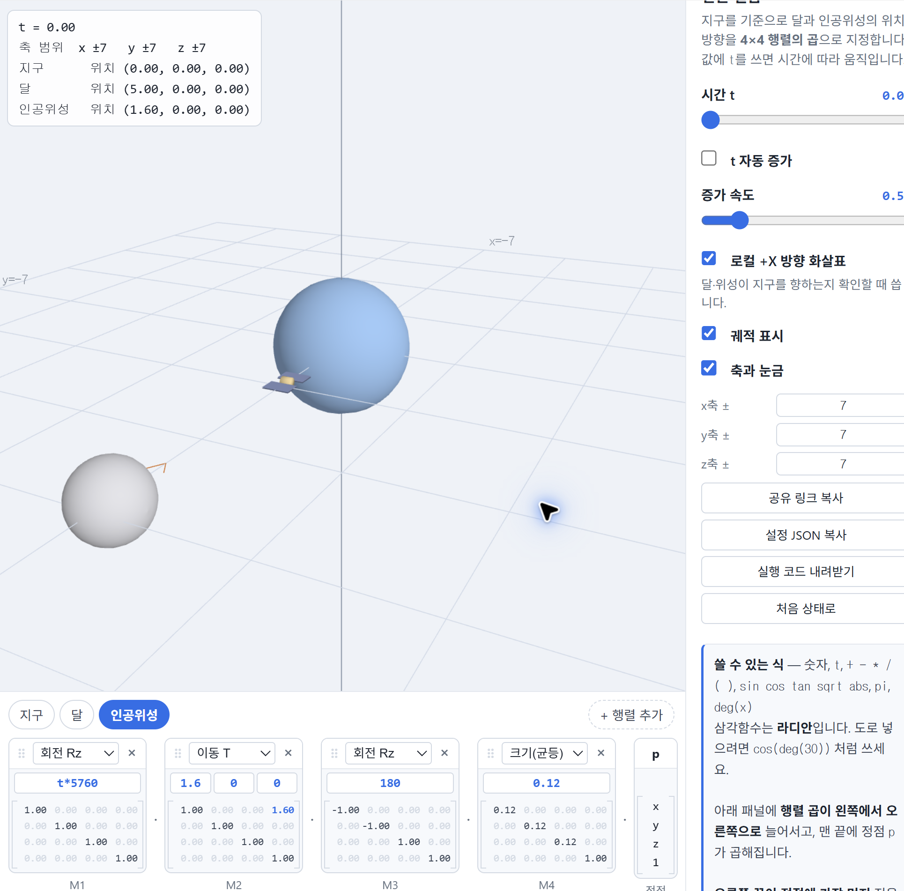

# Computer Graphics Portfolio

컴퓨터 그래픽스 수업에서 매주 진행한 실습과 과제를 정리하는 저장소입니다. WebGL, 변환 행렬, 렌더링 파이프라인을 단계적으로 실험하며 결과물과 보고서를 함께 기록합니다.

- 이름: 이경훈
- 저장소: [KyungHoon03/catholic.cg.26.2](https://github.com/KyungHoon03/catholic.cg.26.2)
- 웹사이트: [https://kyunghoon03.github.io/catholic.cg.26.2/](https://kyunghoon03.github.io/catholic.cg.26.2/)

## Weekly Work

| 주차 | 주제 | 보고서 | 실행 결과 |
| --- | --- | --- | --- |
| 2주차 | 지구 · 달 · 인공위성의 변환 설계 | [week2.md](week2/week2.md) | [Task 1](week2/task1.html) · [Task 2](week2/task2.html) · [Task 3](week2/task3.html) |
| 4주차 | 카메라와 투영 · 관찰 인터페이스 | [week4.md](week4/week4.md) | [기본](week4/baseline/index.html) · [개선](week4/improved/index.html) |
| 5주차 | 빛과 색 · 단계별 조명과 새벽의 두 행성 | [week5.md](week5/week5.md) | [Task 1](week5/task1.html) · [Task 2](week5/task2.html) |
| 6주차 | PBR과 텍스처 매핑 · 조건별 행성 재질 | [week6.md](week6/week6.md) | [Task 1](week6/task1.html) · [Task 2](week6/task2.html) |
| 7주차 | 일식·월식과 렌더링 성능·기기별 자동 설정 | [week7.md](week7/week7.md) | [Task 1](week7/task1.html) · [Task 2](week7/task2.html) |

## Week 2 Preview

2주차 과제에서는 4x4 변환 행렬을 사용해 지구, 달, 인공위성의 위치와 방향을 설계했습니다. 실제 비율 모델, NDC 범위에 맞춘 모델, 관찰하기 좋은 표현용 모델을 비교했습니다.

## Notes

6주차에는 제공 코드를 바탕으로 색·ARM·normal·환경맵을 사용하는 PBR 큐브와 두 조건으로 표면이 변하는 행성을 만들었다.
처음 남겨 둔 필터링 비교를 수업 예제로 보완했고, AI 보조로 실습 1·2와 필터링의 49개 조건을 실행 검증했다. [보고서](week6/week6.md)에 실제 캡처·측정 기록·AI 수정 내용을 구분했다.
직접 비교하면서 normal의 외곽선 유지, 환경 반사의 대비 변화, 행성 영역 확대·기본 전환을 확인했다. 필터링 차이는 뚜렷하게 구별하지 못했고 코드의 기본 역할은 대략 이해했다. 푸시 후 공개 실행·제출은 [확인표](week6/review.md)에 남겼다.

매주 과제를 추가할 때는 새 주차 폴더를 만들고, 보고서와 실행 HTML을 이 README의 표에 한 줄씩 추가합니다.

7주차 실습 1은 제공 코드의 카메라 광선·구 교차·직접광과 그림자 계산을 채웠다.
실습 2에는 측정한 기기 설정의 저장·자동 복원을 추가하고, 노트북 로컬에서 GPU 시간과 화질을 비교했다.
실행 캡처·계산 설명·측정 결과는 [보고서](week7/week7.md)에 정리했다. 노트북·모바일의 Pages 비교 측정과 업로드·배포·제출은 남아 있다.
