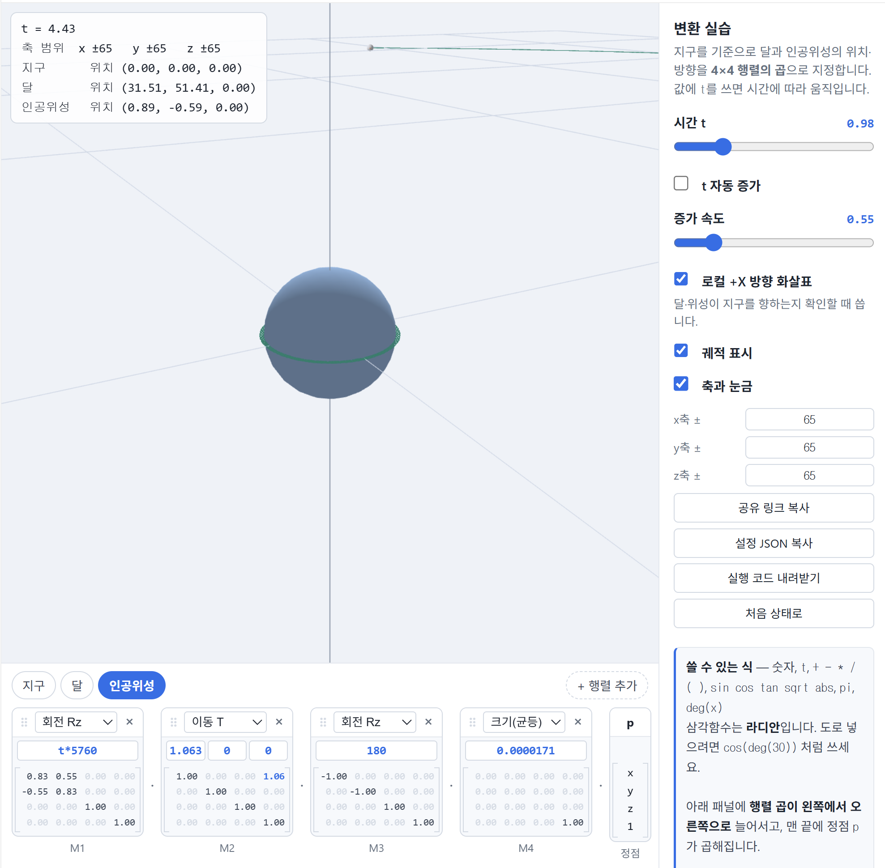
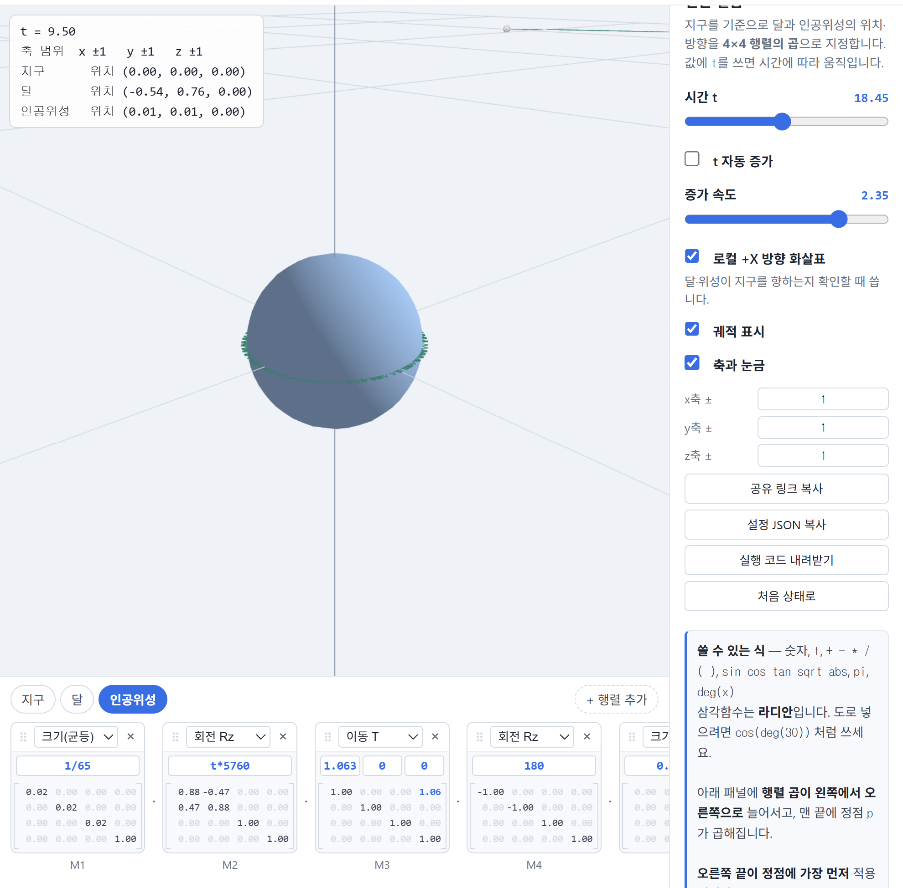

# 2주차 - 지구 · 달 · 인공위성의 변환 설계

- 이름: 이경훈
- 저장소: [https://github.com/KyungHoon03/catholic.cg.26.2](https://github.com/KyungHoon03/catholic.cg.26.2)
- 웹사이트: [https://kyunghoon03.github.io/catholic.cg.26.2/](https://kyunghoon03.github.io/catholic.cg.26.2/)
- 실행: [Task 1](task1.html) · [Task 2](task2.html) · [Task 3](task3.html)

## 사전 관찰 - 행렬 순서 바꾸기

달의 변환을 `Rz · T · S`로 만들고 시간에 따른 회전을 보기 위해 `Rz(t*20)`처럼 시간 변수 `t`를 사용했다. 이때 화면에 놓인 행렬은 왼쪽에서 오른쪽으로 곱해지지만, 정점에는 오른쪽 행렬부터 먼저 적용된다.

1. `T`를 `Rz` 앞으로 옮기면 달의 움직임이 어떻게 달라지나요?

`Rz · T · S`에서는 달이 먼저 작아지고, 지구에서 떨어진 위치로 이동한 뒤, 그 위치 전체가 회전한다. 그래서 달의 중심이 지구 주위를 공전한다. 반대로 `T · Rz · S`처럼 `T`가 `Rz` 앞에 오면 회전이 이동 전에 적용되고 마지막에 위치 이동이 적용된다. 이 경우 달의 중심은 지구 주위를 돌지 않고 한쪽 위치에 머물며 제자리 회전에 가까운 움직임을 보인다.

2. `S`를 맨 앞으로 옮기면 무엇이 달라지나요? 달라지지 않는다면 그 이유는?

`S`가 균등 스케일일 때 `Rz`와 순서만 바꾸는 경우에는 결과가 거의 달라지지 않는다. 모든 방향을 같은 비율로 줄인 뒤 회전하든, 회전한 뒤 같은 비율로 줄이든 모양이 같기 때문이다. 하지만 `S`가 `T`보다 왼쪽에 놓이면 이동 거리까지 함께 스케일될 수 있으므로, 지구와 달 사이의 거리도 달라진다.

3. 세 행렬을 배열하는 방법 6가지 중 달의 공전을 올바르게 표현하는 것은 몇 가지인가요?

공전의 핵심은 이동 `T`가 먼저 적용된 뒤 회전 `Rz`가 적용되는 것이다. 화면의 곱셈 순서에서는 `Rz`가 `T`보다 왼쪽에 있어야 하므로, 가능한 배열은 `Rz · T · S`, `Rz · S · T`, `S · Rz · T`의 3가지이다. 따라서 공전을 올바르게 표현하는 배열은 3가지이다.

## Task 1 - 실제 비율로 배치하기

### 조사한 값

| 항목 | 값 | 출처 |
| --- | --- | --- |
| 지구 반지름 | 6,371 km | [NASA Compare Earth and the Moon](https://science.nasa.gov/moon/by-the-numbers/) |
| 달 반지름 | 1,737.5 km | [NASA Compare Earth and the Moon](https://science.nasa.gov/moon/by-the-numbers/) |
| 지구-달 평균 거리 | 384,400 km | [NASA Compare Earth and the Moon](https://science.nasa.gov/moon/by-the-numbers/) |
| 대상 위성 | ISS, 고도 약 400 km | [NASA Observing our Planet from Low Earth Orbit](https://www.nasa.gov/missions/station/iss-research/observing-our-planet-from-low-earth-orbit/) |
| ISS 크기 | 약 109 m | [NASA International Space Station Facts and Figures](https://www.nasa.gov/international-space-station/space-station-facts-and-figures/) |

### 단위를 정한 방법

지구 반지름을 `1`로 두었다. km나 m를 그대로 사용하면 지구-달 거리 `384400 km`와 ISS 크기 `0.109 km`처럼 매우 큰 값과 매우 작은 값이 함께 나타나서 변환값을 비교하기 어렵기 때문이다.

지구 반지름을 기준으로 환산하면 달 반지름은 `1737.5 / 6371 ≈ 0.273`, 지구-달 거리는 `384400 / 6371 ≈ 60.3`이다. ISS의 궤도 반지름은 `6371 + 400 = 6771 km`이므로 `6771 / 6371 ≈ 1.063`이고, ISS 크기는 `0.109 / 6371 ≈ 0.0000171`이다.

### 내가 넣은 변환

**지구**

```json
[
  { "type": "Su", "args": ["1"] }
]
```

**달**

```json
[
  { "type": "Rz", "args": ["t*13.2"] },
  { "type": "T", "args": ["60.3", "0", "0"] },
  { "type": "Rz", "args": ["180"] },
  { "type": "Su", "args": ["0.273"] }
]
```

**인공위성: ISS**

```json
[
  { "type": "Rz", "args": ["t*5760"] },
  { "type": "T", "args": ["1.063", "0", "0"] },
  { "type": "Rz", "args": ["180"] },
  { "type": "Su", "args": ["0.0000171"] }
]
```

`Rz(t*...)`를 `T`보다 왼쪽에 놓은 이유는 정점에는 오른쪽 행렬부터 적용되기 때문이다. 먼저 물체를 원점에서 떨어진 위치로 이동한 뒤 그 위치 전체를 회전시켜야 지구 주위를 공전한다. `Rz(180)`은 달과 ISS의 로컬 `+X` 방향 화살표가 바깥쪽이 아니라 지구 중심을 향하도록 뒤집기 위해 추가했다.

실제 비율로 배치하자 달의 공전 궤도는 확인할 수 있었지만, ISS는 지구에 비해 너무 작아 거의 보이지 않았다. 지구 반지름을 `1`로 두었을 때 ISS 크기가 `0.0000171`에 불과하기 때문이다.

- 축 범위: `x ±65`, `y ±65`, `z ±65`
- 캡처 이미지:



- 공유 링크: [Task 1 공유 링크](https://cg.catholic.ac.kr/~mgchoi/CG/demos/d02-transform-lab.html?d=eyJyYW5nZSI6eyJ4IjoiNjUiLCJ5IjoiNjUiLCJ6IjoiNjUifSwib2JqZWN0cyI6W3siaWQiOiJlYXJ0aCIsIm5hbWUiOiLsp4DqtawiLCJjb2xvciI6WzAuMzUsMC42LDAuOTVdLCJzdGVwcyI6W3sidHlwZSI6IlN1IiwiYXJncyI6WyIxIl19XX0seyJpZCI6Im1vb24iLCJuYW1lIjoi64usIiwiY29sb3IiOlswLjc4LDAuNzgsMC44Ml0sInN0ZXBzIjpbeyJ0eXBlIjoiUnoiLCJhcmdzIjpbInQqMTMuMiJdfSx7InR5cGUiOiJUIiwiYXJncyI6WyI2MC4zIiwiMCIsIjAiXX0seyJ0eXBlIjoiUnoiLCJhcmdzIjpbIjE4MCJdfSx7InR5cGUiOiJTdSIsImFyZ3MiOlsiMC4yNzMiXX1dfSx7ImlkIjoic2F0IiwibmFtZSI6IuyduOqzteychOyEsSIsImNvbG9yIjpbMC45NSwwLjcyLDAuMzVdLCJzdGVwcyI6W3sidHlwZSI6IlJ6IiwiYXJncyI6WyJ0KjU3NjAiXX0seyJ0eXBlIjoiVCIsImFyZ3MiOlsiMS4wNjMiLCIwIiwiMCJdfSx7InR5cGUiOiJSeiIsImFyZ3MiOlsiMTgwIl19LHsidHlwZSI6IlN1IiwiYXJncyI6WyIwLjAwMDAxNzEiXX1dfV19)

### 설정 JSON

```json
{
  "range": {
    "x": "65",
    "y": "65",
    "z": "65"
  },
  "objects": [
    {
      "id": "earth",
      "name": "지구",
      "color": [
        0.35,
        0.6,
        0.95
      ],
      "steps": [
        {
          "type": "Su",
          "args": [
            "1"
          ]
        }
      ]
    },
    {
      "id": "moon",
      "name": "달",
      "color": [
        0.78,
        0.78,
        0.82
      ],
      "steps": [
        {
          "type": "Rz",
          "args": [
            "t*13.2"
          ]
        },
        {
          "type": "T",
          "args": [
            "60.3",
            "0",
            "0"
          ]
        },
        {
          "type": "Rz",
          "args": [
            "180"
          ]
        },
        {
          "type": "Su",
          "args": [
            "0.273"
          ]
        }
      ]
    },
    {
      "id": "sat",
      "name": "인공위성",
      "color": [
        0.95,
        0.72,
        0.35
      ],
      "steps": [
        {
          "type": "Rz",
          "args": [
            "t*5760"
          ]
        },
        {
          "type": "T",
          "args": [
            "1.063",
            "0",
            "0"
          ]
        },
        {
          "type": "Rz",
          "args": [
            "180"
          ]
        },
        {
          "type": "Su",
          "args": [
            "0.0000171"
          ]
        }
      ]
    }
  ]
}
```

## Task 2 - NDC 범위에 맞추기

Task 2에서는 NDC 범위인 `-1`에서 `1` 사이에 전체 장면이 들어오도록 모든 물체의 최종 변환 맨 앞에 `S(1/65)`를 추가했다. 이 변환은 지구, 달, ISS에 동일하게 적용되므로 실제 거리와 크기의 상대 비율은 유지된다.

달의 중심 위치는 `60.3 / 65 ≈ 0.93`이 되어 화면 범위 안에 들어온다. ISS의 중심 위치는 `1.063 / 65 ≈ 0.016`으로 지구 근처에 위치한다. 다만 모든 크기도 함께 줄어들기 때문에 지구와 ISS는 매우 작게 보인다.

- 축 범위: `x ±1`, `y ±1`, `z ±1`
- 캡처 이미지:



- 공유 링크: [Task 2 공유 링크](https://cg.catholic.ac.kr/~mgchoi/CG/demos/d02-transform-lab.html?d=eyJyYW5nZSI6eyJ4IjoiMSIsInkiOiIxIiwieiI6IjEifSwib2JqZWN0cyI6W3siaWQiOiJlYXJ0aCIsIm5hbWUiOiLsp4DqtawiLCJjb2xvciI6WzAuMzUsMC42LDAuOTVdLCJzdGVwcyI6W3sidHlwZSI6IlN1IiwiYXJncyI6WyIxLzY1Il19XX0seyJpZCI6Im1vb24iLCJuYW1lIjoi64usIiwiY29sb3IiOlswLjc4LDAuNzgsMC44Ml0sInN0ZXBzIjpbeyJ0eXBlIjoiU3UiLCJhcmdzIjpbIjEvNjUiXX0seyJ0eXBlIjoiUnoiLCJhcmdzIjpbInQqMTMuMiJdfSx7InR5cGUiOiJUIiwiYXJncyI6WyI2MC4zIiwiMCIsIjAiXX0seyJ0eXBlIjoiUnoiLCJhcmdzIjpbIjE4MCJdfSx7InR5cGUiOiJTdSIsImFyZ3MiOlsiMC4yNzMiXX1dfSx7ImlkIjoic2F0IiwibmFtZSI6IuyduOqzteychOyEsSIsImNvbG9yIjpbMC45NSwwLjcyLDAuMzVdLCJzdGVwcyI6W3sidHlwZSI6IlN1IiwiYXJncyI6WyIxLzY1Il19LHsidHlwZSI6IlJ6IiwiYXJncyI6WyJ0KjU3NjAiXX0seyJ0eXBlIjoiVCIsImFyZ3MiOlsiMS4wNjMiLCIwIiwiMCJdfSx7InR5cGUiOiJSeiIsImFyZ3MiOlsiMTgwIl19LHsidHlwZSI6IlN1IiwiYXJncyI6WyIwLjAwMDAxNzEiXX1dfV19)

### 설정 JSON

```json
{
  "range": {
    "x": "1",
    "y": "1",
    "z": "1"
  },
  "objects": [
    {
      "id": "earth",
      "name": "지구",
      "color": [
        0.35,
        0.6,
        0.95
      ],
      "steps": [
        {
          "type": "Su",
          "args": [
            "1/65"
          ]
        }
      ]
    },
    {
      "id": "moon",
      "name": "달",
      "color": [
        0.78,
        0.78,
        0.82
      ],
      "steps": [
        {
          "type": "Su",
          "args": [
            "1/65"
          ]
        },
        {
          "type": "Rz",
          "args": [
            "t*13.2"
          ]
        },
        {
          "type": "T",
          "args": [
            "60.3",
            "0",
            "0"
          ]
        },
        {
          "type": "Rz",
          "args": [
            "180"
          ]
        },
        {
          "type": "Su",
          "args": [
            "0.273"
          ]
        }
      ]
    },
    {
      "id": "sat",
      "name": "인공위성",
      "color": [
        0.95,
        0.72,
        0.35
      ],
      "steps": [
        {
          "type": "Su",
          "args": [
            "1/65"
          ]
        },
        {
          "type": "Rz",
          "args": [
            "t*5760"
          ]
        },
        {
          "type": "T",
          "args": [
            "1.063",
            "0",
            "0"
          ]
        },
        {
          "type": "Rz",
          "args": [
            "180"
          ]
        },
        {
          "type": "Su",
          "args": [
            "0.0000171"
          ]
        },
        {
          "type": "T",
          "args": [
            "0",
            "0",
            "0"
          ]
        }
      ]
    }
  ]
}
```

ISS 변환 끝의 `T(0,0,0)`은 추가 이동이 없는 단위 이동이므로 최종 결과에는 영향을 주지 않는다.

## Task 3 - 더 나은 표현 제안

Task 3에서는 실제 비율만 유지하면 장면의 의미를 관찰하기 어렵기 때문에, 정보를 더 잘 전달하는 표현을 따로 설계했다. 사용한 방법은 거리 압축과 크기 과장이다. 지구는 `S(1)`로 유지하고, 달의 거리는 `60.3`에서 `5`로 줄였으며 달 크기는 `0.273`에서 `0.45`로 키웠다. ISS는 실제 궤도 반지름 `1.063`보다 조금 떨어진 `1.6` 위치에 두고, 실제 크기 `0.0000171` 대신 `0.12`로 크게 표현했다.

이 방법의 장점은 세 물체의 위치 관계와 공전 움직임을 한 화면에서 관찰하기 쉽다는 점이다. 실제 비율에서는 달을 보기 위해 축 범위를 크게 잡아야 하고, 그러면 ISS와 지구 주변의 움직임은 거의 보이지 않는다. Task 3 표현에서는 달의 궤도, ISS의 궤도, 각 물체가 지구를 향하는 방향을 동시에 확인할 수 있다.

잃는 부분도 분명하다. 달까지의 실제 거리는 지구 반지름의 약 `60.3`배이지만 Task 3에서는 `5`로 줄였고, ISS의 실제 크기 비율은 `0.0000171`이지만 `0.12`로 크게 키웠다. 따라서 이 장면은 실제 축척 모델이 아니라 설명용 시각화이다. 실제 거리 비교나 크기 비교에는 Task 1, Task 2가 더 적합하고, Task 3는 움직임과 관계를 이해하기 위한 표현으로 보아야 한다.

- 축 범위: `x ±7`, `y ±7`, `z ±7`
- 캡처 이미지:


- 공유 링크: [Task 3 공유 링크](https://cg.catholic.ac.kr/~mgchoi/CG/demos/d02-transform-lab.html?d=eyJyYW5nZSI6eyJ4IjoiNyIsInkiOiI3IiwieiI6IjcifSwib2JqZWN0cyI6W3siaWQiOiJlYXJ0aCIsIm5hbWUiOiLsp4DqtawiLCJjb2xvciI6WzAuMzUsMC42LDAuOTVdLCJzdGVwcyI6W3sidHlwZSI6IlN1IiwiYXJncyI6WyIxIl19XX0seyJpZCI6Im1vb24iLCJuYW1lIjoi64usIiwiY29sb3IiOlswLjc4LDAuNzgsMC44Ml0sInN0ZXBzIjpbeyJ0eXBlIjoiUnoiLCJhcmdzIjpbInQqMTMuMiJdfSx7InR5cGUiOiJUIiwiYXJncyI6WyI1IiwiMCIsIjAiXX0seyJ0eXBlIjoiUnoiLCJhcmdzIjpbIjE4MCJdfSx7InR5cGUiOiJTdSIsImFyZ3MiOlsiMC40NSJdfV19LHsiaWQiOiJzYXQiLCJuYW1lIjoi7J246rO17JyE7ISxIiwiY29sb3IiOlswLjk1LDAuNzIsMC4zNV0sInN0ZXBzIjpbeyJ0eXBlIjoiUnoiLCJhcmdzIjpbInQqNTc2MCJdfSx7InR5cGUiOiJUIiwiYXJncyI6WyIxLjYiLCIwIiwiMCJdfSx7InR5cGUiOiJSeiIsImFyZ3MiOlsiMTgwIl19LHsidHlwZSI6IlN1IiwiYXJncyI6WyIwLjEyIl19XX1dfQ%3D%3D)

### 설정 JSON

```json
{
  "range": {
    "x": "7",
    "y": "7",
    "z": "7"
  },
  "objects": [
    {
      "id": "earth",
      "name": "지구",
      "color": [
        0.35,
        0.6,
        0.95
      ],
      "steps": [
        {
          "type": "Su",
          "args": [
            "1"
          ]
        }
      ]
    },
    {
      "id": "moon",
      "name": "달",
      "color": [
        0.78,
        0.78,
        0.82
      ],
      "steps": [
        {
          "type": "Rz",
          "args": [
            "t*13.2"
          ]
        },
        {
          "type": "T",
          "args": [
            "5",
            "0",
            "0"
          ]
        },
        {
          "type": "Rz",
          "args": [
            "180"
          ]
        },
        {
          "type": "Su",
          "args": [
            "0.45"
          ]
        }
      ]
    },
    {
      "id": "sat",
      "name": "인공위성",
      "color": [
        0.95,
        0.72,
        0.35
      ],
      "steps": [
        {
          "type": "Rz",
          "args": [
            "t*5760"
          ]
        },
        {
          "type": "T",
          "args": [
            "1.6",
            "0",
            "0"
          ]
        },
        {
          "type": "Rz",
          "args": [
            "180"
          ]
        },
        {
          "type": "Su",
          "args": [
            "0.12"
          ]
        }
      ]
    }
  ]
}
```
