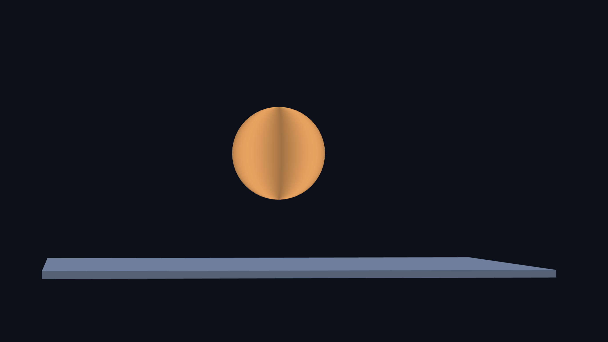
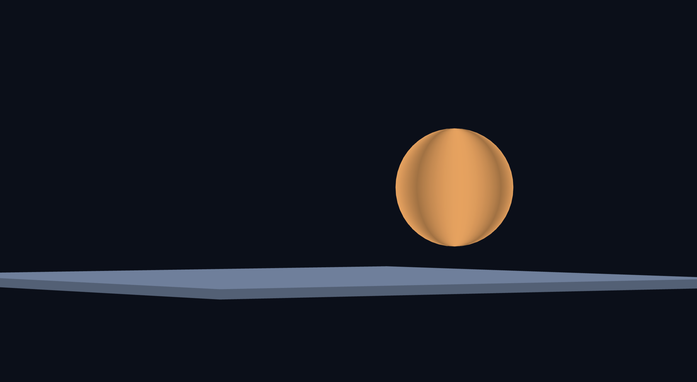
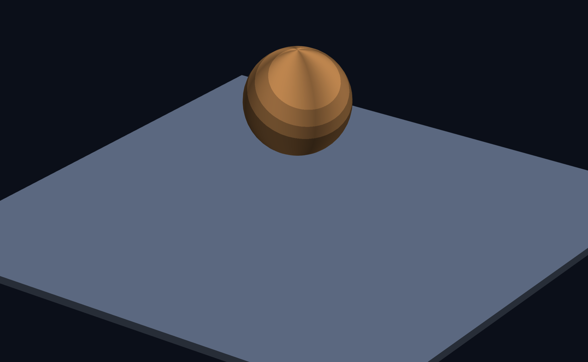
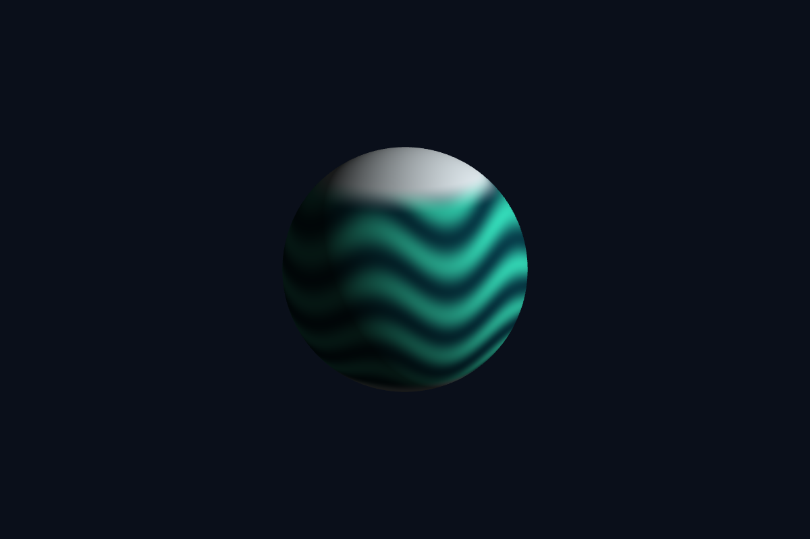
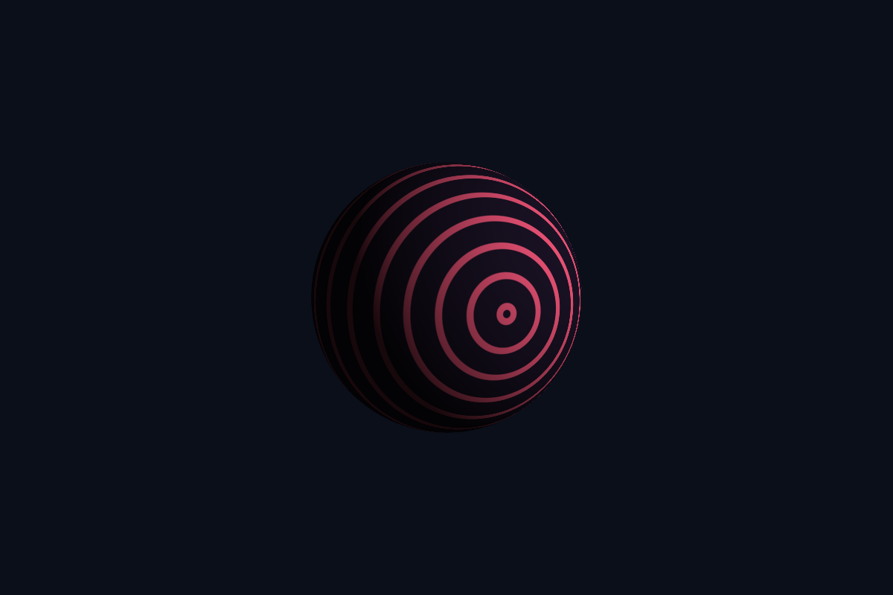

# 3주차 - 그래픽스 파이프라인과 셰이더

- 이름: 이경훈
- 저장소: [https://github.com/KyungHoon03/catholic.cg.26.2](https://github.com/KyungHoon03/catholic.cg.26.2)
- 웹사이트: [https://kyunghoon03.github.io/catholic.cg.26.2/](https://kyunghoon03.github.io/catholic.cg.26.2/)
- 실행: [Task 1](task1.html)

## Task 1 - 바닥 위에서 회전하는 공 만들기

이번 실습에서는 처음 제공된 삼각형 예제를 바닥과 공이 있는 3차원 장면으로 확장했다. 기존에는 정점 좌표가 그대로 `gl_Position`에 들어갔지만, 이제는 물체별 모델 행렬 `uModel`과 카메라·원근 행렬 `uViewProj`를 곱해서 최종 위치를 계산한다.

```glsl
gl_Position = uViewProj * uModel * vec4(aPos, 1.0);
```

행렬은 오른쪽부터 적용되므로, 정점은 먼저 `uModel`로 물체의 위치와 자세를 얻고, 그 다음 `uViewProj`로 카메라에서 본 위치와 원근을 얻는다.

### 메시 구성

삼각형 하나 대신 상자와 구를 만드는 함수를 추가했다. 바닥은 `makeBox(8.0, 0.12, 8.0, ...)`로 만든 아주 납작한 상자이고, 공은 `makeSphere(0.8, 24, 48, ...)`로 만들었다.

```js
const ball  = createMesh(makeSphere(0.8, 24, 48, 0.95, 0.62, 0.32));
const floor = createMesh(makeBox(8.0, 0.12, 8.0, 0.42, 0.50, 0.62));
```

구는 위도와 경도 방향으로 점을 찍고, 이웃한 네 점을 삼각형 두 개로 이어 만들었다. 상자는 면이 6개뿐이라 직접 면을 추가할 수 있지만, 구는 곡면이므로 이렇게 많은 작은 삼각형으로 표본화해야 한다.

### 카메라와 원근

카메라는 행렬을 여러 번 곱해서 만들었다. 먼저 보고 싶은 위치를 맞추고, y축과 x축 회전으로 대각선 위에서 보는 시점을 만든 뒤, z 방향 이동과 원근 행렬, 스케일 행렬을 적용했다.

```js
camera = M4.multiply(M4.translate(0, -1.1, 0), camera);
camera = M4.multiply(M4.rotateY(-0.62), camera);
camera = M4.multiply(M4.rotateX(0.42), camera);
camera = M4.multiply(M4.translate(0, 0, -10), camera);
```

원근 행렬의 `-1 / 30`은 z값이 w에 얼마나 섞이는지를 정한다. `-1 / 8`보다 영향이 작기 때문에 멀리 있는 것이 작아지는 효과가 약해지고, 장면이 조금 더 평면적으로 보인다.

```js
const perspective = new Float32Array([
  1, 0, 0,       0,
  0, 1, 0,       0,
  0, 0, 1, -1 / 30,
  0, 0, 0,       1,
]);
```

### 바닥과 공 그리기

바닥은 원점에 두되 윗면이 `y = 0`에 오도록 `-0.06`만큼 내렸다. 공은 먼저 제자리에서 `rotateY(time * 0.8)`로 회전한 뒤, `translate(0, 1.9, 0)`으로 위로 올렸다.

```js
gl.uniformMatrix4fv(uModelLoc, false, M4.translate(0, -0.06, 0));
gl.bindVertexArray(floor.vao);
gl.drawElements(gl.TRIANGLES, floor.count, gl.UNSIGNED_SHORT, 0);

const model = M4.multiply(M4.translate(0, 1.9, 0), M4.rotateY(time * 0.8));
gl.uniformMatrix4fv(uModelLoc, false, model);
gl.bindVertexArray(ball.vao);
gl.drawElements(gl.TRIANGLES, ball.count, gl.UNSIGNED_SHORT, 0);
```

- 캡처 이미지:


## 순서 비교 - 자전과 공전

기본 코드에서는 모델 행렬을 다음과 같이 만들었다.

```js
const model = M4.multiply(M4.translate(0, 1.9, 0), M4.rotateY(time * 0.8));
```

정점에는 오른쪽 행렬부터 적용되므로, 공은 먼저 원점에서 회전하고 그 다음 위쪽 위치로 이동한다. 따라서 공의 중심 위치는 고정되고 표면의 밝기 무늬가 움직여서 자전처럼 보인다.

순서를 바꿔 다음처럼 만들면 결과가 달라진다.

```js
const model = M4.multiply(M4.rotateY(time * 0.8), M4.translate(1.9, 1.2, 0));
```

이 경우에도 오른쪽부터 적용되므로, 공은 먼저 원점에서 옆으로 떨어진 위치로 이동한다. 그 다음 이동된 위치 전체가 `rotateY`로 회전하므로 공의 중심이 y축 주위를 원으로 돌게 된다. 그래서 제자리 자전이 아니라 공전처럼 보인다.

- 자전 캡처 이미지:



- 공전 캡처 이미지:



## 7단계 - 빛 계산

프래그먼트 셰이더에서는 보간되어 들어온 법선을 다시 정규화한 뒤, 광원 방향과 내적해서 밝기를 계산했다.

```glsl
vec3 N = normalize(vNormal);
vec3 L = normalize(vec3(0.45, 0.8, 0.35));
float diff = max(dot(N, L), 0.0);
```

`dot(N, L)`은 법선 방향과 빛 방향이 얼마나 비슷한지를 나타낸다. 두 방향이 비슷하면 값이 커져 밝아지고, 반대 방향이면 0에 가까워져 어두워진다.

## 8단계 - 계단식 음영 셰이더

8단계에서는 여러 셰이더 중 계단식 음영을 선택해서 적용했다. 부드럽게 변하는 `diff` 값을 그대로 쓰지 않고, `floor(diff * 4.0) / 4.0`으로 네 단계의 값으로 끊었다.

```glsl
void main() {
  vec3 N = normalize(vNormal);
  vec3 L = normalize(vec3(0.45, 0.8, 0.35));
  float diff = max(dot(N, L), 0.0);

  float stepped = floor(diff * 4.0) / 4.0;
  fragColor = vec4(vColor * (0.3 + 0.7 * stepped), 1.0);
}
```

이렇게 바꾸면 공의 명암이 연속적으로 부드럽게 이어지지 않고, 몇 개의 밝기 구간으로 나뉘어 보인다. 그래서 같은 빛 계산을 쓰더라도 만화 같은 단계적 음영 효과가 생긴다.

- 8단계 셰이더 캡처 이미지:



## 점검표 확인

| 항목 | 확인 |
| --- | --- |
| 바닥이 보이고, 공이 바닥에 닿지 않고 떠 있다 | 완료. 바닥은 `makeBox(8.0, 0.12, 8.0, ...)`이고 공은 반지름 `0.8`인 상태에서 `translate(0, 1.9, 0)`으로 올라가므로 바닥과 떨어져 있다. |
| 높은 곳에서 대각선으로 내려다보는 시점이다 | 완료. 카메라에 `rotateY(-0.62)`와 `rotateX(0.42)`를 적용했다. |
| 공이 제자리에서 천천히 돈다 | 완료. 제출용 코드에서는 `translate * rotateY` 순서를 사용하므로 공의 중심은 고정되고 표면 무늬가 돌아 자전이 보인다. |
| `gl.enable(gl.DEPTH_TEST)`를 켰고, 껐을 때 어떻게 되는지 확인했다 | 코드에서는 완료. `gl.enable(gl.DEPTH_TEST)`가 들어가 있어 앞뒤 깊이 판정이 적용된다. 끄면 깊이 판정 없이 나중에 그린 면이 덮어 보일 수 있다. |
| 6단계의 곱하는 순서를 바꾼 결과를 설명할 수 있다 | 완료. `translate * rotateY`는 자전, `rotateY * translate`는 이동된 위치 전체가 돌아 공전이 된다. |
| 코드의 여섯 구역이 각각 무엇을 하는지 설명할 수 있다 | 완료. 메시 데이터, 버텍스 셰이더, 프래그먼트 셰이더, WebGL 준비, 버퍼 생성, 매 프레임 렌더링으로 나뉜다. |

## 코드 구역 설명

1. 메시 데이터: 상자와 구의 정점, 법선, 색, 인덱스를 만든다.
2. 버텍스 셰이더: 정점 위치를 모델 행렬과 카메라 행렬로 변환하고, 색과 법선을 프래그먼트 셰이더로 넘긴다.
3. 프래그먼트 셰이더: 각 픽셀의 최종 색을 계산한다. 이번 최종 코드에서는 빛의 내적과 계단식 음영을 사용했다.
4. WebGL 준비: 캔버스와 WebGL2 컨텍스트를 만들고 셰이더 프로그램과 uniform 위치를 준비한다.
5. 버퍼 생성: 메시 데이터를 GPU 버퍼로 보내고 VAO에 속성 위치를 기록한다.
6. 렌더링 루프: 매 프레임 화면을 지우고, 카메라 행렬과 모델 행렬을 보내 바닥과 공을 그린다.

## Task 2 - 물결 띠와 극관 행성

- 실행: [Task 2](https://kyunghoon03.github.io/catholic.cg.26.2/week3/task2.html)

### 의도

청록색 띠가 천천히 일렁이고 양쪽 극에는 흰 얼음이 있는 차가운 행성을 만들고자 했다. 규칙적으로 반복되는 띠와 넓은 극관으로 차분한 느낌을 표현했다. 예시의 갈색 가스 행성과 달리 청록색을 사용하고, 폭풍과 복잡한 잡음 대신 단순한 물결과 극관을 조합했다.

### 방법

구는 안내대로 `makeSphere(1.3, 64, 128, 1.0, 1.0, 1.0)`으로 만들었다. 버텍스 셰이더에서 `vSurf = aNormal;`로 회전 전 법선을 전달하고, 프래그먼트 셰이더에서는 이를 정규화한 `S`로 무늬를 계산했다. 조명에는 모델 행렬로 변환된 `vNormal`을 사용한다.

1. 물결 띠: `sin(S.x * 6.0 + uTime * 0.6)`으로 좌우 위치와 시간에 따라 변하는 값을 만든다. 여기에 `0.12`를 곱해 굴곡의 크기를 제한하고 `S.y`에 더한다. 그 값에 `18.0`을 곱해 다시 사인 함수를 적용하면 여러 가로 띠가 생긴다. 결과를 0~1로 바꾸어 `mix`에 넣으면 짙은 청록색과 밝은 청록색이 반복된다.
2. 극관: `abs(S.y)`는 북극과 남극에서 모두 1에 가까워진다. `smoothstep(0.65, 0.82, abs(S.y))`는 적도 부근에서 0, 극지방에서 1이 된다. 이 값을 흰색의 혼합 비율로 사용해 양쪽 극을 덮는다. 두 경계값 사이에서는 서서히 섞이므로 얼음의 가장자리가 부드럽다.

실습 1의 계단식 음영은 연속적인 방향광 명암으로 바꾸었다. `0.10 + 0.90 * diff`를 표면색에 곱해 밤면은 어둡게, 낮면은 밝게 표현했다. 바닥 숨기기와 정면 카메라는 안내의 선택 항목을 적용했고, 세로 화면에서는 짧은 변에 맞춰 구 전체가 보이도록 배율을 조절했다.

### 프래그먼트 셰이더 전체 코드

```glsl
#version 300 es
precision highp float;

in vec3 vNormal;
in vec3 vSurf;
uniform float uTime;
out vec4 fragColor;

void main() {
  vec3 S = normalize(vSurf);   // 물체 기준: 표면 무늬
  vec3 N = normalize(vNormal); // 세계 기준: 조명
  vec3 L = normalize(vec3(0.8, 0.35, 0.5));
  float diff = max(dot(N, L), 0.0);

  // x 방향에 따라 띠를 굽히고, 시간에 따라 일렁이게 한다.
  float wave = 0.12 * sin(S.x * 6.0 + uTime * 0.6);
  float band = 0.5 + 0.5 * sin((S.y + wave) * 18.0);
  vec3 surface = mix(vec3(0.03, 0.25, 0.30),
                     vec3(0.20, 0.85, 0.72), band);

  // 양쪽 극에 가까워질수록 흰색을 섞는다.
  float ice = smoothstep(0.65, 0.82, abs(S.y));
  surface = mix(surface, vec3(0.94, 0.98, 1.0), ice);
  fragColor = vec4(surface * (0.10 + 0.90 * diff), 1.0);
}
```

- 캡처 이미지:



## Task 3 - 맥동하는 동심원 행성

- 실행: [Task 3](https://kyunghoon03.github.io/catholic.cg.26.2/week3/task3.html)
- 실습 2에서 요구하는 두 번째 행성이다.

### 의도

어두운 표면에 분홍색 원형 띠가 있고, 그 띠가 천천히 밝아졌다 어두워지는 행성을 만들고자 했다. 첫 번째 행성의 가로 띠와 달리 한 점을 중심으로 반복되는 무늬를 사용해 서로 구별되도록 했다. 예시의 분화구처럼 표면을 울퉁불퉁하게 표현하지 않고, 단순한 거리 계산으로 인공적인 표면을 표현했다.

### 방법

메시, 카메라, 버텍스 셰이더와 자전 행렬은 첫 번째 행성과 동일하다. 프래그먼트 셰이더의 표면 계산을 바꾸어 같은 구에서도 다른 결과가 나오는 것을 비교했다.

1. 동심원: `center`는 무늬의 중심이 되는 구 표면의 방향이다. `distance(S, center)`는 구 위의 두 점 사이 직선거리이며, 거리가 같은 점들이 원형으로 모인다. 여기에 `32.0`을 곱하고 사인 함수를 적용하면 거리에 따라 값이 반복된다. `smoothstep(0.65, 0.85, ...)`로 사인 값이 높은 구간만 골라 가느다란 띠를 만든다.
2. 맥동: `sin(uTime * 1.5)`는 시간에 따라 -1~1을 반복한다. `0.65 + 0.35 * sin(...)`로 바꾸면 밝기 계수가 0.30~1.00 사이에서 변한다. 이 값을 분홍색에 곱하므로 띠가 완전히 사라지지 않으면서 밝아졌다 어두워진다. 마지막에 조명 계수를 곱하므로 밤면의 띠도 어둡게 유지되며 실제 발광이나 주변을 비추는 효과는 아니다.

### 프래그먼트 셰이더 전체 코드

```glsl
#version 300 es
precision highp float;

in vec3 vNormal;
in vec3 vSurf;
uniform float uTime;
out vec4 fragColor;

void main() {
  vec3 S = normalize(vSurf);   // 물체 기준: 표면 무늬
  vec3 N = normalize(vNormal); // 세계 기준: 조명
  vec3 L = normalize(vec3(0.8, 0.35, 0.5));
  float diff = max(dot(N, L), 0.0);

  // 표면의 한 방향으로부터 거리가 같은 점들을 원형 띠로 만든다.
  vec3 center = normalize(vec3(0.3, 0.2, 1.0));
  float d = distance(S, center);
  float ring = smoothstep(0.65, 0.85, sin(d * 32.0));

  // 원형 띠의 밝기만 주기적으로 바꾼다.
  float pulse = 0.65 + 0.35 * sin(uTime * 1.5);
  vec3 surface = mix(vec3(0.10, 0.07, 0.14),
                     vec3(1.0, 0.35, 0.50) * pulse, ring);
  fragColor = vec4(surface * (0.10 + 0.90 * diff), 1.0);
}
```

- 캡처 이미지:



## 실습 2 점검표 확인

| 항목 | 확인 |
| --- | --- |
| 이미지 파일을 쓰지 않았다 | 행성 렌더링에 이미지나 텍스처를 사용하지 않았다. 보고서의 PNG는 실행 결과 캡처이다. |
| 서로 다른 행성이 두 개 이상 있다 | Task 2의 물결 띠·극관과 Task 3의 동심원·맥동으로 두 결과물을 구성했다. |
| `uTime`으로 무언가 움직인다 | Task 2는 물결의 위상, Task 3은 띠의 밝기가 변한다. 두 행성 모두 모델 행렬로 자전한다. |
| 낮과 밤의 경계가 보인다 | `max(dot(N, L), 0.0)`과 `0.10 + 0.90 * diff`로 명암을 적용했다. |
| 예시 코드와 눈에 띄게 다르다 | 청록색 물결과 극관, 분홍색 동심원과 맥동으로 색·무늬·움직임을 다르게 설계했다. |
| 보고서에 의도와 방법이 모두 적혀 있다 | 각 행성의 의도, 계산 방법, 전체 프래그먼트 셰이더와 캡처를 기록했다. |
| 무늬 계산식 두 가지 이상을 스스로 설명할 수 있다 | 설명 자료는 작성했다. 제출 전 직접 각 식과 숫자의 역할을 설명해 보는 확인이 필요하다. |

### 실행 확인과 남은 확인

로컬 브라우저에서 셰이더 컴파일·링크, WebGL 오류, 시간에 따른 화면 변화와 데스크톱·세로 화면의 표시를 확인했다. 위 실행 링크는 제출할 GitHub Pages 주소이며, 저장소 업로드와 배포 후 실제 주소에서 다시 확인해야 한다. 중간 실패 화면이나 경험은 임의로 작성하지 않았다.
