# 4주차 - 카메라와 투영

- 이름: 이경훈
- 저장소: [KyungHoon03/catholic.cg.26.2](https://github.com/KyungHoon03/catholic.cg.26.2)
- 웹사이트: [컴퓨터그래픽스 포트폴리오](https://kyunghoon03.github.io/catholic.cg.26.2/)
- 로컬 실행: [기본 버전](baseline/index.html) · [개선 버전](improved/index.html)
- GitHub Pages 실행 주소: [기본 버전](https://kyunghoon03.github.io/catholic.cg.26.2/week4/baseline/) · [개선 버전](https://kyunghoon03.github.io/catholic.cg.26.2/week4/improved/)
- 수업: [4주차 카메라와 투영](https://cg.catholic.ac.kr/~mgchoi/CG/weeks/week04/)

## Task 1 - 필요한 정보를 찾는 관찰 인터페이스

제공된 복합 연구시설을 사용해 전체 보기, 표지 관찰, 구조 비교를 연결했다. `baseline`은 보존하고 `improved`의 학생 확장 파일을 중심으로 수정했다. 물체의 위치와 크기, 명판 내용은 바꾸지 않았다.

### 사용자와 목표

시설을 처음 보는 점검자가 여섯 장치의 정보와 두 구조 비교를 확인하는 상황을 정했다. 우선한 목표는 작은 명판을 찾고 읽는 조작을 줄이는 것과, 상세 관찰 후 전체에서 위치를 다시 확인하는 것이다.

### 조작법

| 동작 | 기본 버전 | 개선 버전 |
| --- | --- | --- |
| 회전 | 드래그 또는 방향키 | 원근 화면에서 동일하며 선택 지점이 회전 중심이 된다 |
| 이동 | Shift+드래그 또는 오른쪽 드래그 | 동일. 직교에서는 직교 시야 높이로 이동량 계산 |
| 확대·축소 | 휠 또는 `+`, `-`로 거리 조절 | 원근은 거리, 직교는 거리값에 비례한 시야 높이 변경 |
| 전체 복귀 | 전체 보기 또는 `Home` | 최초 시점으로 또는 `Home`. 원근 복원 및 마지막 대상 위치 표시 |
| 대상 선택 | 수동 탐색 | P1~P6 버튼으로 표지 앞면을 바라봄 |
| 화면 정렬 | 수동 회전 | 화면 바로 세우기로 현재 시선의 옆 기울기를 정리 |
| 구조 비교 | 원근 화면에서 시도 | O1 전면 직교, O2 오른쪽 측면 직교 |
| 측정 | 측정 시작 / 초기화 | 같은 버튼. 추가 UI 클릭도 조작 횟수에 포함 |

직교 관찰 중에는 방향키 회전과 왼쪽 드래그 회전을 막아 비교 축을 유지한다. 이동과 확대는 가능하며 해당 O 버튼을 다시 누르면 처음 배율로 돌아온다. 좁은 화면에서는 버튼을 누른 뒤 관찰 화면으로 스크롤된다.

## 기본 버전 관찰과 불편

### 기록의 출처

대화에서 직접 언급한 경험은 확대·축소 후 처음 시점으로 돌아가는 일이 많았다는 점과, 손으로 회전하다 기울어진 화면으로 보게 된다는 점이다. 직접 관찰하고 복귀까지 진행한 뒤에도 기울기를 맞추는 것이 어려웠다고 기록했다. 작은 표지를 찾는 문제는 AI 제안을 함께 검토해 세 번째 설계 항목으로 정했다. 본인이 전달한 전체 기록은 기본 90초·614회, 개선 76초·403회다. 기본 조작 횟수는 처음에는 근삿값으로 전달했지만 이후 P1~P6 묶음과 O1·O2 구간별 기록을 통해 합계를 확인했다.

아래 불편 재현 캡처와 'AI 보조 화면 검증' 표는 2026-09-30에 AI가 로컬 Chrome에서 실행한 보조 관찰이다. 코드의 지점 좌표를 이미 알고 난 뒤 오른쪽 드래그와 휠을 사용했다. 따라서 수업에서 요구한 '답과 위치를 모르는 상태의 첫 탐색'을 대신하지 않으며, 개인 성공률이나 시간 개선의 근거로 사용할 수 없다. 직접 전달한 관찰 결과는 '본인 관찰 결과'에 따로 기록했다.

### 불편 1 - 상세 관찰 후 전체 위치를 다시 찾기

확대된 P3 화면에서는 제어함은 보이지만 전체 건물에서의 위치를 함께 보기 어렵다. 기본 코드에도 전체 보기 기능은 있다. 개선에서는 기존 기능을 재사용하고, 복귀 후 마지막 선택 지점의 위치를 표시했다. 버튼을 새로 발명한 것으로 설명하지 않는다.

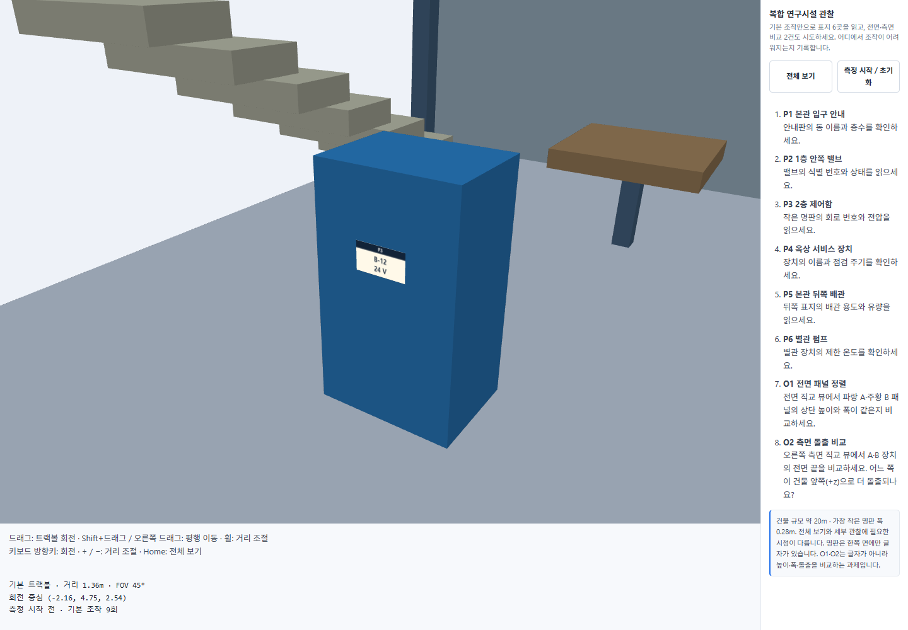
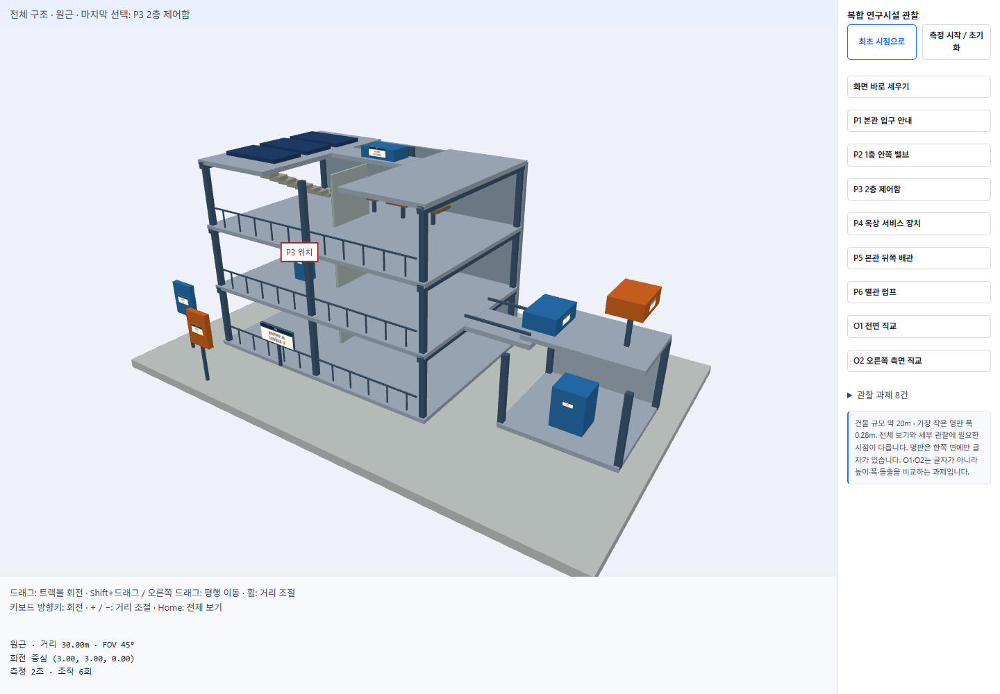

사용 결과에서는 전체 시점으로 돌아가기 어렵다는 불편이 해결되었다고 판단했다. 전체와 상세를 동시에 보여 주지는 않으며, 위치 마커는 벽 뒤에 있어도 표시되는 안내이므로 실제 명판이 보인다는 뜻은 아니다.

### 불편 2 - 작은 명판과 뒤쪽 표지 찾기

P3는 큰 제어함에 비해 글자 영역이 작다. P5는 초기 카메라 방향에서 건물 뒤쪽에 있어, 위치 쪽으로 이동하고 확대하는 것만으로 읽을 수 없었다. 보조 실행의 P5 화면은 실패로 남겼다. 개선은 표지의 위치뿐 아니라 앞면 방향도 사용한다.

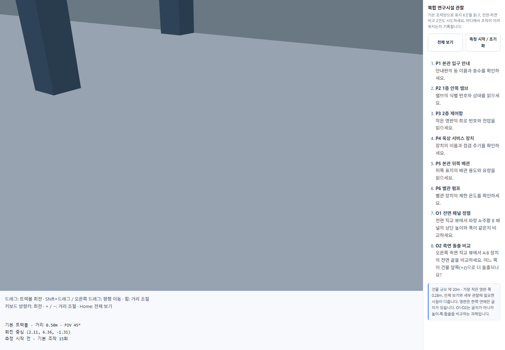
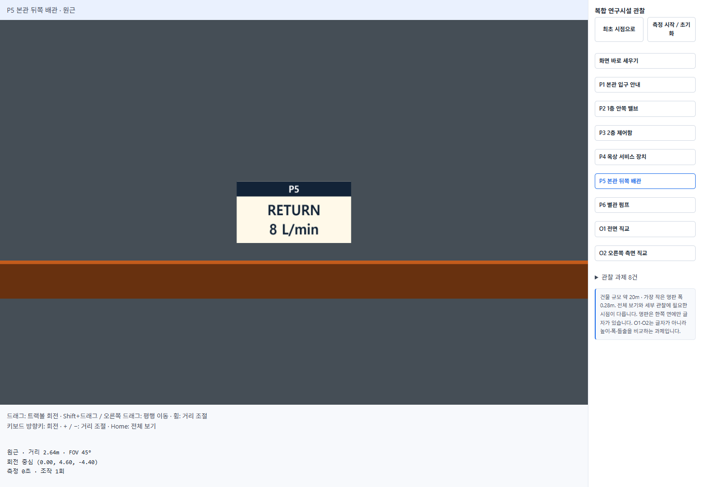

준비된 여섯 표지에는 한 번의 선택으로 읽기 시점을 제공한다. 임의의 새로운 장치까지 자동으로 찾아 주는 기능은 아니다.

### 불편 3 - 수동 회전 후 화면 기울기

화면 가장자리에서 트랙볼을 드래그하면 카메라의 위쪽도 함께 회전한다. 개선에서는 현재 `eye`와 `target`을 유지하면서 세계의 +y를 기준으로 옆 기울기를 없앤다. 표지를 항상 정면으로 돌리는 기능은 아니므로, 정면 재관찰은 해당 P 버튼을 사용한다.

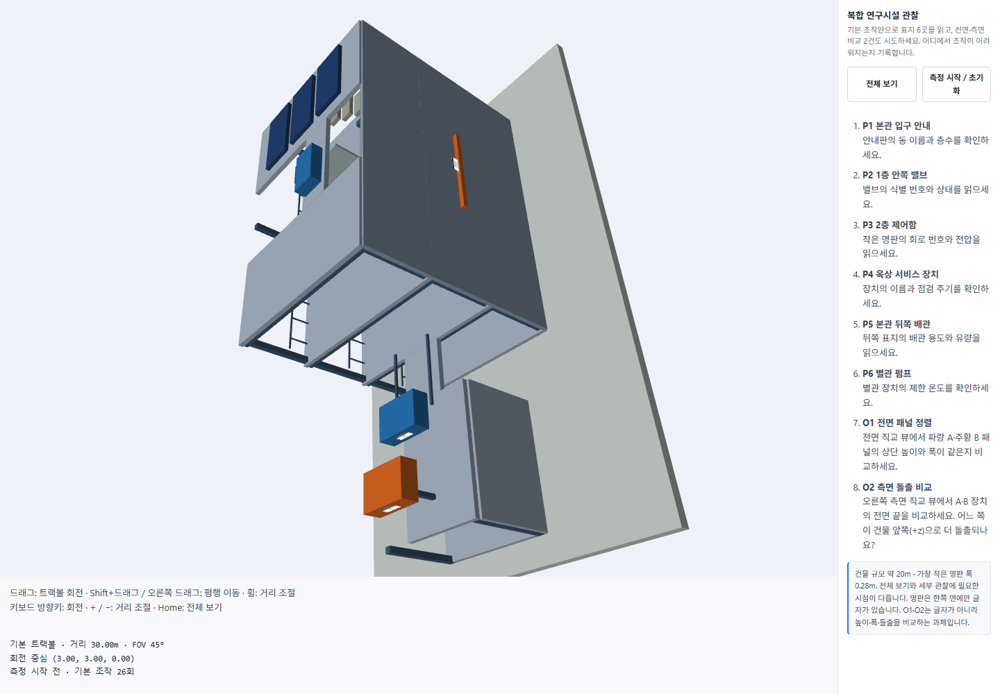
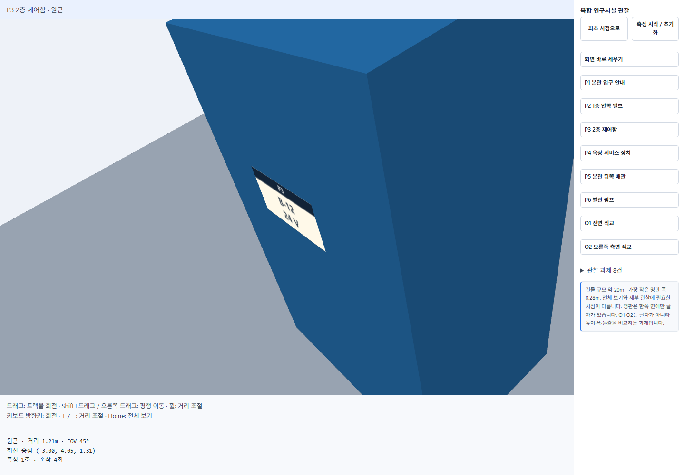
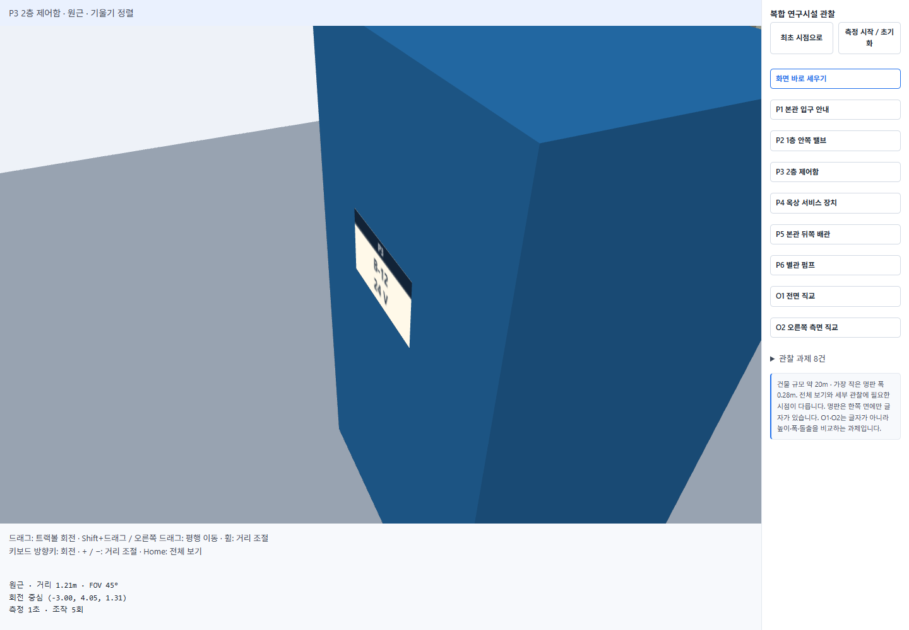

정렬 전후의 위치·대상 유지와 위쪽 방향은 수치 검사로 확인했다. 비스듬한 시선에서 원근 때문에 가로 모서리가 기울어 보이는 것은 남을 수 있다.

## 설계 대안 비교

아래는 대화에서 정한 기능을 바탕으로 AI가 제작한 디지털 배치 스케치다. 실제 실행 캡처와 구별한다.

### 대안 A - 한 화면과 지점 선택

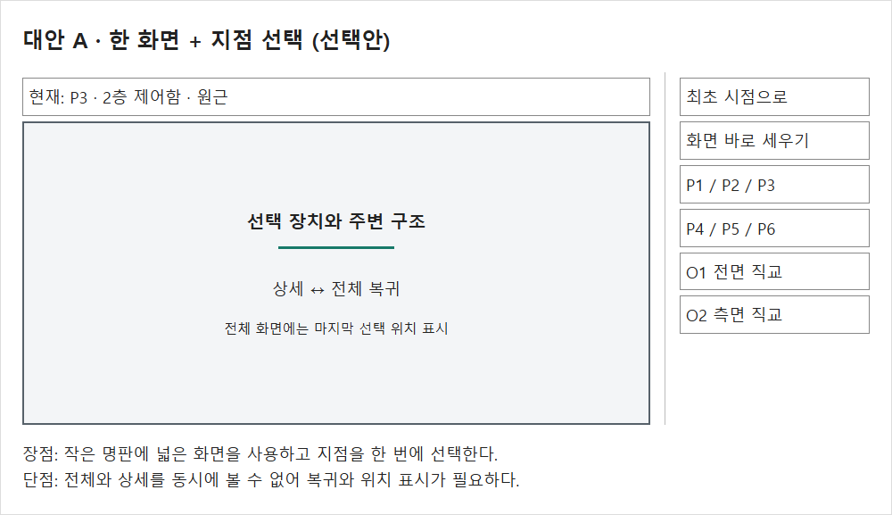

넓은 화면 하나를 사용하고 P1~P6를 바로 선택한다. 전체 복귀와 기울기 정렬을 함께 제공한다. O1·O2는 필요할 때 같은 화면을 직교 투영으로 전환한다. 작은 명판에 화면을 충분히 사용할 수 있지만, 전체와 상세를 동시에 볼 수 없다는 단점이 있다.

### 대안 B - 네 화면 동시 관찰

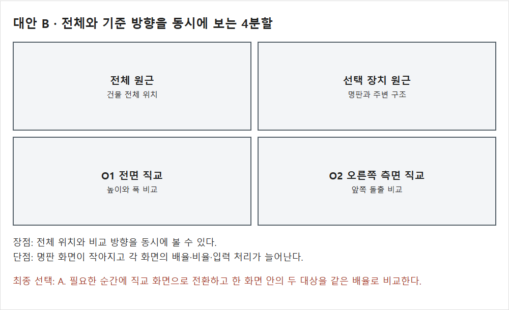

전체 원근, 선택 장치, 전면 직교, 측면 직교를 동시에 보여 주는 대안이다. 위치와 방향을 동시에 비교하기 좋지만 화면마다 글자가 작아지고, 입력 대상과 각 뷰의 비율·배율을 관리해야 한다.

최종 구현은 A를 사용한다. 명판을 읽는 화면 면적을 우선하고, 전체 위치는 복귀 후 마커로 보완했다. 직교 비교에서는 비교할 두 물체를 하나의 화면에 함께 담아 공통 배율을 보장했다.

## 카메라와 투영 구현

주요 코드: [학생 확장](improved/d04-inspection-student.js), [트랙볼과 lookAt 연결](improved/d04-inspection-controls.js), [제공 렌더러와 상태 표시](improved/d04-inspection-viewer.js).
추가한 계산과 입력 처리에는 줄별로 짧은 주석을 달았다. 제공 코드 전체를 새로 작성하지 않았다.

### 대상 위치와 카메라 위치

`target`은 표지 중심이다. `eye`는 그 중심에서 표지 앞면으로 관찰 거리만큼 떨어진 위치다. 두 값이 같으면 바라보는 방향을 만들 수 없다.

```js
const normal=[Math.sin(poi.yaw),0,Math.cos(poi.yaw)];
const eye=poi.position.map((v,i)=>v+normal[i]*distance);
controls.lookAt(eye,poi.position);
```

P1~P4와 P6의 `yaw`는 0이므로 +z 쪽에서 -z를 바라본다. P5는 `yaw = Math.PI`이므로 -z 쪽에서 +z를 바라본다. 이동은 즉시 전환한다. 이동 경로 애니메이션이나 충돌 회피 경로는 구현하지 않았다.

### 크기와 FOV로 관찰 거리 구하기

수직 시야각은 45도로 고정한다. 화면 깊이 d에서 반높이는 `d * tan(FOV / 2)`다. 표지 높이가 화면 높이의 16%, 너비가 화면 너비의 42% 이내에 들어오도록 필요한 반높이를 정하고 거리로 바꾼다.

```js
const halfHeight=Math.max(poi.size[1]/.32,poi.size[0]/(.84*aspect));
return halfHeight/Math.tan(controls.state.fov*Math.PI/360);
```

`.32 = 2 * .16`, `.84 = 2 * .42`다. 더 큰 반높이를 선택해야 가로와 세로 조건을 모두 만족한다. 1440×1000 검증 화면에서 P3의 거리는 약 1.21m다. 고정 숫자를 모든 화면에 적용하는 것이 아니라 캔버스 비율에 따라 다시 계산한다.

FOV를 좁히는 것은 같은 눈 위치에서 보이는 범위를 줄이는 일이다. 이 구현은 FOV를 고정하고 위치를 옮기므로 주변 구조와의 상대적인 원근도 변한다. 대상마다 확대율이 달라지는 P 화면끼리는 실제 물체 크기를 비교하지 않는다.

### 회전 중심과 바로 세우기

기존 트랙볼은 쿼터니언으로 `eye`와 `up`을 함께 회전한다. 여기에 `lookAt(eye,target)` 연결 함수를 추가했다. 대상에서 카메라로 향하는 벡터의 좌우·상하 각도를 구하고, 기존 쿼터니언 곱 함수를 재사용한다.

```js
const yaw=Math.atan2(offset[0],offset[2]);
const pitch=-Math.asin(Math.max(-1,Math.min(1,offset[1]/distance)));
state.rotation=normalize(mul(turn,tilt));
state.target=[...target];
state.distance=distance;
```

`turn`은 y축 좌우 회전, `tilt`는 x축 상하 회전이다. 반각의 sin과 cos는 제공 코드와 같은 쿼터니언 표현이다. 상하 회전 후 좌우 회전을 적용하며 별도의 시선축 회전을 넣지 않아 옆 기울기가 제거된다.

`up`은 최종 카메라 y축을 무조건 `[0,1,0]`으로 만드는 값이 아니다. 일반 시선에서는 +y를 시선에 수직인 평면으로 투영한 방향이 최종 위쪽이 된다. 정확히 위나 아래를 보는 경우에는 +y만으로 화면 방향을 유일하게 정할 수 없어 좌우각으로 정해지는 수평 기준을 사용한다. 표지·직교 프리셋의 시선은 수평이므로 이 모호함이 없다.

### 전면·측면 직교 비교

```js
const eye=item.position.map((v,i)=>v-item.viewDirection[i]*12);
controls.lookAt(eye,item.position);
camera.orthographic=Boolean(comparison);
camera.halfHeight=Math.max(3,2.6/aspect)*controls.state.distance/12;
```

O1은 +z에서 -z로 보고, 화면 오른쪽이 +x, 위가 +y다. O2는 +x에서 -x로 보므로 화면 왼쪽이 +z, 위가 +y다. 두 대상이 각각 한 화면 안에 있으므로 거리 차이에 상관없이 같은 월드 단위당 픽셀 배율을 적용한다.

기본 반높이는 3m이며 세로 범위는 6m다. 좁은 창에서는 `2.6/aspect`로 가로 범위가 최소 5.2m가 되게 한다. `distance/12`는 기존 휠·키보드 값을 직교 확대에 연결하는 비율이다. 직교에서 눈 위치만 옮겨 크기가 바뀌는 것으로 설명하면 안 된다. 실제 크기를 바꾸는 것은 `halfHeight`다.

렌더러는 가로 반범위를 `halfHeight * aspect`로 설정한다. 원근 역시 실제 캔버스 비율을 사용한다. O1과 O2 화면을 따로 확대했을 때 서로 다른 화면의 픽셀 크기까지 같다고 보장하지는 않는다. 필요한 비교는 각 화면 안의 A·B 사이에서 한다.

### 가림과 클리핑

가림은 앞쪽 구조물이 깊이 테스트에서 표지를 덮는 현상이고, near 클리핑은 카메라 앞 절단면보다 가까운 도형이 잘리는 현상이다. 제공 렌더러의 near 0.02m, far 180m를 유지한다. 여섯 읽기 시점에서는 실제 캡처로 표지가 보이는 것을 확인했다.

층이나 벽을 숨기지 않았다. 준비된 시점으로 직접 이동해 표지를 보고, 수동 회전으로 가려지거나 너무 가까워지면 해당 지점 버튼으로 읽기 시점을 복원한다. 임의의 자유 조작에서 발생하는 모든 충돌과 가림을 막는 기능은 없다.

## 같은 8건의 실행 비교

### AI 보조 화면 검증

기본·개선 캡처는 같은 Chrome, 데스크톱 1440×1000, DPR 1에서 생성했다. 각 지점 진입 전 전체로 복귀했다. 기본은 좌표를 참고한 오른쪽 드래그와 휠, 개선은 지점 버튼을 사용했다. 연속 탐색이나 처음 사용하는 사람의 실험이 아니며 자동화 지연을 관찰 시간으로 보고하지 않는다.

| 지점 | 기본 화면에서 확인한 내용 | 개선 화면에서 확인한 내용 | 캡처 |
| --- | --- | --- | --- |
| P1 | 비스듬하지만 ENTRY A / LEVELS 3 판독 가능 | 정면에서 같은 글자와 입구 주변 확인 | [전](images/baseline-p1.png) · [후](images/improved-p1.png) |
| P2 | 책상 옆 밸브의 V-07 / OPEN 판독 가능 | 표지 정면과 밸브·배관 확인 | [전](images/baseline-p2.png) · [후](images/improved-p2.png) |
| P3 | 제어함은 보이나 명판이 작음. B-12 / 24 V 확대 확인 가능 | 읽기 거리에서 글자와 제어함 면 확인 | [전](images/baseline-p3.png) · [후](images/improved-p3.png) |
| P4 | 옥상 장치 FILTER / 30 DAYS 판독 가능 | 정면에서 같은 글자와 옥상 설비 확인 | [전](images/baseline-p4.png) · [후](images/improved-p4.png) |
| P5 | 앞쪽 시선을 유지한 자동 탐색은 벽에 가려 실패 | 뒤쪽에서 RETURN / 8 L/min 및 배관 확인 | [전](images/baseline-p5.png) · [후](images/improved-p5.png) |
| P6 | LIMIT / 80 C가 보이나 비스듬한 작은 표지 | 별관 펌프 정면에서 판독 가능 | [전](images/baseline-p6.png) · [후](images/improved-p6.png) |
| O1 | B가 더 크고 낮아 보임. 실제 높이·폭은 판단 보류 | 두 패널의 상단과 폭이 같음 | [전](images/baseline-o1.png) · [후](images/improved-o1.png) |
| O2 | 위치·높이·깊이가 섞여 돌출 판단 보류 | 파랑 A의 왼쪽 끝이 더 앞쪽(+z)으로 나옴 | [전](images/baseline-o2.png) · [후](images/improved-o2.png) |

표지 글자는 실제 캡처를 확인한 결과다. 기본의 5개 표지 판독은 전체 위치를 이해한 학생의 완료 5/8이라는 뜻이 아니다. 개선의 8개 화면을 검증했지만 학생 자신의 완료 수는 다음 표에서 기록한다.

### O1 전면 직교

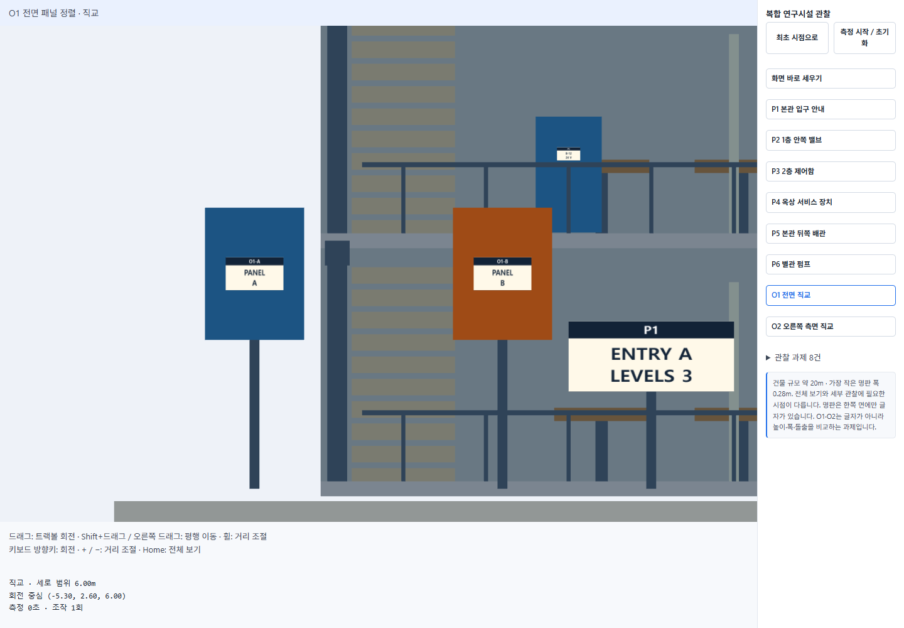

두 패널의 위 모서리가 같은 수평 위치에 있고 폭이 같다. 화면 확인 후 모델 수치로 대조하면 위끝은 `2.6 + 1.6/2 = 3.4m`, 폭은 두 패널 모두 1.2m다. 깊이는 다르지만 직교 투영에서는 크기가 깊이로 나누어지지 않는다.

### O2 오른쪽 측면 직교

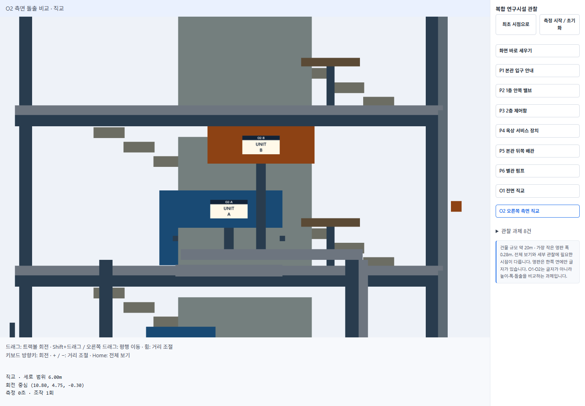

파랑 A가 주황 B보다 왼쪽으로 더 나와 있다. 이 화면에서 왼쪽이 +z이므로 A가 더 앞쪽으로 돌출된다. 모델 수치로도 A의 앞끝은 `0 + 2/2 = 1m`, B는 `-0.6 + 2/2 = 0.4m`이며 차이는 0.6m다. 장치의 높이나 x 위치 차이를 돌출 차이로 해석하지 않는다.

### 본인 관찰 결과

직접 표지를 읽고 다음과 같이 관찰했다. P1의 '3층'은 표지가 있는 층이 아니라 건물이 총 3개 층이라는 뜻으로 정리했다. O1은 처음 높이가 같아 보인다고 답한 뒤 폭도 같아 보인다고 추가로 확인했다.

| 지점 | 직접 전달한 관찰 결과 | 확인 과정 |
| --- | --- | --- |
| P1 | A동이며 층수는 3개 층이다. (`ENTRY A / LEVELS 3`) | 표지 판독 |
| P2 | 식별번호는 V-07이고 상태는 OPEN이다. | 표지 판독 |
| P3 | 회로번호는 B-12이고 전압은 24V다. | 표지 판독 |
| P4 | 장치는 FILTER이며 점검 주기는 30일이다. | 표지 판독 |
| P5 | RETURN 배관이며 유량은 분당 8L다. | 표지 판독 |
| P6 | 제한 온도는 80°C다. | 표지 판독 |
| O1 | 두 패널의 상단 높이와 폭이 같아 보인다. | 높이 확인 후 폭도 추가 확인 |
| O2 | 파랑 A가 주황 B보다 건물 앞쪽(+z)으로 더 돌출되어 있다. | 질문의 의미를 설명받은 뒤 A를 선택하고 방향 표현을 정리 |

O2는 처음에 무엇을 비교하는 질문인지 이해하지 못해 판단을 보류했다. 오른쪽 측면 직교 화면에서는 왼쪽이 건물 앞쪽(+z)이며 두 장치의 왼쪽 끝을 비교한다는 설명을 들었다. 이후 A가 더 나와 있는 것으로 답했고, '건물 쪽'이라는 표현을 '건물 앞쪽으로 더 돌출'로 정리했다. 이 결과는 도움 없이 처음부터 판단한 결과와 구분한다.

직접 조작하면서 어려웠던 점은 화면의 기울기를 맞추는 것이었다. 본인은 기본 버전과 개선 버전에서 각각 8건 모두 완료했고 복귀까지 진행했다고 확인했다. 전체 시점 복귀, 지점 탐색, 기울기 맞추기의 세 가지 불편은 개선 버전에서 모두 해결되었다고 판단했다. O2는 앞서 기록한 설명 후 판단 과정을 포함한다.

### 본인 측정 기록과 비교

같은 8개 관찰 과제를 대상으로 기본 버전과 개선 버전을 사용했다. 개선 버전은 최초 시점 복귀와 위치 표시, 지점 바로가기, 기울기 정렬을 적용하고 O1·O2 직교 관찰을 제공한 프로그램이다. 개선 기능 3개의 개수를 관찰 완료 수로 세는 것은 아니다.

| 비교 항목 | 기본 버전 | 개선 버전 | 해석 |
| --- | --- | --- | --- |
| 관찰 과제 수 | 8건 | 8건 | 두 버전의 관찰 대상은 동일 |
| 관찰 완료 수 | 8/8 | 8/8 | 본인 확인 기준으로 두 버전 모두 완료. 완료 수 차이는 없음 |
| 전체 관찰 시간 | 90초 | 76초 | 이번 실행에서는 14초 줄었음 |
| 조작 부담 | 614회 | 403회 | 이번 실행에서는 211회 줄었음. 학습 효과를 함께 고려 |
| 대표 불편 3개 | 전체 시점 복귀, 작은 지점 탐색, 기울기 맞추기의 어려움 | 복귀·위치 표시, P1~P6 바로가기, 화면 바로 세우기로 대응 | 본인 판단: 세 가지 모두 해결. 각 불편의 캡처와 설명은 앞 절에 기록 |
| 새로 생긴 불편 | 해당 없음 | 별도의 새로운 불편은 아직 보고하지 않음 | 반복 사용에 따른 조작 감소는 새로운 UI 불편보다 학습 효과에 해당 |

개선 버전의 **76초·403회**는 전달한 측정 화면에서도 확인했다. 화면에는 거리 12.79m, FOV 45도, 회전 중심 `(3.00, 3.00, 0.00)`이 표시되어 있다. 복귀까지 진행했다고 전달했지만, 캡처가 정확히 복귀 전인지 복귀 후 추가 조작 시점인지는 구분하지 않았다. 기본 버전은 아래 구간별 기록의 합계가 전체 기록과 일치한다. P1~P6의 실제 기록은 여섯 지점의 합산값이며, 아래 개별 표의 배분 추정치와 구별한다.

| 기본 버전 관찰 구간 | 시간 | 조작 횟수 |
| --- | --- | --- |
| P1~P6 합산 | 64초 | 463회 |
| O1 | 11초 | 62회 |
| O2 | 15초 | 89회 |
| 합계 | 90초 | 614회 |

조작 횟수는 기능을 개선해서만 줄어드는 것이 아니라 여러 번 사용하면서 익숙해져 줄어드는 것 같았다. 따라서 이번에 시간과 조작 횟수가 줄었다는 결과는 기록하되, 감소분 전부가 개선 기능 때문이라고 단정하지 않는다. 특히 개선 버전을 나중에 사용하면서 지점 위치와 조작을 이미 익힌 효과가 함께 작용했을 수 있다.

순서를 바꾸어 다시 관찰했을 때도 이미 각 지점의 대략적인 위치를 기억하고 있어, 순서 변경만으로는 학습 효과를 없애기 어려웠다. 체감상 순서를 바꾸는 효과는 크지 않았다. 재확인 때의 정확한 시간과 조작 횟수는 별도로 기록하지 않았으므로 수치 비교는 하지 않는다. 이 관찰은 학습 효과가 없다는 뜻이 아니라, 기능 개선과 익숙해진 효과를 분리해 측정하기 어렵다는 한계로 해석한다.

수업 6-3의 기본 관찰 순서는 전체 보기 → P1 → P2 → P3 → P4 → P5 → P6 → O1 → O2 → 전체 보기다. 아래 지점별 완료 여부는 본인 확인을 반영했다. **P1~P6의 개별 시간·횟수는 실제 측정값이 아니라 합계 64초·463회를 거의 균등하게 나눈 배분 추정치다.** 정수로 나눈 나머지를 앞쪽 지점에 배정했으며, 지점별 난이도나 실제 소요 차이를 나타내지 않는다. 이 추정치로 지점별 실측을 완료했다고 주장하지 않는다. O1·O2는 본인이 전달한 개별 기록이다.

| 지점 | 기본 성공/실패 | 기본 소요 초·조작·되돌아가기 | 개선 성공/실패 | 개선 소요 초·조작·되돌아가기 |
| --- | --- | --- | --- | --- |
| P1 | 완료 | 11초 · 78회 (배분 추정) | 완료 | 합산만 기록 |
| P2 | 완료 | 11초 · 77회 (배분 추정) | 완료 | 합산만 기록 |
| P3 | 완료 | 11초 · 77회 (배분 추정) | 완료 | 합산만 기록 |
| P4 | 완료 | 11초 · 77회 (배분 추정) | 완료 | 합산만 기록 |
| P5 | 완료 | 10초 · 77회 (배분 추정) | 완료 | 합산만 기록 |
| P6 | 완료 | 10초 · 77회 (배분 추정) | 완료 | 합산만 기록 |
| O1 | 완료 | 11초 · 62회 | 완료 | 합산만 기록 |
| O2 | 완료 | 15초 · 89회 | 완료 | 합산만 기록 |
| 전체 복귀·합계 | 8/8 · 복귀 완료 | 90초 · 614회 | 8/8 · 복귀 완료 | 76초 · 403회 |

각 지점에서 누적 시간과 조작 수를 적고 직전 값과의 차이를 계산하면 된다. 측정 버튼을 매 지점마다 초기화하면 전체 시간은 별도로 합산해야 한다. 새 UI 클릭은 자동 집계되지만 페이지 스크롤은 집계하지 않는다. 휠 이벤트 수는 기기에 따라 달라진다. 이미 위치와 답을 본 학습 효과가 있으므로 이후 기록 역시 완전히 새로운 사용자의 첫 관찰과 같지 않다.

## 구현 후 수정

첫 구현은 모든 P 지점을 3m 거리에서 보도록 했다. 실행에서 P3 명판이 작게 표시되어 표지 크기·FOV 기반 거리로 바꿨다. 그다음 높이 점유율 24%에서는 장치 주변이 너무 많이 잘려 최종 16%로 줄였다. 화면 폭 제한은 42%로 유지했다.

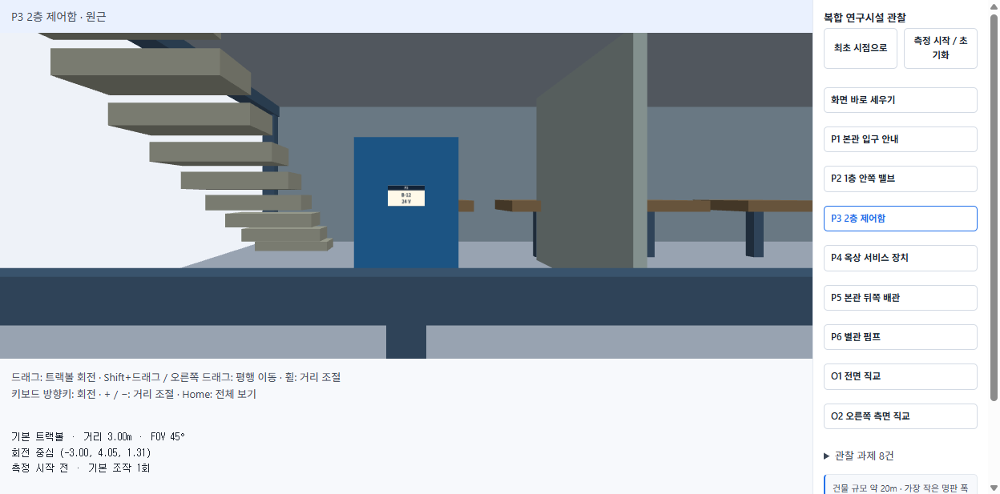

첫 캡처는 1248×617이다. 아래는 비교 조건을 맞추기 위해 최종 화면에서 거리만 이전 값 3m로 되돌려 재현한 화면과 최종 화면이다. 과거 실행 캡처인 것처럼 취급하지 않는다.

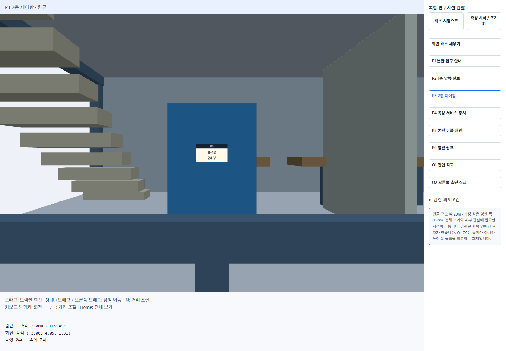
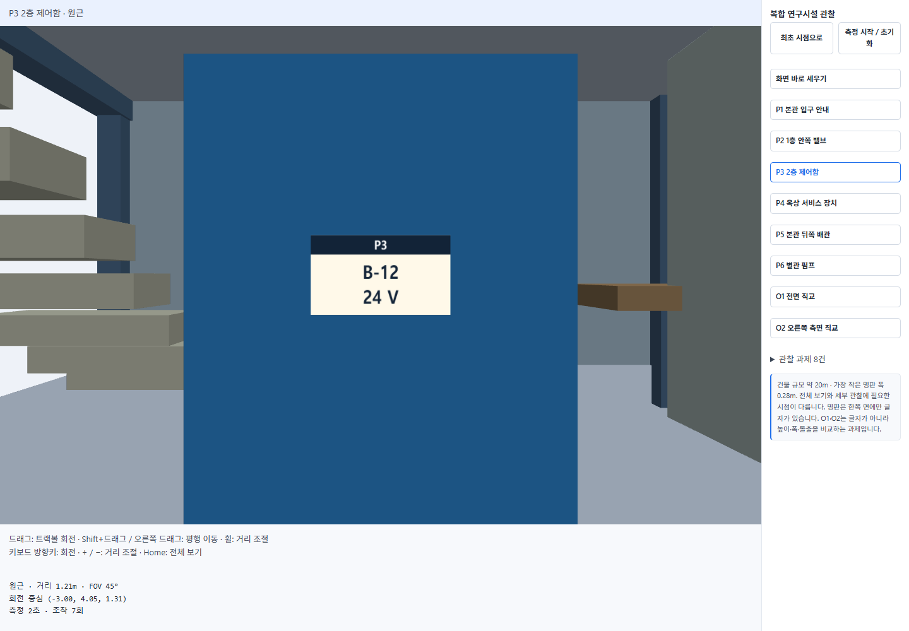

### 남은 불편

AI 보조 검증에서 확인한 한계로는 작은 화면에서 관찰 화면과 버튼 목록을 함께 볼 수 없어 스크롤이 필요하다는 점이 있다. 상세 화면에서 전체 구조를 동시에 볼 수 없으며, 위치 표시는 숨은 지점의 방향 안내까지 해 주지는 않는다. 자유 회전하면 벽이나 장치 뒤로 들어갈 수 있다. 이 경우 지점 버튼으로 복원해야 한다. 본인이 새로 겪은 불편으로 보고한 것은 아니며, 본인은 반복 사용으로 익숙해지는 효과가 조작 횟수 감소에 영향을 주는 것 같다고 의견을 남겼다.

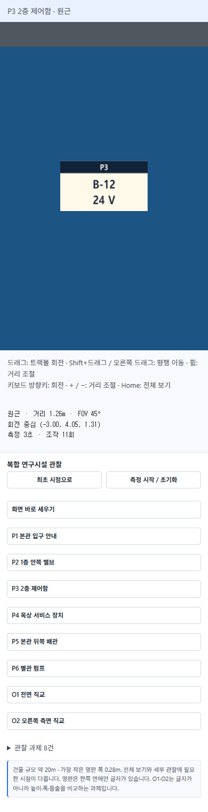
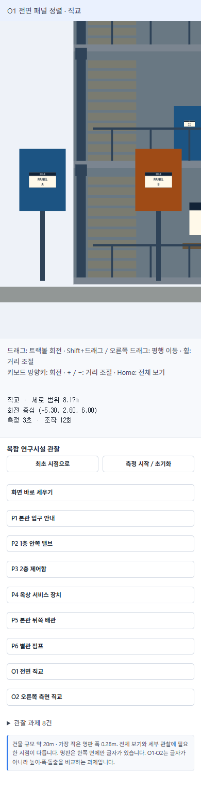
