# 5주차 - 빛과 색

- 이름: 이경훈
- 저장소: [KyungHoon03/catholic.cg.26.2](https://github.com/KyungHoon03/catholic.cg.26.2)
- 웹사이트: [컴퓨터그래픽스 포트폴리오](https://kyunghoon03.github.io/catholic.cg.26.2/)
- 로컬 실행: [Task 1](task1.html) · [Task 2](task2.html)
- GitHub Pages 실행 주소: [Task 1](https://kyunghoon03.github.io/catholic.cg.26.2/week5/task1.html) · [Task 2](https://kyunghoon03.github.io/catholic.cg.26.2/week5/task2.html)
- 수업: [5주차 빛과 색](https://cg.catholic.ac.kr/~mgchoi/CG/weeks/week05/)

## Task 1 - 납작한 원을 구로 만들기

### 의도와 방법

제공된 바닥·행성·달 장면에 조명을 하나씩 넣어 어떤 계산이 입체감과 반짝임을 만드는지 비교한다. 새로운 메시나 렌더링 라이브러리를 추가하지 않고, 내려받은 `w5-start.html`을 복사한 `task1.html`의 셰이더를 중심으로 수정했다.

확산 반사, 환경광, 정반사와 거리 감쇠를 순서대로 적용했다. 법선 변환은 모델 행렬의 역전치 행렬로 바꾸었고, 마지막에는 같은 장면에서 point·directional·spot을 비교하도록 했다. 수업의 [제공 시작 파일](https://cg.catholic.ac.kr/~mgchoi/CG/demos/starter/w5-start.html)은 여기에서 확인할 수 있다.

### 조작법

| 입력 | 동작 |
| --- | --- |
| 마우스 드래그 | 카메라 회전 |
| 마우스 휠 | 카메라 거리 조절 |
| `1` | point: 제공된 광원이 장면 위를 회전 |
| `2` | directional: 일정한 방향, 감쇠 없음 |
| `3` | spot: `(0, 6, 0)`에서 아래로 비추는 원뿔 광원 |

숫자 키는 한 광원의 **종류를 전환**한다. 여러 광원을 동시에 사용하는 실습 2의 켜기·끄기 기능과는 다르다. 처음 실행하면 point 상태다. 최종 제출용 파일에서는 행성의 원래 균등 스케일 `(1.3, 1.3, 1.3)`과 애니메이션을 유지했다.

### 캡처 조건

이 보고서의 캡처는 2026-10-08에 Microsoft Edge의 실제 WebGL2 실행 화면에서 얻었다. 캡처 환경은 임시 브라우저와 SwiftShader 소프트웨어 렌더러다.

1~4단계와 5단계 법선 비교, 6단계 종류 비교는 같은 1440×1000 화면, DPR 1, `cam = { yaw: 0.6, pitch: 0.42, dist: 11 }`, `t = 2.0`으로 고정했다. 광원·물체가 움직이는 시간을 고정해야 서로 다른 순간을 조명 단계의 차이로 오해하지 않는다. 광원 거리 비교만 `t = 0.0`이며, 시점 비교는 광원과 물체를 고정한 뒤 카메라를 드래그했다.

비교 화면은 [검증 스크립트](verification/verify-task1.cjs)가 실제 `task1.html`을 읽고 해당 단계의 출력식·비교 조건만 바꾼 임시 HTML을 실행한 결과다. 최종 파일 자체에 캡처용 시간 고정을 남기지 않았다. [검증 기록](verification/results.json)에 컴파일·링크와 WebGL 오류 검사, 조작 확인 결과를 남겼다.

## 0단계 - 조명이 없는 상태

출발 파일은 모든 픽셀에 같은 물체색을 출력한다.

```glsl
fragColor = vec4(uBaseColor, 1.0);
```

구의 메시와 깊이 판정은 있지만, 표면이 어느 쪽을 향하는지에 따른 밝기 차이가 없어 실루엣 안이 납작한 원처럼 보인다. 입체감을 만들려면 각 픽셀의 법선과 광원 방향에 따라 밝기를 다르게 계산해야 한다.

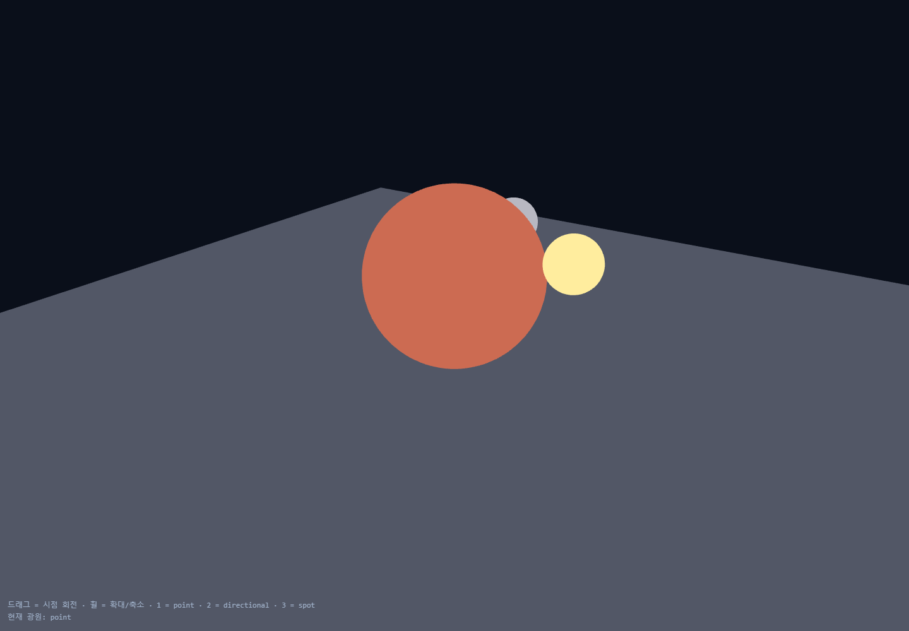

## 1단계 - 확산 반사

```glsl
vec3 N = normalize(vNormal);
vec3 L = normalize(uLightPos - vWorldPos);
float lambert = max(dot(N, L), 0.0);
vec3 diffuse = lambert * uBaseColor * uLightColor;
fragColor = vec4(diffuse, 1.0);
```

`N`은 표면의 법선 방향, `L`은 표면에서 광원으로 향하는 방향이다. 정규화한 두 벡터의 내적은 두 방향 사이 각도의 코사인이므로, 광원을 정면으로 받는 면이 밝고 비스듬한 면이 어두워진다. `uBaseColor * uLightColor`는 물체의 반사 색과 들어오는 빛의 색을 함께 반영한다.

캡처에서는 구의 표면 밝기가 연속적으로 변하고, 빛을 등진 부분은 검게 보인다. 별도의 밤낮 경계선을 그리는 코드 없이 `max(dot(N, L), 0.0)`으로 경계가 생긴다.

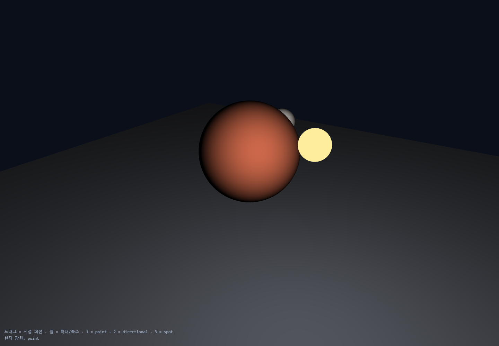

### max 제거 전 예측과 실제 결과

처음에는 `max`가 두 값 중 더 큰 값을 고르므로 결과가 최소한 `0.0` 미만은 되지 않고, 결국 덜 어둡게 만들어 주는 코드라고 생각했다.

`max(dot(N, L), 0.0)`은 내적이 양수이면 그대로 사용하고 음수이면 0을 반환한다. 빛을 등진 면에서 내적이 음수가 되더라도, 빛을 받지 않는다는 뜻으로 밝기를 0으로 처리한다. 음수를 0으로 올린다는 점에서는 처음 생각이 계산상 맞지만, 화면에서 0은 이미 완전한 검정이므로 항상 눈에 보이게 밝아지는 것은 아니다.

```glsl
// max를 사용한 경우
float lambert = max(dot(N, L), 0.0);
// 제거 실험
float lambert = dot(N, L);
```

제거 실험에서는 1단계처럼 확산광만 출력하고, 같은 화면·카메라·광원과 `t = 2.0`을 유지한 채 `max`만 제거했다. 두 화면 모두 빛을 등진 면은 검게 보였고, 캡처 PNG의 바이트까지 동일했다. 셰이더 컴파일·링크는 정상이고 WebGL 오류도 0이었다. 따라서 이번 조건에서는 눈에 보이는 차이가 없었다.


그 이유는 화면에 출력할 때 음수 색 값이 0으로 제한되기 때문이다. 예를 들어 내적이 `-0.5`, 행성의 빨강 값이 `0.8`, 광원의 빨강 값이 `1.0`이면, `max`가 있을 때 확산광의 빨강 값은 `0.0`이고 없을 때는 `-0.4`다. 계산 결과는 다르지만 이 화면에서는 둘 다 검정으로 출력된다.

환경광을 더하면 음수 확산광이 다른 빛을 깎아 버릴 수 있다. 행성의 빨강 채널에서 환경광은 `0.08 * 0.8 = 0.064`다. 내적이 `-0.05`인 표면이라면 `max`가 있을 때는 `0.064 + 0.0 = 0.064`이고, 없을 때는 `0.064 + (-0.05 * 0.8 * 1.0) = 0.024`로 더 어두워진다. 이것은 현재 코드의 색과 환경광 계수를 사용한 계산 예시이며, 별도로 환경광 상태의 `max` 제거 화면을 실행·캡처한 결과는 아니다.

따라서 `max`는 단순히 전체를 밝게 만드는 함수라기보다, 빛을 등진 면의 음수 확산광이 다른 조명 항의 밝기를 빼지 못하게 하는 역할이다. 최종 `task1.html`에는 `max`를 유지했다.

### 시점을 바꿀 때

확산 반사에는 시선 벡터가 없다. 광원과 물체를 고정하면 같은 월드 표면점의 확산광 값은 카메라만 움직여도 바뀌지 않는다. 화면에서는 시점이 달라져 보이는 면과 경계의 화면 위치가 달라질 수 있다. 따라서 화면 속 경계가 같은 픽셀에 고정된다는 뜻은 아니다.

## 2단계 - 환경광

```glsl
vec3 ambient = 0.08 * uBaseColor;
fragColor = vec4(ambient + diffuse, 1.0);
```

환경광은 주변에서 돌아오는 간접광을 상수로 근사한다. `0.08`은 물체색의 8%를 모든 면에 더하는 계수다. `N`, `L`, 시선 방향이나 광원 거리에 의존하지 않는다. 확산광만 있던 1단계와 비교하면 밤면도 조금 보인다.

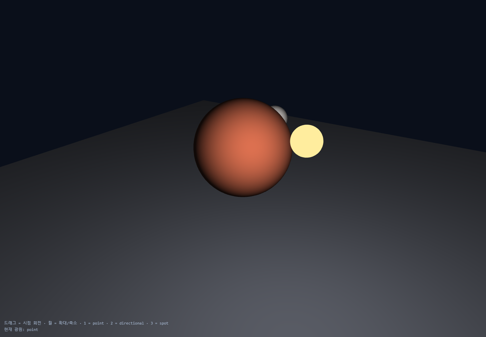

환경광 계수를 `0.0`으로 두면 밤면이 완전히 검고, `0.4`로 두면 어두운 면도 밝아져 밝은 면과의 대비가 줄어든다. 아래 두 보조 비교는 최종 4단계 조명식에서 환경광 계수만 바꾼 화면이며, 2단계 제출 캡처와 구별한다. 최종 값은 `0.08`이다.

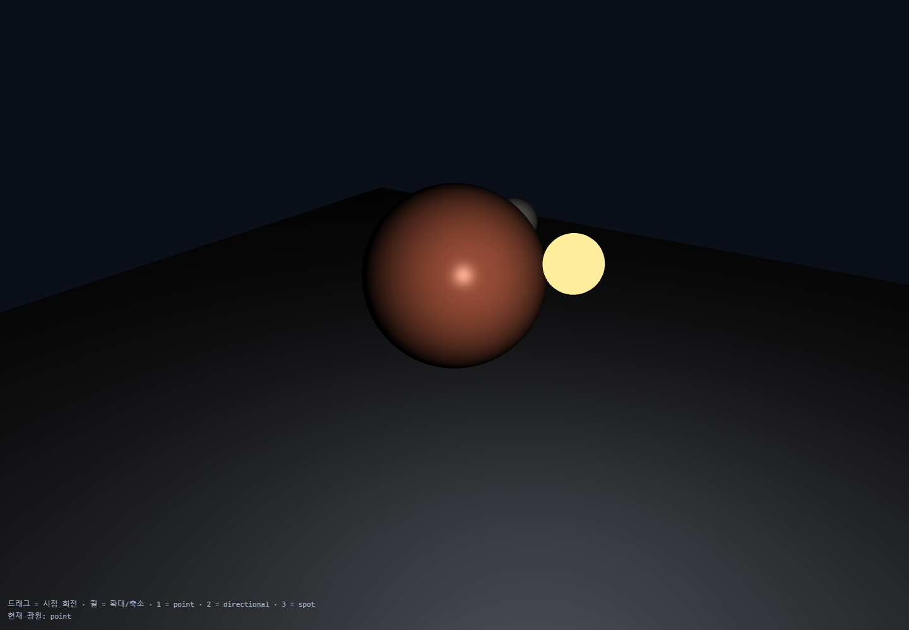
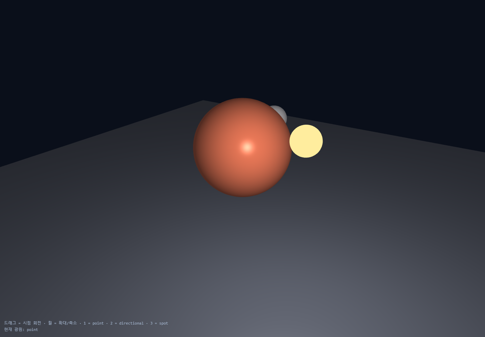

## 3단계 - 정반사

```glsl
vec3 V = normalize(uViewPos - vWorldPos);
vec3 R = reflect(-L, N);
float spec = (lambert > 0.0)
  ? pow(max(dot(R, V), 0.0), uShininess) : 0.0;
vec3 specular = spec * uLightColor * 0.5;
fragColor = vec4(ambient + diffuse + specular, 1.0);
```

`V`는 표면에서 카메라로 향하는 방향이다. `reflect`는 입사 방향을 받으므로 광원을 향한 `L`의 반대인 `-L`을 넣는다. 반사 방향 `R`과 시선 방향 `V`가 가까울수록 밝은 하이라이트가 생긴다. `uShininess`가 커지면 반짝이는 영역이 좁아지고, `0.5`는 정반사의 세기를 정한다.

행성의 shininess는 `32`, 달은 `16`, 바닥은 `8`로 제공 값을 유지했다. 정반사에는 물체색을 곱하지 않으므로 하이라이트는 광원의 색을 띤다.

수업의 3단계 짧은 예시에는 `lambert > 0.0` 조건이 빠져 있지만, 본문의 전체 Phong 코드와 주의사항은 등진 면의 정반사를 끄도록 한다. 최종 구현에는 이 조건을 추가해 물체 뒤쪽에 하이라이트가 생기는 문제를 막았다.

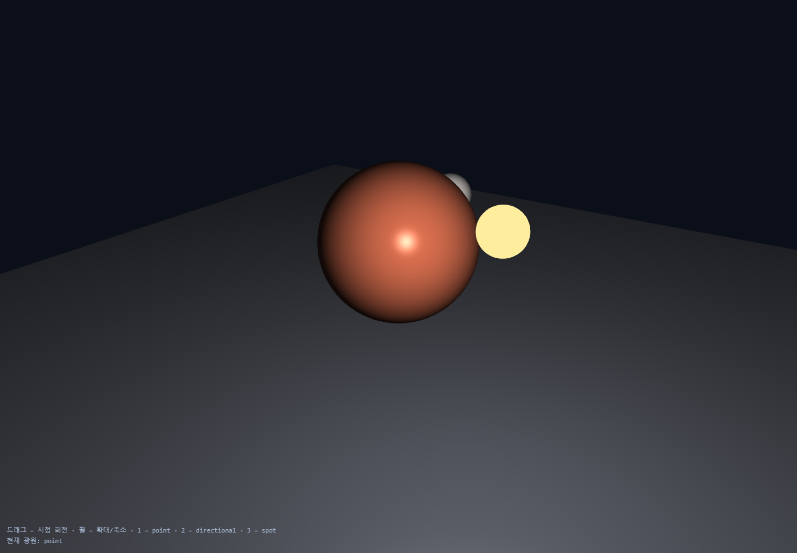

### 고정된 광원에서 시점 회전

아래는 `t = 2.0`에서 광원과 물체를 멈춘 뒤 마우스로 시점을 돌린 실제 화면이다. 카메라는 `yaw: 0.6 → 1.48`, `pitch: 0.42 → 0.30`으로 바뀌었다. 하이라이트가 보이는 표면 영역이 달라진다. 확산광의 밤낮 구분은 광원 방향으로 결정되고, 하이라이트는 여기에 시선 방향까지 필요하다.


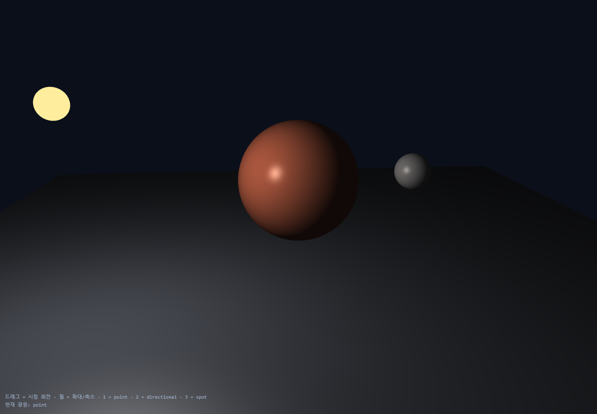

`render()`에서 매 프레임 `gl.uniform3fv(U.uViewPos, eye)`를 호출해 움직인 카메라의 월드 좌표를 전달한다. `vWorldPos`, `uLightPos`, `uViewPos`를 모두 월드 좌표로 사용한다.

## 4단계 - 거리 감쇠

```glsl
float d = length(uLightPos - vWorldPos);
float att = 1.0 / (1.0 + 0.02 * d * d);
fragColor = vec4(ambient + (diffuse + specular) * att, 1.0);
```

`d`는 광원에서 표면까지의 거리다. 거리가 커지면 분모가 커지고 `att`가 작아져 직접광이 약해진다. 예를 들어 거리 5에서는 `1 / (1 + 0.02 * 25) = 2/3`이고, 거리 10에서는 `1/3`이다. 환경광은 특정 광원에서 오는 빛이 아니므로 감쇠를 곱하지 않는다.

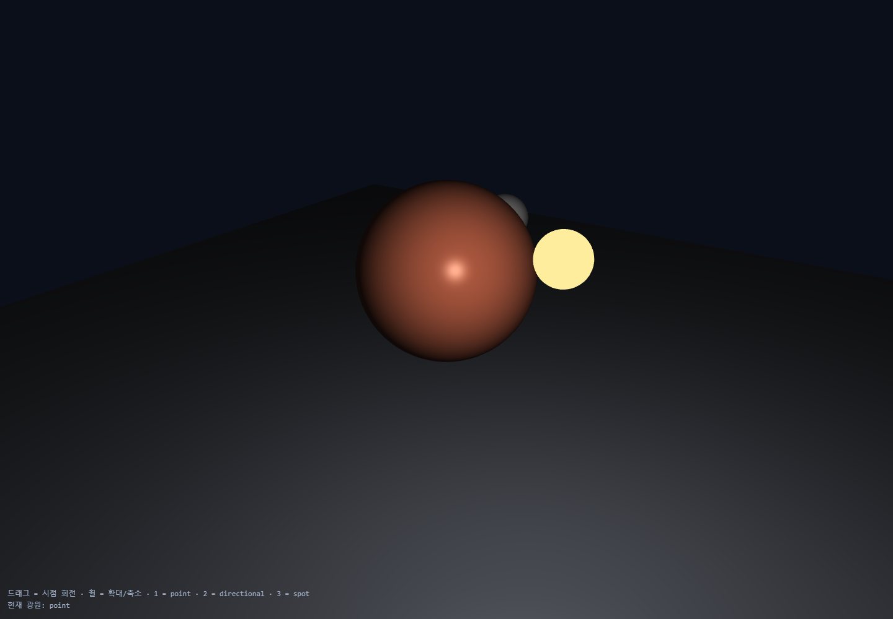

### 광원을 가까이 옮긴 비교

두 화면은 `t = 0.0`에서 시점과 물체를 고정하고 광원을 `(5, 3.6, 0)`에서 `(0, 3.3, 0)`으로 옮긴 결과다. 옆쪽에서 빛을 받던 장면이 행성 위를 강하게 비추는 장면으로 바뀌고, 달의 밝은 영역도 달라진다. 행성 꼭대기 `(0, 2.9, 0)`까지의 거리는 약 `5.05 → 0.40`으로 줄고 감쇠 계수는 약 `0.662 → 0.997`로 커진다. 달 꼭대기 `(2.8, 2.02, 0)`에서는 거리가 약 `2.71 → 3.08`로 늘어 감쇠 계수는 약 `0.872 → 0.841`로 작아진다.

광원 이동은 거리뿐 아니라 `L`도 바꾸므로 캡처의 모든 밝기 차이를 감쇠만의 효과라고 설명하지 않는다. 거리별 계수 계산과 3·4단계 동일 조건 비교를 함께 근거로 사용한다.

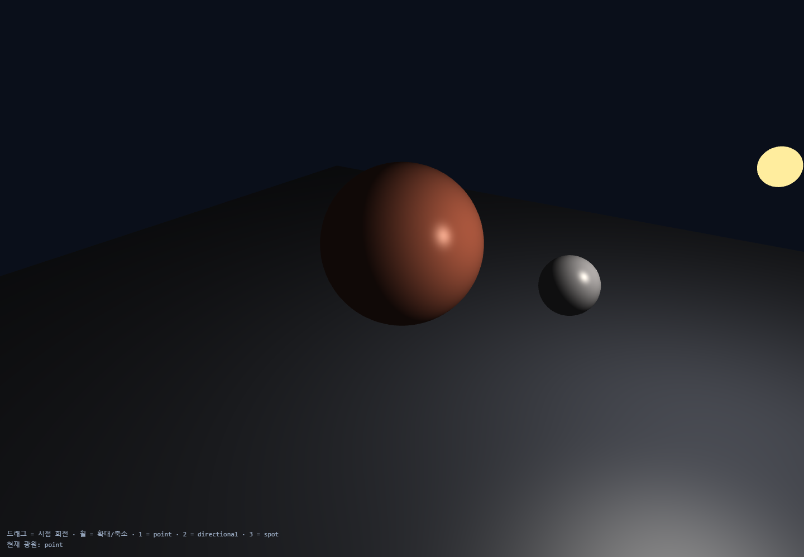
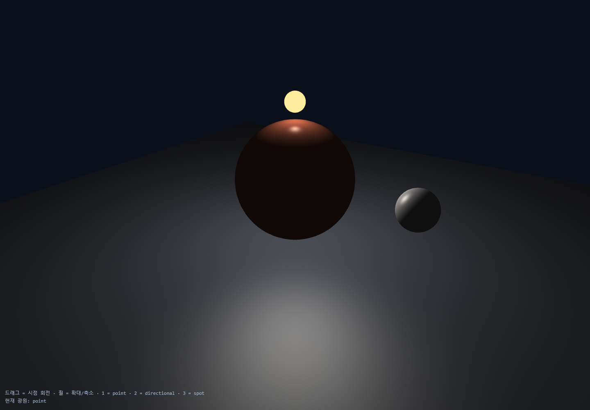

## 5단계 - 법선 행렬 비교

```glsl
// 비교 전
vNormal = mat3(uModel) * aNormal;
// 최종 구현
vNormal = uNormalMat * aNormal;
```

```js
gl.uniformMatrix3fv(U.uNormalMat, false, Mat4.normalFromMat4(model));
// 아래 비균등 스케일은 비교 캡처에서만 사용했다.
m = Mat4.multiply(m, Mat4.scale(0.7, 2.2, 0.7));
```

모든 축을 같은 비율로 늘리는 경우에는 모델 행렬로 변환한 법선을 정규화해도 방향이 맞는다. 하지만 비균등 스케일에서는 법선과 표면의 수직 관계가 깨진다. 모델 행렬의 역전치 3×3을 사용해야 변환된 표면에도 법선이 수직이다. 법선은 방향 벡터이므로 위치 이동은 적용하지 않는다.

같은 `(0.7, 2.2, 0.7)` 스케일에서 모델 행렬을 사용한 화면은 행성의 윗부분이 어둡고 하이라이트가 짧게 모인다. 법선 행렬을 사용한 화면에서는 밝은 영역이 위쪽까지 이어지고 하이라이트도 길게 나타난다. 두 화면의 형상과 카메라, 광원, 시간은 같다. 제공 위치 `y = 1.6`을 유지했으므로 길게 늘인 행성의 아래쪽 `0.6`은 바닥 아래로 들어가 가려진다. 형상 위치를 바꾸어 조명 비교 조건을 섞지 않았다.

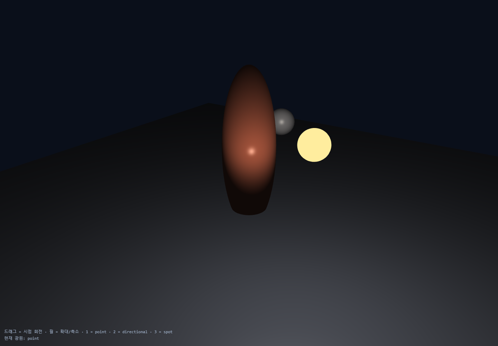
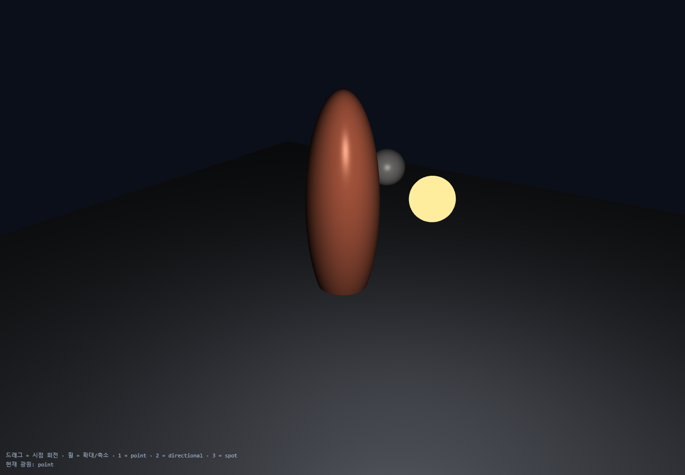

### 제공 함수에서 수정한 부분

원본 `normalFromMat4()`는 역전치라고 주석이 달려 있지만, 반환 배열의 배치가 역행렬 형태다. 열 우선 행렬에서 역행렬의 행과 열을 바꾸도록 반환 순서만 수정했다. 행렬 계산 전체를 다른 라이브러리로 대체하지 않았다.

```js
return new Float32Array([
  b01*det, b11*det, b21*det,
  (-a22*a01 + a02*a21)*det, (a22*a00 - a02*a20)*det, (-a21*a00 + a01*a20)*det,
  (a12*a01 - a02*a11)*det, (-a12*a00 + a02*a10)*det, (a11*a00 - a01*a10)*det
]);
```

`rotateY(0.6) * scale(0.7, 2.2, 0.7)`에서 원래 수직인 접선과 법선을 각각 변환한 뒤 내적을 확인했다. 결과는 약 `-3.20 × 10^-8`로 부동소수점 오차 범위에서 0이다. 이 검사는 화면 비교와 별도로 수직 관계를 확인한 근거다.

## 6단계 - 광원의 종류 비교

### Point

```glsl
vec3 L = normalize(uLightPos - vWorldPos);
float att = 1.0 / (1.0 + 0.02 * d * d);
```

위치가 있는 광원이므로 표면마다 빛을 받는 방향과 거리가 다르다.


### Directional

```glsl
L = normalize(vec3(0.4, 0.8, 0.5));
att = 1.0;
```

모든 표면에서 같은 방향으로 빛을 받고 거리 감쇠는 없다. 이 벡터는 **표면에서 광원을 향하는 방향**이다. 광선이 진행하는 방향을 저장한 `uLightDir`을 사용할 때는 부호를 반대로 해야 한다. 위치가 없으므로 이 상태에서는 광원 위치 표시용 구를 숨긴다.

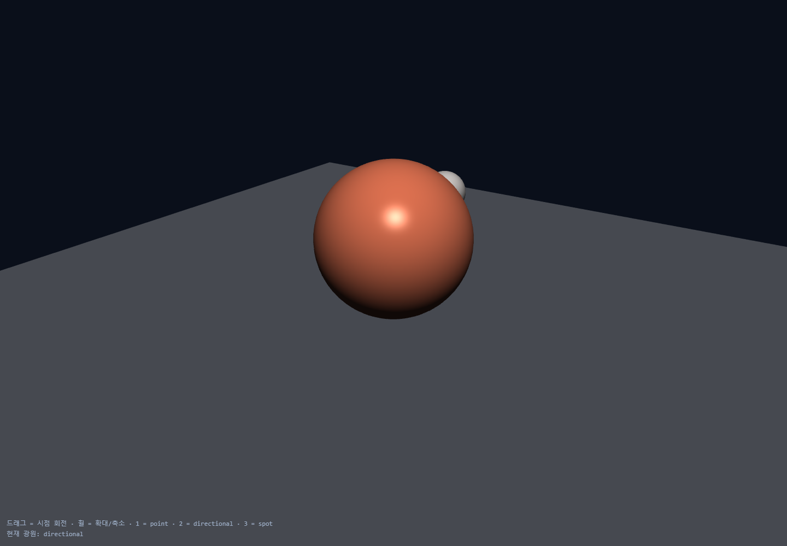

### Spot

```glsl
vec3 spotDir = vec3(0.0, -1.0, 0.0);
float c = dot(-L, spotDir);
att *= clamp((c - uCosOuter) / (uCosInner - uCosOuter), 0.0, 1.0);
```

```js
const lightPos = lightType === 2 ? [0, 6, 0] :
  [Math.cos(t * 0.4) * 5.0, 3.6, Math.sin(t * 0.4) * 5.0];
gl.uniform1f(U.uCosInner, Math.cos(16 * Math.PI / 180));
gl.uniform1f(U.uCosOuter, Math.cos(28 * Math.PI / 180));
```

Point의 거리 감쇠에 원뿔 범위를 추가했다. 광원은 `(0, 6, 0)`에서 아래쪽을 향한다. 광원에서 표면으로 향하는 `-L`과 원뿔 축의 내적을 비교해, 16도 안쪽은 그대로 비추고 16~28도 사이는 서서히 줄이며 28도 바깥에서는 직접광을 0으로 만든다. 각이 작을수록 cos 값이 크므로 `uCosInner > uCosOuter`다.

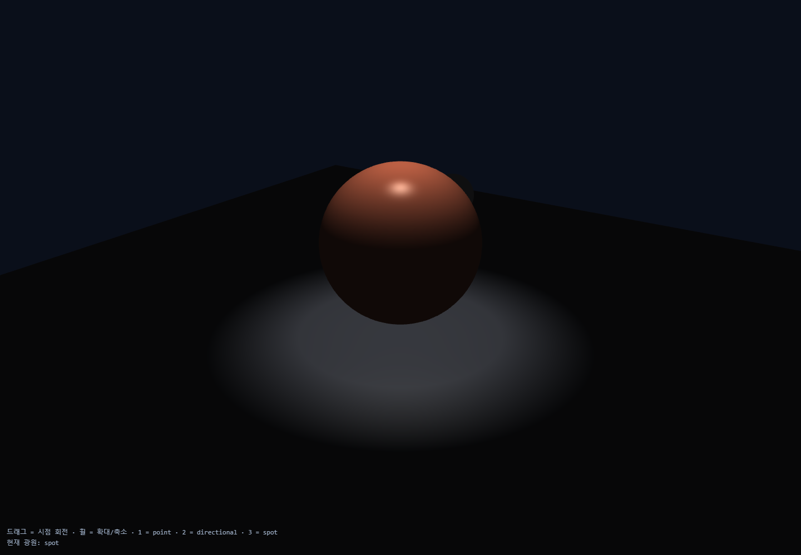

### 바닥에서 달라진 점

Point에서는 바닥의 위치에 따라 빛을 받는 방향과 거리가 달라져 밝기가 부드럽게 변한다. Directional에서는 바닥의 법선과 광원 방향이 어디서나 같고 감쇠가 없어 바닥의 확산광이 일정하다. 정반사는 시선 벡터를 사용하므로 directional에서도 위치에 따라 달라질 수 있다. Spot에서는 광원 아래에 원형 범위가 생기고 바깥쪽으로 갈수록 약해진다. 비스듬한 카메라에서는 이 원이 타원처럼 보이며 가운데 일부는 행성이 가린다. 바깥도 환경광 `0.08`은 남는다. 아래 동일한 `(0, 6, 0)`의 point 비교와 spot 캡처는 위치 변화와 원뿔 제한의 효과를 구분하는 데 사용했다.

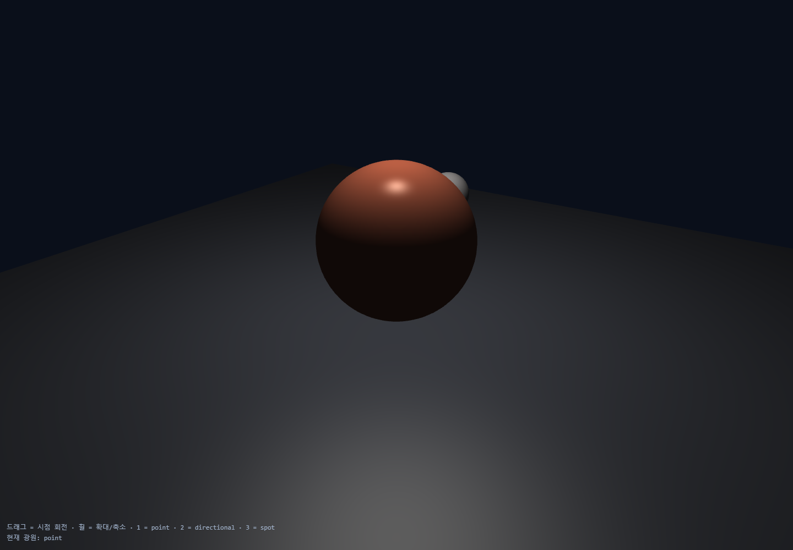

## 실행 확인과 점검표

| 수업 점검 항목 | 근거와 상태 |
| --- | --- |
| 구가 원이 아니라 구로 보인다 | 0·1단계 캡처에서 단색과 확산광 결과 비교. |
| 시점을 돌리면 하이라이트만 움직이고 밤낮 경계는 그대로다 | 광원·물체를 고정하고 드래그한 전후 캡처. 밤낮 경계가 같은 화면 픽셀에 고정된다는 의미는 아니다. |
| ambient 0에서 밤 쪽이 완전히 검어진다 | 환경광 0 캡처와 등진 면의 specular 차단 코드. |
| 가까운 광원의 감쇠 효과 | 3·4단계 비교와 광원 거리 비교 캡처, 표면점별 거리·감쇠 계수 계산으로 확인. 위치를 바꿀 때 방향 변화도 포함된다. |
| 비균등 스케일의 법선 행렬 유무 차이를 보여 준다 | 동일 조건의 비교 캡처 2장과 변환된 접선·법선 내적 검사. |
| 광원 표시용 구가 항상 밝다 | `uEmissive`가 true이면 조명 계산 전에 물체색을 그대로 출력한다. |
| 실습 2에 서로 다른 종류의 광원이 2개 이상 있다 | Task 2의 point와 directional을 동시에 사용한다. 아래 코드 설명과 두 광원을 각각 끈 실행 캡처로 확인했다. |
| 보고서에 의도와 방법이 있다 | 실습 1과 실습 2에 각각 의도·방법을 작성했다. |

셰이더 컴파일·링크, 각 비교 화면의 WebGL 오류 `0`, JavaScript 오류 없음, 숫자 키 전환을 확인했다. 실제 마우스 입력으로 회전했고 휠 입력으로 거리가 `11 → 9.24`로 줄었다. 최종 애니메이션에서 광원 위치 uniform이 시간에 따라 바뀌는 것도 확인했다.

390×844 화면에서도 WebGL 오류 없이 렌더링된다. 다만 기존 카메라 구도를 유지했으므로 작은 세로 화면에서는 달이나 광원 표시가 화면 밖으로 나갈 수 있다. 전체 장면이 모두 들어오는 모바일 구도까지 완료했다고 기록하지 않는다.

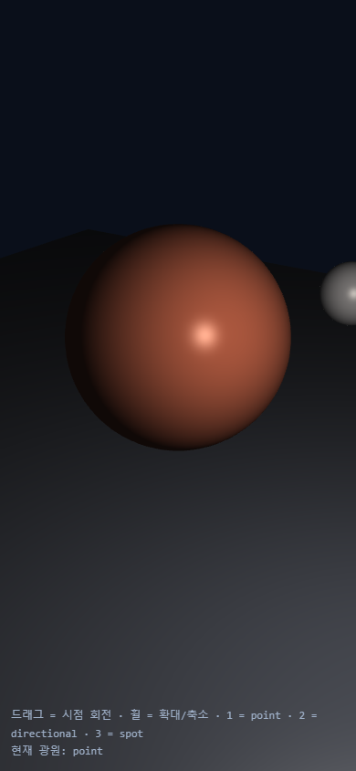

### AI 사용 기록

요청: 제공 구조를 유지하며 실습 1의 조명 단계를 순서대로 적용하고, 실행 캡처와 보고서를 정리하기.

반영한 수정: 확산광·환경광·정반사·감쇠 계산 추가, 등진 면의 정반사 차단, 법선 함수의 역전치 반환 순서 수정, 광원 종류 전환과 계산 설명 주석 추가.

## Task 2 - 새벽의 두 행성

### 의도

낮은 주황 point 광원과 약한 파란 directional 광원으로 두 행성의 새벽 분위기를 표현한다. 바닥과 구 두 개의 단순한 형상은 유지하고, 따뜻한 빛을 받는 면과 차가운 윤곽이 함께 보이도록 한다. 큰 행성은 거친 암석, 작은 행성은 매끈한 얼음으로 재질을 나누어 같은 장면에서 반짝임의 차이도 표현한다.

### 방법

광원은 두 개이며, 각각의 직접광을 계산한 뒤 더한다. 실습 1의 구 중심과 반지름을 사용하고, 이번에는 구와 광원을 움직이지 않아 키를 눌렀을 때 조명 변화만 비교할 수 있게 했다. 제공 예시의 `shade()`와 행렬·메시·입력 처리 구조를 사용하되, 네 암석과 움직이는 서치라이트 장면을 두 행성과 고정된 두 광원으로 바꾸었다.

| 광원 | 위치 또는 방향 | RGB 색 | 역할 |
| --- | --- | --- | --- |
| Point, 키 `1` | 위치 `(-4.0, 0.7, 3.0)` | `(1.0, 0.38, 0.12)` | 행성 중심보다 낮은 주황빛. 바닥과 행성의 옆면을 비추며 거리에 따라 약해진다. |
| Directional, 키 `2` | 광선 진행 방향 `(-0.6, -0.4, 0.5)` | `(0.12, 0.22, 0.42)` | 반대쪽에서 오는 약한 파란빛. 위치와 거리 감쇠가 없다. |

Directional의 표에 적힌 값은 **빛이 진행하는 방향**이다. 조명 계산의 `L`은 표면에서 광원으로 향하므로 `normalize(-uStarDir)`을 사용한다. Point는 표면마다 `uSunPos - vWorldPos`로 방향과 거리를 구한다. Point 위치에는 반지름 `0.22`, 색 `(1.0, 0.52, 0.22)`의 자체발광 구를 표시하고, 해당 광원을 끄면 함께 숨긴다. Directional에는 위치 표시 구가 없다.

| 물체 | 중심 / 반지름 | 물체색 RGB | shininess | ks |
| --- | --- | --- | --- | --- |
| 암석 행성 | `(0, 1.6, 0)` / `1.3` | `(0.80, 0.42, 0.32)` | `12` | `0.12` |
| 얼음 행성 | `(2.8, 1.6, 0)` / `0.42` | `(0.45, 0.65, 0.82)` | `96` | `0.55` |
| 바닥 | `y = 0`, 한 변 `16` | `(0.32, 0.34, 0.40)` | `8` | `0.04` |

`shininess`가 클수록 하이라이트가 좁아지고, `ks`는 정반사의 세기를 정한다. 암석은 낮은 지수와 작은 세기로 넓고 약한 반짝임을, 얼음은 높은 지수와 큰 세기로 좁고 강한 반짝임을 계산한다. 두 행성은 크기와 광원까지의 거리도 다르므로 화면의 모든 밝기 차이를 재질 하나의 효과로 해석하지 않는다.

### 조명 계산과 코드

```glsl
// 하나의 광원이 만드는 밝기 = diffuse + specular
vec3 shade(vec3 N, vec3 V, vec3 L, vec3 lightColor, float att) {
  float lambert = max(dot(N, L), 0.0);
  if (lambert <= 0.0) return vec3(0.0); // 등진 면의 직접광과 정반사는 0
  vec3 R = reflect(-L, N);             // 입사 방향을 반사
  float spec = pow(max(dot(R, V), 0.0), uShininess);
  return (uBaseColor * lambert + uKs * spec) * lightColor * att;
}
```

정규화한 `N`과 `L`의 내적은 입사각의 cos 값이다. 음수인 면에서는 직접광을 0으로 처리하여 다른 광원의 밝기를 빼지 않게 한다. `reflect(-L, N)`으로 구한 반사 방향이 시선 `V`와 가까울수록 정반사가 강하다. 확산광에는 물체색을 곱하지만 정반사에는 곱하지 않아 하이라이트가 광원의 색을 띤다.

```glsl
vec3 N = normalize(vNormal); // 보간 뒤 다시 단위 법선으로 만든다
vec3 V = normalize(uViewPos - vWorldPos);
vec3 color = 0.025 * uBaseColor; // 환경광은 광원 수와 관계없이 한 번

if (uOn1) {
  vec3 d = uSunPos - vWorldPos;
  float dist = length(d);
  color += shade(N, V, d / dist, uSunColor,
                 1.0 / (1.0 + 0.02 * dist * dist));
}
if (uOn2) {
  color += shade(N, V, normalize(-uStarDir), uStarColor, 1.0);
}
fragColor = vec4(color, 1.0);
```

Point의 감쇠는 실습 1과 같은 `1 / (1 + 0.02 * dist²)`이다. Directional은 모든 표면에서 같은 `L`과 감쇠 `1`을 사용한다. 환경광을 `shade()` 안에 넣으면 광원마다 중복해서 더해지므로 함수 밖에서 한 번만 더한다. 두 광원을 모두 꺼도 물체색의 `2.5%`에 해당하는 환경광은 남는다. 카메라와 표면 위치는 월드 좌표이고, 법선에는 실습 1에서 수정한 역전치 행렬을 사용한다. 최종 색은 합을 그대로 출력한다.

```js
const on = { l1: true, l2: true };
window.addEventListener('keydown', function (e) {
  if (e.key === '1') on.l1 = !on.l1;
  if (e.key === '2') on.l2 = !on.l2;
  paintHud();
});
```

각 키는 해당 상태만 반전시킨다. 두 상태를 각각 `uOn1`, `uOn2`로 전달해 광원을 독립적으로 켜고 끈다. 실습 1처럼 광원 종류 하나를 전환하는 방식과 다르다. 마우스 드래그는 시점 회전, 휠은 확대·축소다.

### 최종 결과와 광원별 비교

아래는 2026-10-08에 Microsoft Edge와 SwiftShader로 실제 WebGL2 화면을 실행해 얻은 캡처다. 화면은 `1440×1000`, DPR `1`, 카메라는 `yaw: 0.2, pitch: 0.25, dist: 11`이며, 모든 비교에서 카메라·물체·광원 위치를 유지했다. 화면을 편집하거나 합성하지 않았다.

**두 광원 켜짐:** 큰 행성에 주황빛이 보이고, 반대쪽과 작은 행성에는 약한 파란 윤곽이 보인다. 낮은 주황 광원은 바닥에도 따뜻한 밝기 분포를 만든다.

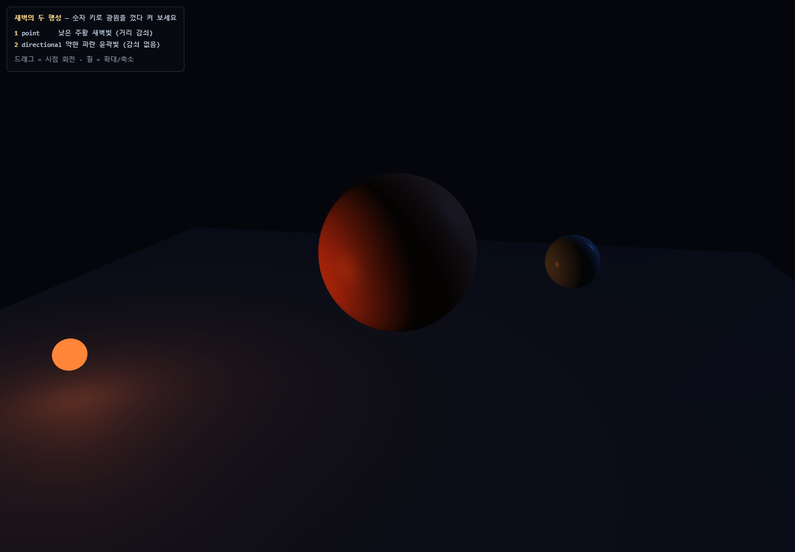

**Point 끔, directional 켜짐:** 주황빛과 광원 표시 구가 사라지고 파란 윤곽빛이 남는다. 바닥의 따뜻한 영역도 사라져 낮은 point가 맡던 역할을 확인할 수 있다.

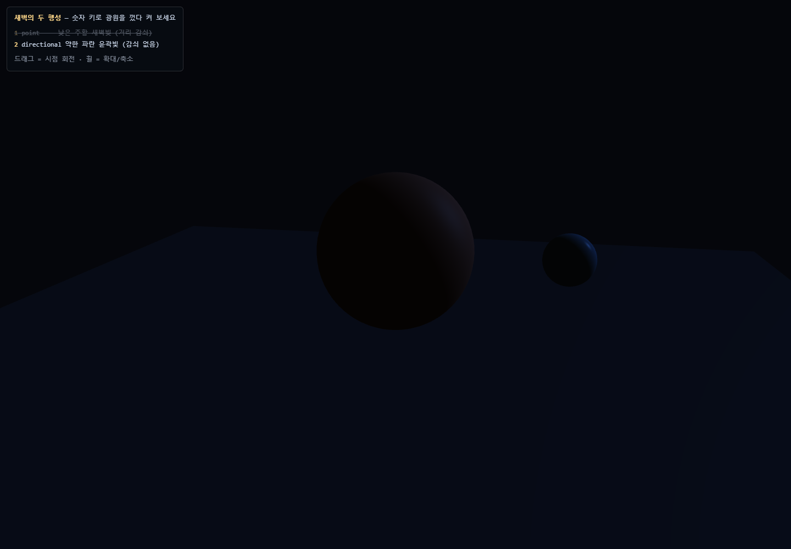

**Directional 끔, point 켜짐:** 파란 윤곽빛이 사라지고 주황빛을 받는 면과 작은 정반사 하이라이트가 남는다. 반대편은 약한 환경광만 받아 더 어둡다.

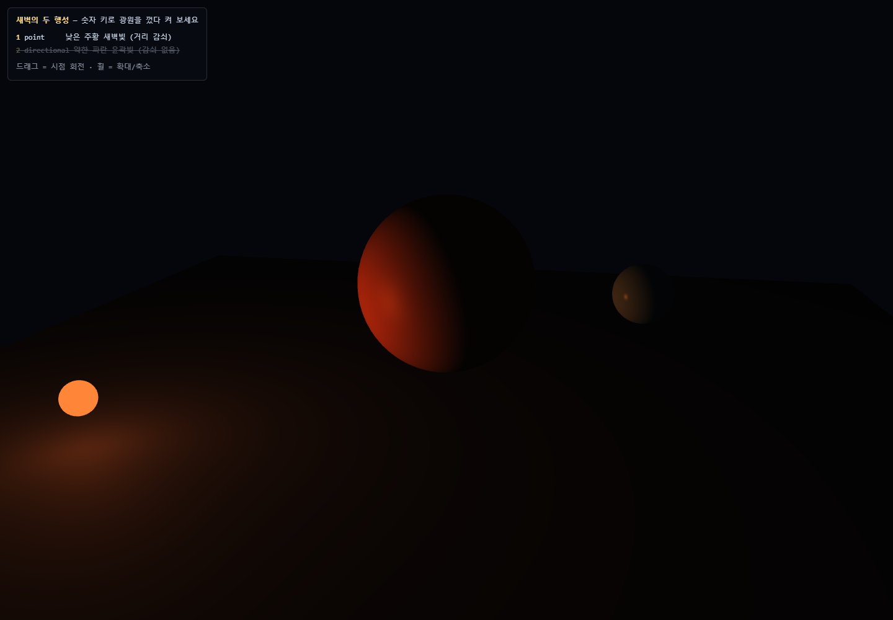

**둘 다 끔:** 직접광이 없고 작은 환경광만 남는다. 위 두 비교와 구별되는 보조 확인 화면이다.

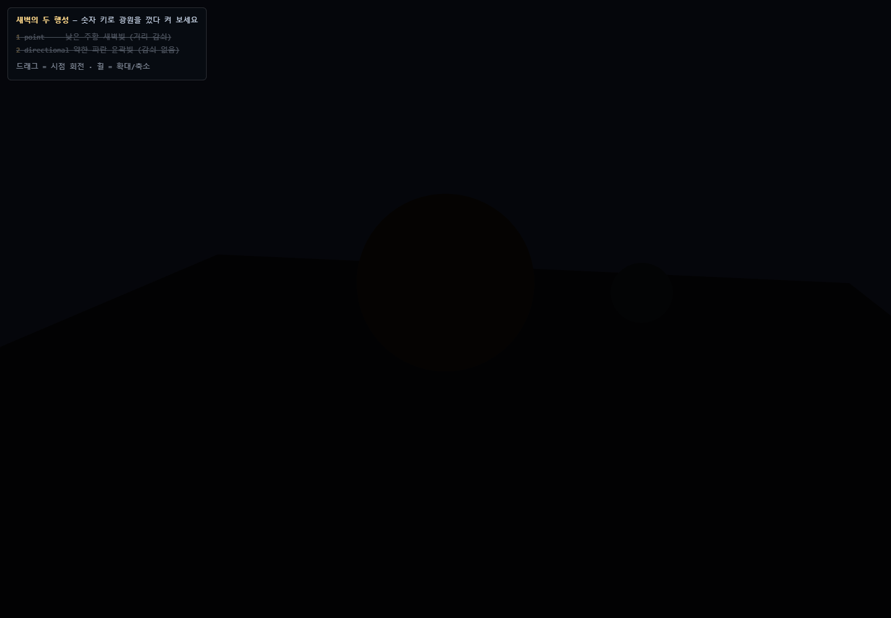

### AI 사용 기록

요청: 「새벽의 두 행성」을 낮은 주황 point와 약한 파란 directional로 표현하고, 제공 코드의 내부 주석과 계산의 의미·이유를 설명하는 주석을 유지하기.

반영한 수정: 광원 세 개를 두 개로 줄이고 움직이는 spotlight를 제거했다. 네 암석 대신 실습 1의 구 두 개를 배치하고 물체별 색·shininess·ks, 고정 광원 위치와 방향을 설정했다. 법선 행렬에 실습 1의 수정을 적용하고, 예시의 톤 매핑과 감마 보정 대신 조명 합을 그대로 출력하도록 했다.

### 실행 확인과 점검표

[검증 스크립트](verification/verify-task2.cjs)는 최종 `task2.html`을 그대로 실행한다. [검증 기록](verification/task2-results.json)에는 광원 상태와 uniform 값, 오류 검사와 카메라 입력 결과를 남겼다.

| 항목 | 근거와 상태 |
| --- | --- |
| 광원 2개 이상, 종류 2가지 이상 | Point와 directional이 동시에 켜진 최종 화면과 코드로 확인. |
| 광원별 다른 색 | 주황 `(1.0, 0.38, 0.12)`과 파랑 `(0.12, 0.22, 0.42)`. 각각 끈 화면의 차이 확인. |
| 물체별 다른 색과 shininess | 암석과 얼음의 물체색·지수 `12`, `96`을 코드와 위 표로 대조. |
| 광원을 독립적으로 켜고 끄기 | 실제 키 `1`, `2` 입력 후 네 조합의 상태·uniform 값과 서로 다른 화면을 확인. |
| 의도·방법, 최종 캡처와 광원별 끈 캡처 | 본문과 실제 캡처 4장으로 정리. |
| 셰이더·실행 오류 | 네 조합 모두 링크 정상, WebGL 오류 `0`, JavaScript·콘솔 오류 없음. |
| 카메라 조작 | 실제 드래그로 yaw `0.2 → 0.68`, pitch `0.25 → 0.15`, 휠로 거리 `11 → 9.68` 확인. |
