# 6주차 - PBR과 텍스처 매핑

- 이름: 이경훈
- 저장소: [KyungHoon03/catholic.cg.26.2](https://github.com/KyungHoon03/catholic.cg.26.2)
- 웹사이트: [컴퓨터그래픽스 포트폴리오](https://kyunghoon03.github.io/catholic.cg.26.2/)
- 로컬 실행: [Task 1](task1.html) · [Task 2](task2.html)
- GitHub Pages 실행 예정 주소: [Task 1](https://kyunghoon03.github.io/catholic.cg.26.2/week6/task1.html) · [Task 2](https://kyunghoon03.github.io/catholic.cg.26.2/week6/task2.html)
- 수업: [6주차 PBR과 텍스처 매핑](https://cg.catholic.ac.kr/~mgchoi/CG/weeks/week06/)

> 작성 상태: 실습 1의 TODO 1~5와 필터링 비교, 실습 2를 로컬에서 구현·검증했다. 직접 화면을 보며 확인한 내용과 AI 보조 캡처·측정은 따로 정리했다. 수식 전체를 혼자 설명하는 연습과 업로드·공개 실행·제출 확인은 남아 있다. [제출 전 확인표](review.md)에 남은 작업을 정리했다.

## Task 1 - 같은 물건이 다른 재료로 보이게 만들기

### 의도와 방법

제공된 `week06-material-starter.zip`의 큐브·카메라·UI·텍스처 로딩 구조를 유지하고 `task1.js`의 TODO를 순서대로 채웠다. 색 맵, D·F·G PBR, ARM, normal map, 환경 반사를 적용했다. 공용 `demo.js`, `demo.css`와 텍스처·출처 기록은 제공 파일을 사용했다.

### 0단계 - 회색 큐브

색 맵을 연결하기 전에는 `base = uTint`로 큐브 전체에 같은 색을 사용한다. 정점 위치·법선·UV와 Phong 조명은 이미 제공되어 있다.

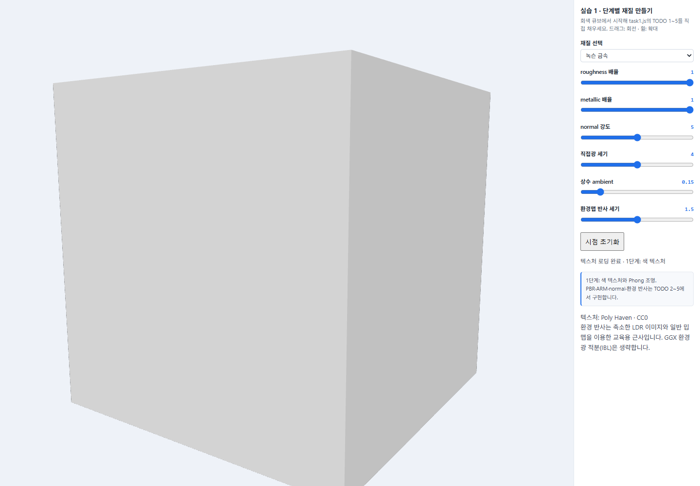

이 비교 화면은 처음 1단계까지 진행했을 때 색 맵 대입 한 줄만 제외해 시작 상태의 셰이더를 재현한 실제 실행 캡처다. 오른쪽 상태 안내는 1단계 문구가 유지되며, 시작 ZIP 원본의 안내 화면 전체를 캡처한 것은 아니다. 이후 단계에서도 이 캡처는 보존했다.

### 1단계 - 색 텍스처

`main()`의 `vec3 base=uTint;` 바로 뒤에 다음 한 줄을 추가했다.

```glsl
base = srgbToLinear(texture(uColor, vUV).rgb) * uTint;
```

`vUV`는 정점의 UV가 삼각형 안에서 보간된 주소다. `texture()`로 그 위치의 색을 읽고, JPEG의 sRGB 색을 `srgbToLinear()`로 선형화한 뒤 조명 계산에 사용한다. `uTint`는 제공값 `(0.6, 0.6, 0.6)`을 유지한 색 배율이다. 원본의 로더는 일반 RGBA로 업로드하므로 이 단계에서는 셰이더에서 선형화한다. 이후 sRGB 텍스처 형식으로 바꾼다면 중복 변환하지 않아야 한다.

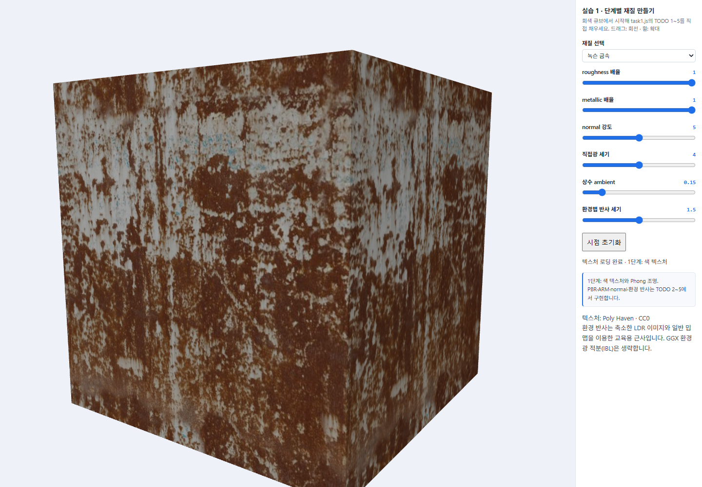

같은 시점의 큐브에 녹슨 금속의 갈색·회색 무늬가 나타난다. 메시를 바꾸지 않았으므로 삼각형 수와 외곽선은 그대로다. 이 1단계 화면에서는 녹과 금속이 색으로만 구별되며 위치별 roughness·metallic이나 법선 변화는 아직 적용하지 않았다. ARM과 normal은 수치 데이터이므로 색 선형화 함수를 적용하지 않는다.

### 2단계 - D·F·G PBR

`directPBR()`에 수업의 GGX·Schlick·Smith-Schlick 계산을 넣고, `main()`의 Phong 계산을 함수 호출로 교체했다. `N`, `V`, `L`은 모두 월드 공간의 단위 벡터이며 `H = normalize(V + L)`은 반사에 기여하는 미세면 방향이다.

```glsl
float a=rough*rough, a2=a*a;
float den=nh*nh*(a2-1.0)+1.0;
float D=a2/max(PI*den*den,1e-6);
float k=(rough+1.0)*(rough+1.0)/8.0;
float G=(nl/(nl*(1.0-k)+k))*(nv/(nv*(1.0-k)+k));
vec3 F0=mix(vec3(0.04),base,metal);
vec3 F=F0+(1.0-F0)*pow(1.0-vh,5.0);
vec3 kd=(1.0-F)*(1.0-metal);
return (kd*base/PI+D*G*F/max(4.0*nl*nv,1e-4))*nl*uPower;
```

`nh`, `vh`, `nl`, `nv`는 각각 음수를 0으로 제한한 `N·H`, `V·H`, `N·L`, `N·V`다. D는 미세면 방향 분포, F는 반사 비율, G는 미세면 사이의 가림을 나타낸다. roughness는 퍼짐을 조절한다. metallic이 0이면 F0는 0.04, 1이면 선형 base color다. 금속은 `kd`가 0이므로 확산 반사를 더하지 않는다. `nl` 또는 `nv`가 0 이하이면 직접광을 0으로 반환해 등진 면의 반사를 막았다. 작은 분모의 하한은 수치적 특이점을 막는다.

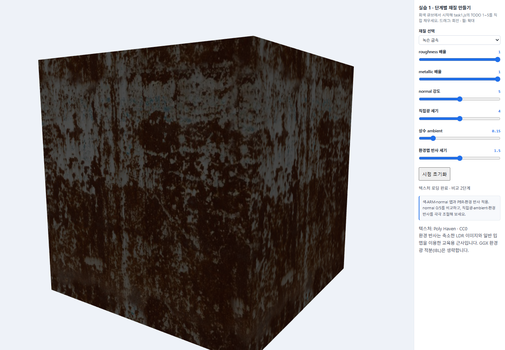

이 단계 비교에서는 아직 ARM을 읽지 않아 uniform roughness·metallic을 사용한다. 기본 metallic 배율이 1이므로 전체가 금속으로 계산된다. 다음 단계에서 텍셀별 값으로 바꾼다.

### 3단계 - ARM의 위치별 재질

```glsl
vec3 arm=texture(uARM,vUV).rgb;
ao=arm.r;
rough=max(arm.g*uRough,0.045);
metal=arm.b*uMetal;
```

ARM의 R은 AO, G는 roughness, B는 metallic이다. `uRough`와 `uMetal`은 원본 값에 곱하는 배율이며, 거칠기 하한 0.045는 D 계산의 특이점을 막는다. 녹은 금속 위에 있어도 유전체이므로 노출된 금속과 같은 metallic 1을 쓰지 않는다. 나무·돌의 B 채널은 0이어서 배율을 높여도 금속으로 바뀌지 않는다.

```glsl
vec3 color=directPBR(N,V,L,base,rough,metal);
vec3 F0=mix(vec3(0.04),base,metal);
color+=uAmbient*ao*(base*(1.0-metal)*(1.0-F0)+F0);
```

AO는 직접광이 아닌 위의 상수 간접광과 아래 환경 반사에만 곱했다. 환경 반사 전체에 AO를 곱하는 것은 수업의 교육용 근사다. 이 ambient는 환경 이미지와 별개이며, 금속에도 정반사 근사 성분이 남는다.


### 4단계 - normal map과 TBN

```glsl
if(uNormalStrength>0.0){
 vec3 dp1=dFdx(vP), dp2=dFdy(vP);
 vec2 du1=dFdx(vUV), du2=dFdy(vUV);
 vec3 T=cross(dp2,N)*du1.x+cross(N,dp1)*du2.x;
 vec3 B=cross(dp2,N)*du1.y+cross(N,dp1)*du2.y;
 float inv=inversesqrt(max(max(dot(T,T),dot(B,B)),1e-8));
 vec3 mapN=texture(uNormal,vUV).xyz*2.0-1.0;
 mapN.xy*=uNormalStrength;
 N=normalize(mat3(T*inv,B*inv,N)*normalize(mapN));
}
```

`dFdx/dFdy`는 이웃 프래그먼트 사이의 위치·UV 변화를 구한다. 여기에서 표면의 접선 T와 종법선 B를 만들고, `RGB*2-1`로 복원한 접선 공간 법선을 TBN 기저로 월드 공간에 옮긴다. `inv`는 제공된 계산 방식대로 두 접선의 큰 길이를 기준으로 공통 배율을 정한다. `normalStrength`는 법선의 xy 성분에 곱하며 0이면 기하 법선을 그대로 쓴다. 마지막에 다시 정규화한다.


최종 5단계 상태에서도 같은 시점에서 normal 강도 0과 5를 비교했다. 메시와 실루엣은 같고 조명에 사용하는 방향만 달라진다.

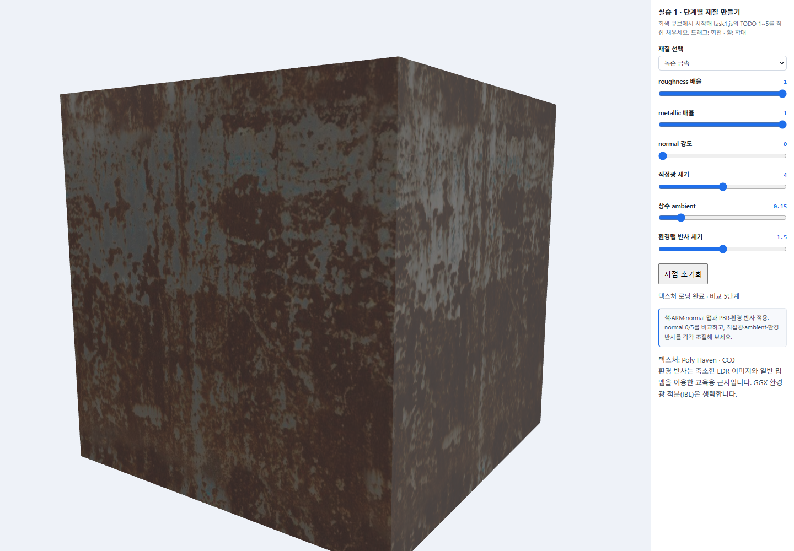


### 5단계 - 환경 이미지 반사

```glsl
vec3 reflected=reflect(-V,N);
vec2 envUV=vec2(atan(reflected.z,reflected.x)/(2.0*PI)+0.5,
                asin(clamp(reflected.y,-1.0,1.0))/PI+0.5);
vec3 envColor=srgbToLinear(textureLod(uEnv,envUV,rough*7.0).rgb);
color+=uEnvPower*ao*envColor*F0;
```

`-V`는 눈에서 표면으로 들어오는 방향이고 `reflect()`의 결과를 경도·위도에 해당하는 UV로 바꾼다. roughness가 클수록 LOD 값이 커져 해상도가 낮은 밉맵을 조회하므로 반사가 흐려진다. 이는 일반 밉맵을 이용한 근사이며 GGX로 사전 필터링한 정밀 IBL은 아니다. 색 이미지인 환경맵은 선형화하고, 반사 세기 `uEnvPower`는 `uAmbient`와 따로 조절한다. 파노라마의 위아래 경계는 `CLAMP_TO_EDGE`로 설정했다.


직접광과 ambient를 0으로 둔 상태에서 환경 반사 세기 0과 2를 비교했다. 모두 0이면 큐브 표면이 검게 보이고 환경 반사만 켜면 이미지 반사가 남는다. 환경 반사를 다시 0으로 하고 ambient만 0.5로 올리면 상수 간접광만 남는다.

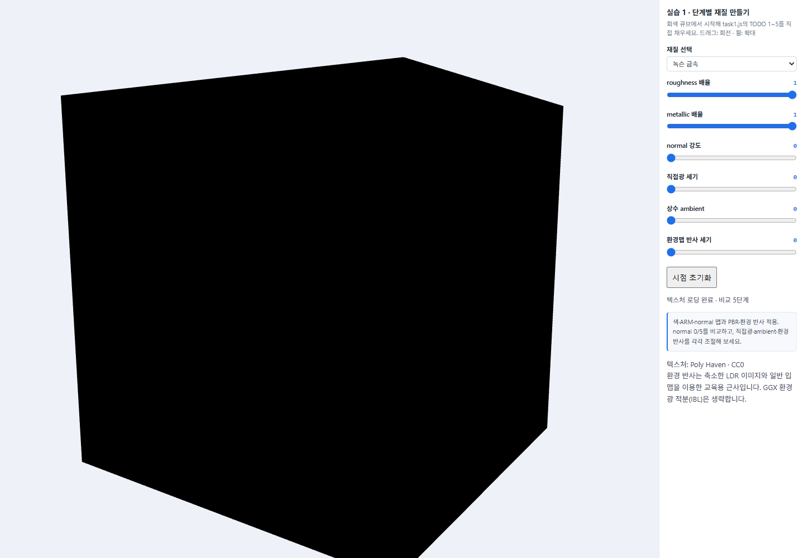
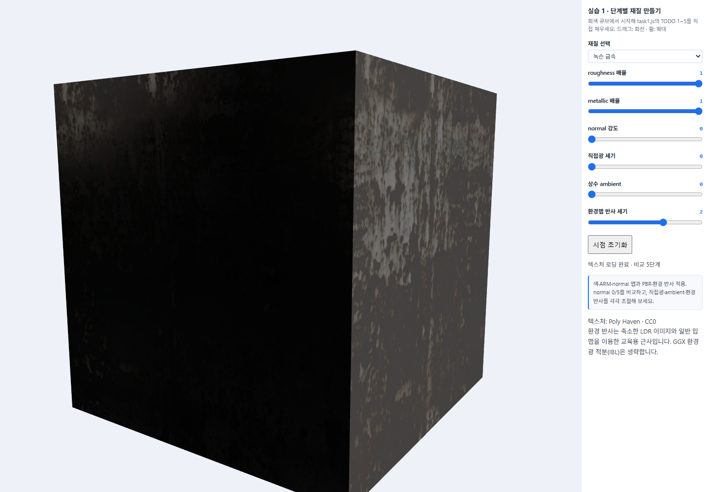
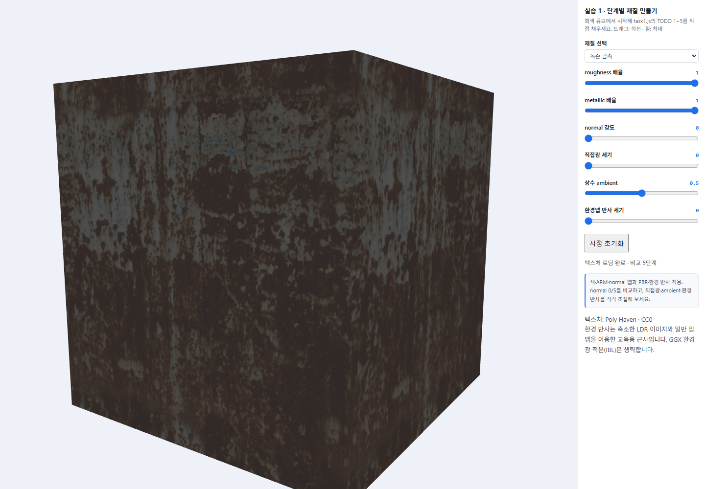

### 재질과 배율 비교

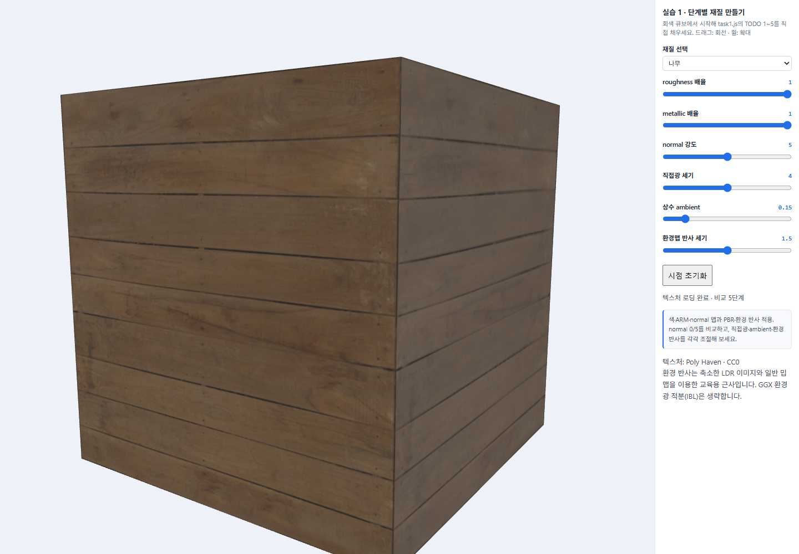
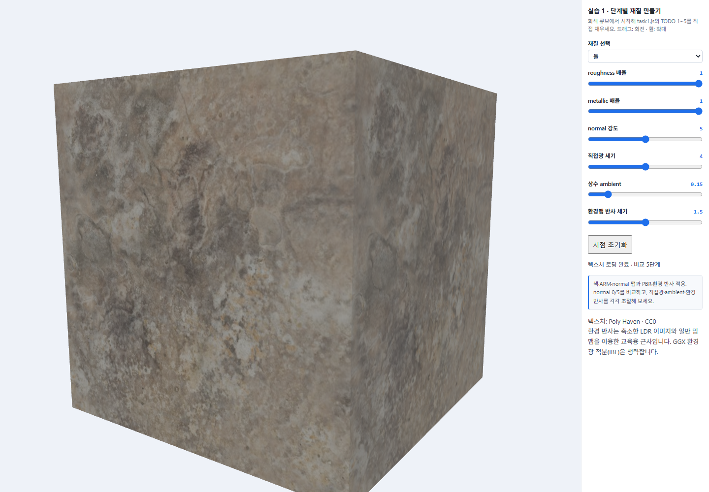


직접광만 켜고 normal 강도를 0으로 둔 상태에서 roughness 배율 0.15와 1, metallic 배율 0과 1도 비교했다. ARM을 사용하므로 roughness 0.15는 모든 텍셀의 거칠기를 0.15로 고정한다는 뜻이 아니며 `max(arm.g * 0.15, 0.045)`다.

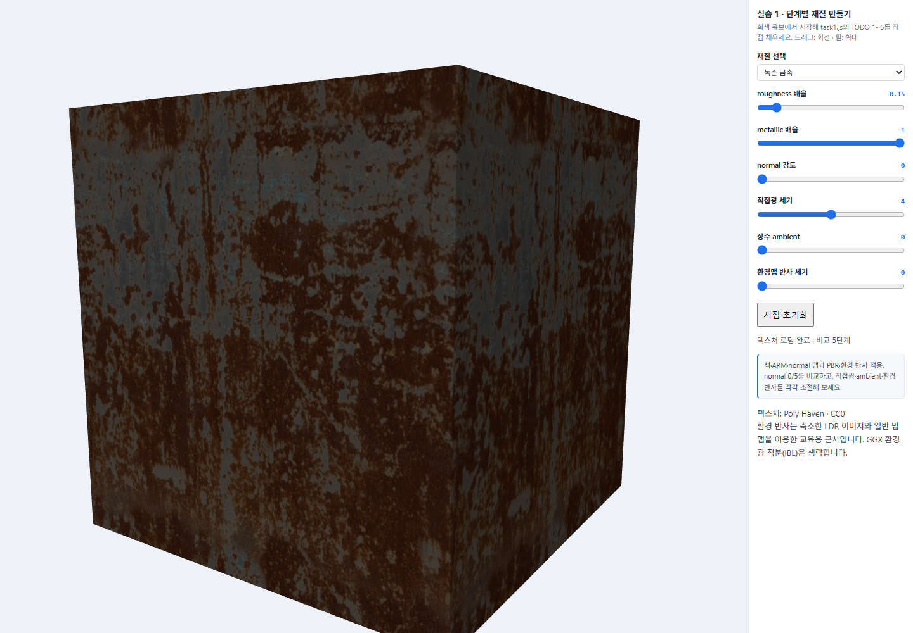
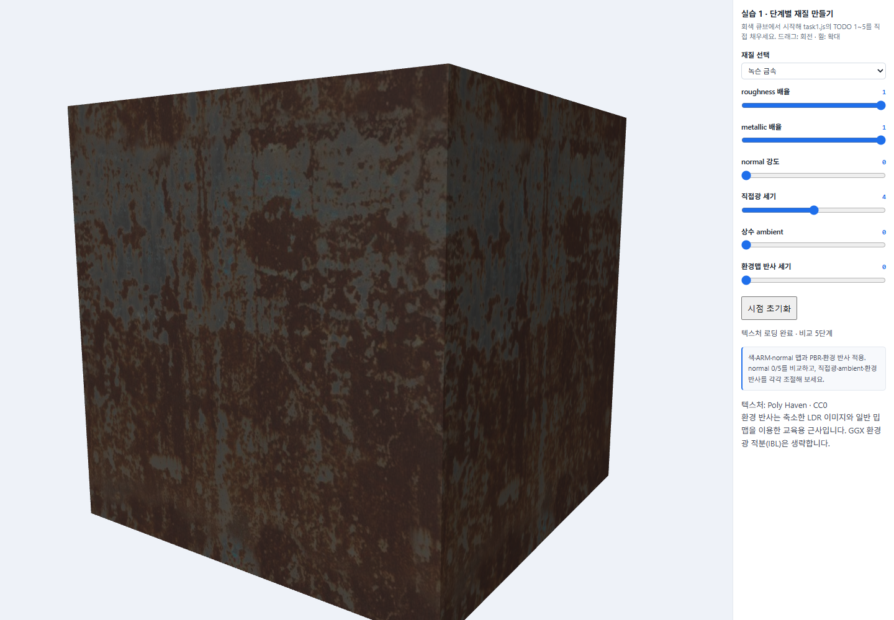
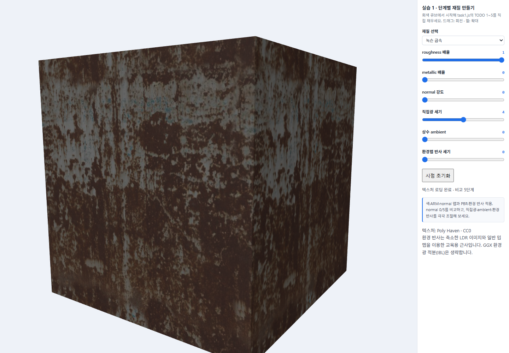


### 6단계 - 필터링 비교

수업의 [필터링 예제](https://cg.catholic.ac.kr/~mgchoi/CG/demos/d06-texture.html)를 사용했다. [로컬 검증용 사본](verification/d06-texture-reference.html)은 원본 HTML의 공용 `demo.js`·`demo.css` 주소만 `../demo.js`·`../demo.css`로 바꾸었고, 예제의 메시·셰이더·UI·필터 계산은 수정하지 않았다. 직접 제작한 과제 코드와 구분한다. 외부 이미지 없이 256×256 체크무늬를 절차적으로 만든 수업 예제다.

먼저 예측은 LINEAR가 한 레벨의 주변 텍셀을 섞어 경계를 부드럽게 하지만 큰 축소 영역에는 충분하지 않고, LINEAR_MIPMAP_LINEAR는 축소된 밉맵도 사용해 먼 곳의 고주파 무늬를 줄인다는 것이다. 2026-10-15, Edge headless / SwiftShader, 1440×1000, DPR 1에서 카메라 이동을 끄고 높이 1.2, UV 반복 16, MAG=LINEAR, REPEAT, 비등방성 1×, 먼 곳 어둡게 켜짐을 유지해 MIN_FILTER만 바꾸었다.

| 축소 필터 | 실제 캡처와 관찰 |
| --- | --- |
| NEAREST | [캡처](images/filter-nearest.png). 먼 곳의 반복 무늬가 가는 띠와 불규칙한 패턴으로 보임 |
| LINEAR | [캡처](images/filter-linear.png). 가까운 경계는 부드럽지만 먼 곳에 잔무늬가 남음 |
| LINEAR_MIPMAP_LINEAR | [캡처](images/filter-linear_mipmap_linear.png). 먼 곳의 작은 무늬가 더 고르게 섞여 보임. 원본에 없던 세부를 복원한 것은 아님 |

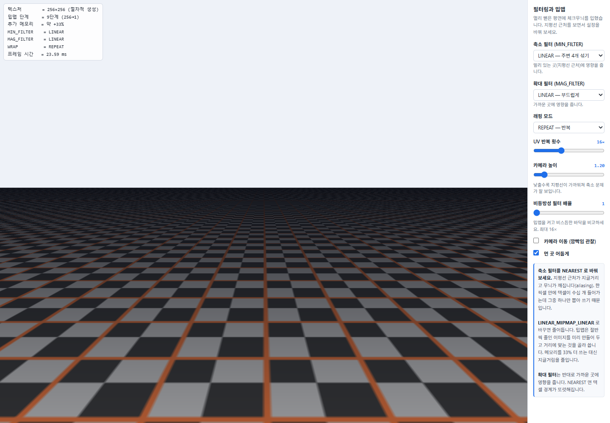


밉맵은 256→128→…→1의 9단계를 만들고 전체 메모리는 기본 레벨의 약 4/3이다. 레벨 선택은 단순히 거리만 쓰는 것이 아니라 화면에서의 UV 변화율에 따른 텍셀 footprint로 정한다. 확대는 원본에 없는 세부를 만들 수 없고, 축소는 여러 텍셀을 화면 픽셀 하나로 요약해야 하므로 서로 다른 문제다. MAG_FILTER에는 NEAREST 또는 LINEAR를 사용한다.

이어서 MIN=LINEAR_MIPMAP_LINEAR, 높이 0.5, 반복 32를 고정하고 비등방성만 1×·8×로 비교했다. 실행 기기의 확장 상한은 16×였고 실제 설정값도 1·8로 확인했다. 8×에서는 비스듬한 바닥의 중간 거리 격자와 주황 선이 더 또렷하게 이어졌다. 길쭉한 픽셀 footprint에 여러 위치의 샘플을 사용하는 효과이며 항상 모든 깜빡임을 없애는 보장은 아니다.

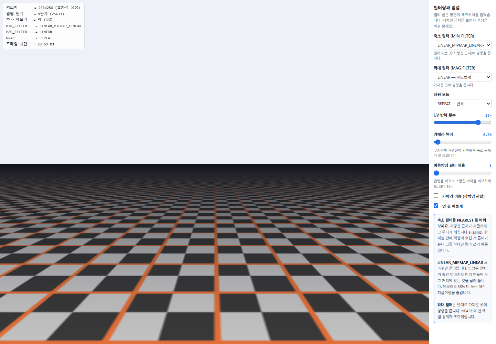
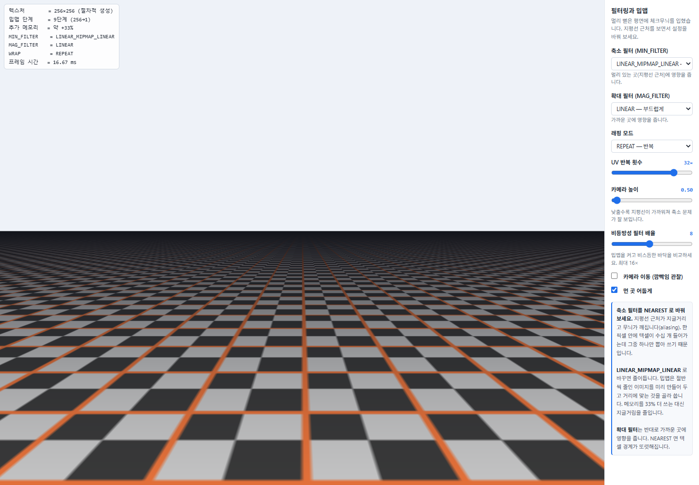

카메라 이동도 켜서 서로 다른 시점의 프레임과 VP 행렬 변화를 확인했다. [실행 전 프레임](images/filter-moving-before.png)·[이후 프레임](images/filter-moving-after.png)은 실제 실행 기록이지만, 두 정지 캡처만으로 시간적 깜빡임의 정도나 성능 우열을 수치화하지 않는다. 화면의 프레임 시간 표시는 소프트웨어 렌더러·자동화 환경의 순간값이므로 성능 결론으로 사용하지 않았다.

[검증 스크립트](verification/verify-filtering.cjs)·[검증 결과](verification/filtering-results.json)에 7개 조건과 실제 GL 필터값, 카메라 행렬, 픽셀 해시를 기록했다. 세 축소 필터의 캔버스 픽셀이 달랐고 셰이더 링크·WebGL·JavaScript·콘솔 오류는 없었다. 위 예측·캡처 관찰과 측정은 AI 보조 검증이다. 직접 화면을 보며 느낀 차이는 아래에 따로 정리했다.

### 직접 관찰한 결과 - 실습 1

2026-10-15에 로컬 실행 화면에서 설정을 바꾸며 비교했다. 이때는 새 캡처를 저장하지 않았고, 위 PNG는 AI 보조 실행에서 얻은 화면이다. 직접 조작한 최종 슬라이더 값과 시점은 따로 기록하지 않았다.

| 비교 | 화면에서 본 변화 | 정리 |
| --- | --- | --- |
| normal 강도 변경 | 명암은 변하지만 외곽선은 그대로인 것 같았다. | 표면 명암 변화와 외곽선 유지를 확인했다. 법선맵은 조명 방향을 바꾸며 정점 위치는 바꾸지 않는다. |
| 환경 반사 | 처음에는 반사가 남는지 눈으로 잘 모르겠었다. 조명 조건을 분리하고 roughness 배율을 낮춰 비교하니 대비가 조금 더 커져 보였다. | 풍경이 거울처럼 선명하게 보인 것은 아니지만, 조건을 분리하니 밝기와 대비의 차이는 느낄 수 있었다. |
| 필터링 | LINEAR와 밉맵 필터를 비교했지만 뚜렷한 차이를 모르겠었다. NEAREST와 밉맵을 비교하는 조건에서도 차이를 구별하기 어려웠다. | 자동 검증에서는 픽셀 값이 달랐지만 직접 보는 화면에서는 그 차이를 확실히 느끼지 못했다. |

필터링 차이를 구별하지 못한 정확한 원인은 확인하지 못했다. 화면 크기나 시점 때문이라고 단정하기는 어렵다. 밉맵이 축소된 무늬를 평균 내어 읽는다는 원리는 정리했지만, 카메라 이동이나 비등방성의 효과까지 직접 구분해 보지는 못했다.

### 실행 확인

2026-10-15에 Microsoft Edge headless와 SwiftShader로 HTTP 실행했다. 비교 캡처는 `1440×1000`, DPR 1, 제공 초기 시점 `dist: 3.7, pitch: 0.15`를 사용했다. 단계 2~5 비교는 같은 기본 조명 설정이며, 배율·조명 분리 비교는 앞서 명시한 슬라이더만 바꾸었다. 이미지를 합성하지 않았다.

[검증 기록](images/task1-check.json)에는 두 단계의 셰이더 링크 성공과 렌더링 호출, WebGL 오류 없음, JavaScript 오류 없음, HTTP 로딩 실패 없음을 기록했다. 세 재질 선택과 드래그·휠 입력 후에도 렌더링 오류가 없음을 확인했다. 카메라 이동량을 수치로 측정하거나 모든 슬라이더 효과를 검증한 것은 아니다.

위 기록은 최초 0·1단계 확인이다. 이후 [2~5단계 검증 스크립트](verification/verify-task1.cjs)와 [실행 기록](verification/task1-results.json)을 추가했다. 최종 코드에서 이후 단계의 블록만 제외해 2·3·4단계를 재현하고, 5단계는 최종 셰이더를 사용한다. 비교 화면의 상태 문구만 해당 단계로 표시하며 최종 파일을 바꾸지 않는다.

2~5단계, normal 0·5, roughness 0.15·1, metallic 0·1, 전체 조명 끄기·환경 반사만·ambient만, 세 재질과 카메라 조작의 17개 조건을 실행했다. 최종 검증은 모두 통과했고 셰이더 링크 실패, WebGL·JavaScript·콘솔 오류와 HTTP 요청 실패는 없었다. 비교 해시는 UI를 제외하고 WebGL 캔버스의 RGB 픽셀에서 계산해 조작별 렌더링 변화를 검사했다. 자동 검증의 통과와 코드를 이해하고 설명하는 것은 별개로 두었다.

| 항목 | 현재 상태 |
| --- | --- |
| 0단계 HTTP 실행 | 회색 큐브 렌더링 확인 |
| TODO 1 색 텍스처 | 구현 및 같은 시점 비교 캡처 확인 |
| TODO 2 D·F·G PBR | 구현. roughness·metallic 배율별 화면 변화 확인 |
| TODO 3 ARM | 구현. R·G·B를 AO·roughness·metallic에 연결 |
| TODO 4 normal map / TBN | 구현·AI 보조 비교 캡처. 직접 비교해도 명암은 달라지고 외곽선은 유지됨 |
| TODO 5 환경 반사 | 구현·조명 분리 검증. 직접 조건을 나누어 비교하니 대비 변화가 보임 |
| 필터링 두 설정 비교 | 수업 예제 실행·AI 보조 캡처·설명 있음. 직접 비교에서는 차이를 뚜렷하게 구별하지 못함 |
| 전체 조명 끄기 | 직접광·ambient·환경 반사 0 비교 |
| 수식과 코드를 스스로 설명하기 | 화면 변화는 확인했다. D·F·G·TBN 등 수식 전체를 혼자 설명하는 연습은 더 필요함 |

### 이미지 출처와 라이선스

제공 텍스처는 Poly Haven의 CC0-1.0 자료다. 파일별 원본 주소와 축소·포맷 변환 기록은 [sources.json](assets/week06/sources.json)에 보존했다. 색·normal은 JPEG, ARM은 PNG이며 채널은 `R=AO`, `G=roughness`, `B=metallic`이다. 법선맵은 OpenGL 방향의 `nor_gl`이다. 환경 이미지는 `Studio Small 09`의 축소된 LDR JPG다.

### AI 사용 기록

제공 코드의 구조를 유지하면서 TODO 1~5를 채우는 데 AI의 도움을 받았다. 색·ARM·normal·환경맵 연결과 단계별 실행 검증, 캡처 정리에도 AI를 사용했다. 수업의 짧은 PBR 예시에는 등진 면의 조기 반환을 추가했고, 환경 파노라마의 상하 경계는 `CLAMP_TO_EDGE`로 설정했다. 처음에는 5단계까지 진행하고 필터링 비교가 남아 있어, 이후 수업 예제를 실행해 보완했다.

## Task 2 - 황토와 흑요석의 행성

### 의도와 설정

태양 가까이에서 적도 부근이 황토색의 거친 표면으로 바뀌고, 두 화산 지점에는 검고 매끈한 유리질 흔적이 넓어지는 행성으로 정했다. 태양과 행성 하나만 사용해 두 원인의 영향 위치와 반사 차이를 구별하도록 했다. 수업의 얼음·충돌 예시를 그대로 복제하지 않고 적도 띠와 화산 퇴적을 조합했다. 실제 기후·화산·흑요석 생성의 정밀 시뮬레이션은 아니며, 조건과 표면 재질을 연결하는 수업용 규칙이다.

| 원인 | 장면·표면에서 바뀌는 부분 | 색과 재질 값 |
| --- | --- | --- |
| 태양 접근 0~100 | 행성 중심 x가 3→1로 이동하고 태양빛 감쇠가 달라진다. 건조 띠가 적도에서 고위도로 넓어진다. | 선형 RGB `(0.48, 0.22, 0.055)`, roughness `0.95`로 혼합 |
| 화산 퇴적 0~100 | 행성 로컬 좌표의 두 지점에서 원형 흔적이 연속적으로 넓어진다. | 선형 RGB `(0.025, 0.035, 0.045)`, roughness `0.16`으로 혼합 |
| 기본 표면 | 제공된 돌 색·ARM·normal 맵을 사용한다. | 선형화한 돌색에 `(0.45, 0.65, 0.5)`를 곱한다. roughness는 ARM의 G, metallic은 B |

두 규칙은 각각 다른 입력만 사용한다. 태양 접근은 `uHeat`, 화산 퇴적은 `uDeposit`이며 JavaScript에서 슬라이더 값을 100으로 나누어 0~1로 전달한다. 두 마스크가 겹치면 나중에 적용한 화산 흔적이 우선한다.

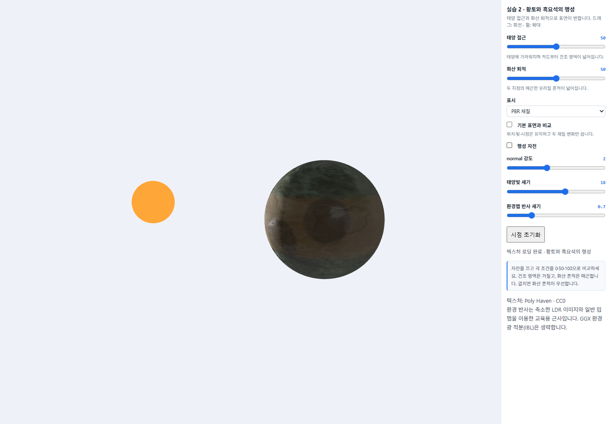

### 실습 1과 5주차 코드의 연결

완성한 `task1.html/js`를 `task2.html/js`로 복사해 시작했다. 실습 1의 색 공간 변환, D·F·G PBR, ARM, 화면 미분 TBN, normal map, 환경 반사 계산을 유지했다. 큐브 메시만 제공 공용 함수의 UV 구로 바꾸었다.

```js
const mesh=D.upload(gl,D.revolution(D.profiles.sphere(1,48),96));
```

5주차의 표면에서 point 광원으로 향하는 방향, 거리 감쇠, 자체발광 표시 방식도 참고했다. 태양 위치는 `(-2, 0, 0)`, 표시 구 반지름은 `0.45`다. 태양을 그릴 때는 `uSun=1`로 고정 색 `(1.0, 0.65, 0.22)`를 출력하고, 행성에는 태양을 point 광원으로 계산한다. 발광 표시 자체가 자동으로 주변을 비추는 것은 아니다.

행성 반지름은 1이다. 태양 접근 0·50·100에서 중심은 `(3,0,0)`·`(2,0,0)`·`(1,0,0)`, 태양과의 중심 거리는 5·4·3이다. 실제 표면점의 거리는 각 프래그먼트에서 따로 구한다.

```glsl
vec3 L=normalize(uLight-vP);
float lightDistance=length(uLight-vP);
float attenuation=1.0/(1.0+0.18*lightDistance*lightDistance);
vec3 color=directPBR(N,V,L,base,rough,metal)*attenuation;
```

태양빛 기본 세기는 18, 상수 ambient는 0.12, 환경 반사 세기는 0.7이다. 태양빛 세기와 환경 반사는 UI에서 조절한다. 행성은 y축으로 초당 0.22라디안 자전하며, 비교할 때는 체크를 꺼 멈춘다. 모델 행렬은 이동·자전 순서로 구성하고 버텍스 셰이더에서 위치와 법선을 월드 공간으로 변환한다.

```glsl
vec4 world=uModel*vec4(aPos,1.0);
vP=world.xyz;
vLocal=aPos;
vN=mat3(transpose(inverse(uModel)))*aNormal;
gl_Position=uVP*world;
```

조명에는 월드 위치와 월드 법선을, 마스크에는 회전 전 `vLocal`을 사용한다. 그래서 자전할 때 표면 무늬도 행성과 함께 돌고, 광원 방향은 월드에 남는다.

### 첫째 규칙 - 적도에서 넓어지는 건조 영역

코드 위치: [task2.js의 dryRegion()과 main()](task2.js).

```glsl
float dryRegion(vec3 local,float heat){
 float latitude=abs(normalize(local).y);
 float boundary=mix(0.08,0.85,heat);
 return heat*(1.0-smoothstep(boundary-0.06,boundary+0.06,latitude));
}
```

`latitude`는 적도에서 0, 양 극점에서 1이다. 실제 위도 각도 자체가 아니라 정규화한 로컬 y값의 절댓값이다. 태양 접근이 커지면 경계가 0.08에서 0.85로 올라가므로, `latitude`가 작은 적도 쪽에서 시작한 띠가 양쪽 극 방향으로 넓어진다. ±0.06 구간은 부드러운 경계이고 맨 앞의 `heat`는 적용 강도도 함께 바꾼다. 0에서는 마스크가 모두 0, 50에서는 띠 안쪽도 최대 0.5, 100에서는 최대 1이다.

화산 퇴적을 0으로 고정하고 같은 카메라·회전각에서 태양 접근만 바꾸었다. 행성 위치가 달라지는 것은 첫 조건에 연결된 동작이다.

| 태양 접근 | PBR 표면 | 흑백 건조 마스크 |
| --- | --- | --- |
| 0 | [실행 화면](images/task2-heat0.png) | [마스크 0](images/task2-dry-mask0.png) |
| 50 | [실행 화면](images/task2-heat50.png) | [마스크 50](images/task2-dry-mask50.png) |
| 100 | [실행 화면](images/task2-heat100.png) | [마스크 100](images/task2-dry-mask100.png) |

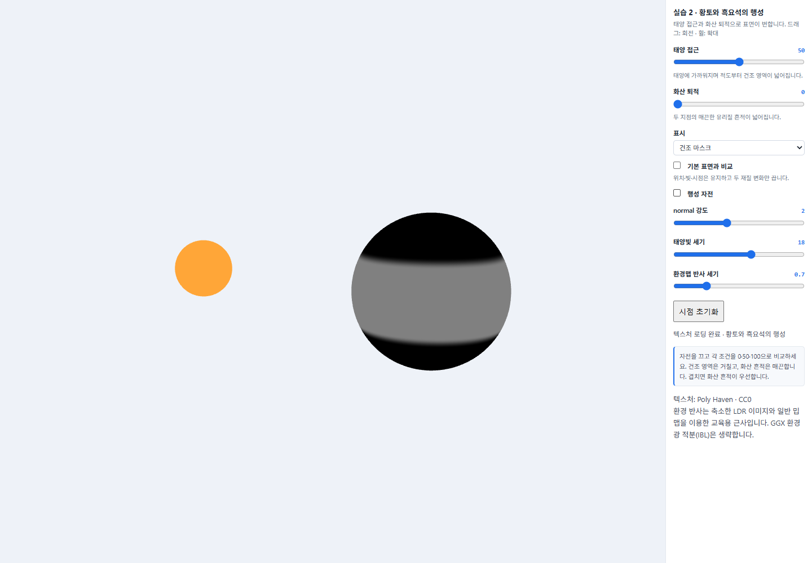

### 둘째 규칙 - 두 화산 지점의 퇴적 흔적

코드 위치: [task2.js의 volcanicRegion()과 main()](task2.js).

```glsl
float volcanicRegion(vec3 local,float amount){
 vec3 p=normalize(local);
 float d1=distance(p,normalize(vec3(0.35,0.15,1.0)));
 float d2=distance(p,normalize(vec3(-0.5,-0.25,0.9)));
 float radius=0.08+0.55*amount;
 return amount*(1.0-smoothstep(radius-0.04,radius+0.04,min(d1,d2)));
}
```

중심 두 개는 로컬 구 표면의 방향이다. `distance()`는 정규화한 구 위 두 점 사이의 직선거리이며 표면을 따라 잰 거리는 아니다. `min(d1,d2)`로 더 가까운 중심을 고르면 두 원형 영역을 합칠 수 있다. `radius`는 0.08~0.63으로 커지고 ±0.04 구간에서 부드럽게 섞는다. `amount`를 곱해 값 0에서는 흔적이 사라지고, 50에서는 최대 혼합 비율이 0.5가 된다. UV 이미지의 이음새에 원을 따로 붙이는 대신 로컬 3D 방향을 사용했다.

태양 접근을 50으로 고정하고 화산 퇴적만 0·50·100으로 바꾸었다. 행성 위치와 조명·카메라·회전각을 유지한 비교다.

| 화산 퇴적 | PBR 표면 | 흑백 화산 마스크 |
| --- | --- | --- |
| 0 | [실행 화면](images/task2-deposit0.png) | [마스크 0](images/task2-volcanic-mask0.png) |
| 50 | [실행 화면](images/task2-deposit50.png) | [마스크 50](images/task2-volcanic-mask50.png) |
| 100 | [실행 화면](images/task2-deposit100.png) | [마스크 100](images/task2-volcanic-mask100.png) |

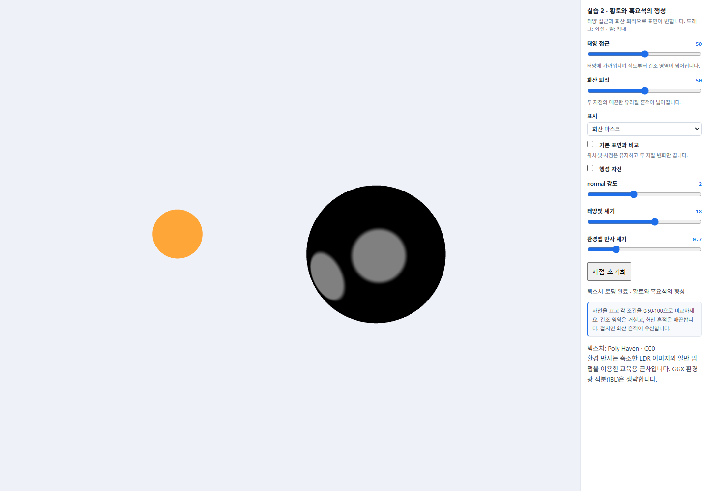

### 마스크를 색과 반사에 연결하기

```glsl
float dry=dryRegion(vLocal,uHeat);
float volcanic=volcanicRegion(vLocal,uDeposit);
if(uView==1){outColor=vec4(vec3(dry),1.0);return;}
if(uView==2){outColor=vec4(vec3(volcanic),1.0);return;}
base*=vec3(0.45,0.65,0.5);
if(uBaseline==0){
 base=mix(base,vec3(0.48,0.22,0.055),dry);
 rough=mix(rough,0.95,dry);
 base=mix(base,vec3(0.025,0.035,0.045),volcanic);
 rough=mix(rough,0.16,volcanic);
}
```

흑백 진단 화면은 조명·톤 매핑·sRGB 출력 변환 전에 마스크 숫자를 바로 출력한다. 기본 표면 비교 체크는 위 네 `mix`만 건너뛰므로 카메라·위치·빛·normal map은 그대로다. 마스크 계산 자체를 지우지는 않는다. 색과 roughness를 함께 바꾸고 그 결과를 기존 PBR 계산에 전달하므로 완성 텍스처를 교체하는 기능과 다르다.

두 조건을 모두 100으로 둔 비교에서 황토색 띠와 넓은 검은 흔적이 보인다. 검은 흔적에는 밝고 좁은 반사 부분이 나타나며 주변의 거친 황토색 영역과 구별된다. normal 강도 0·2 비교에서도 명암이 달라진다. 화면의 모든 밝기 차이를 roughness 하나의 효과로 해석하지 않는다.

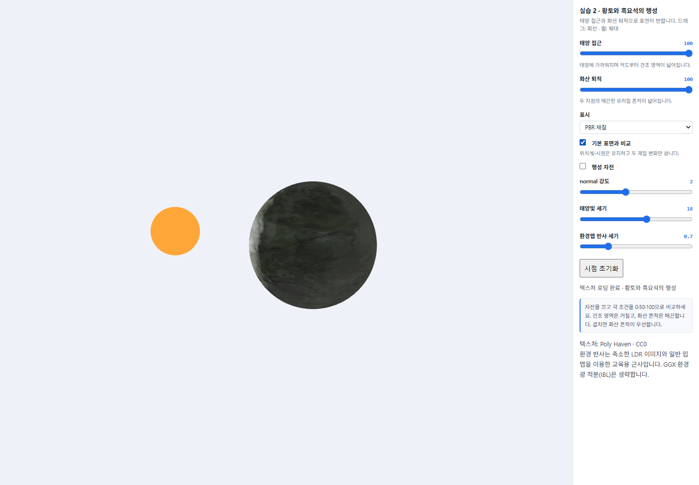


태양빛 세기를 4·30으로 바꾸어 같은 표면이 다른 조명에서 보이는 모습도 비교했다. 이 비교는 카메라와 재질을 유지하고 광원 세기만 바꾼 것이다.

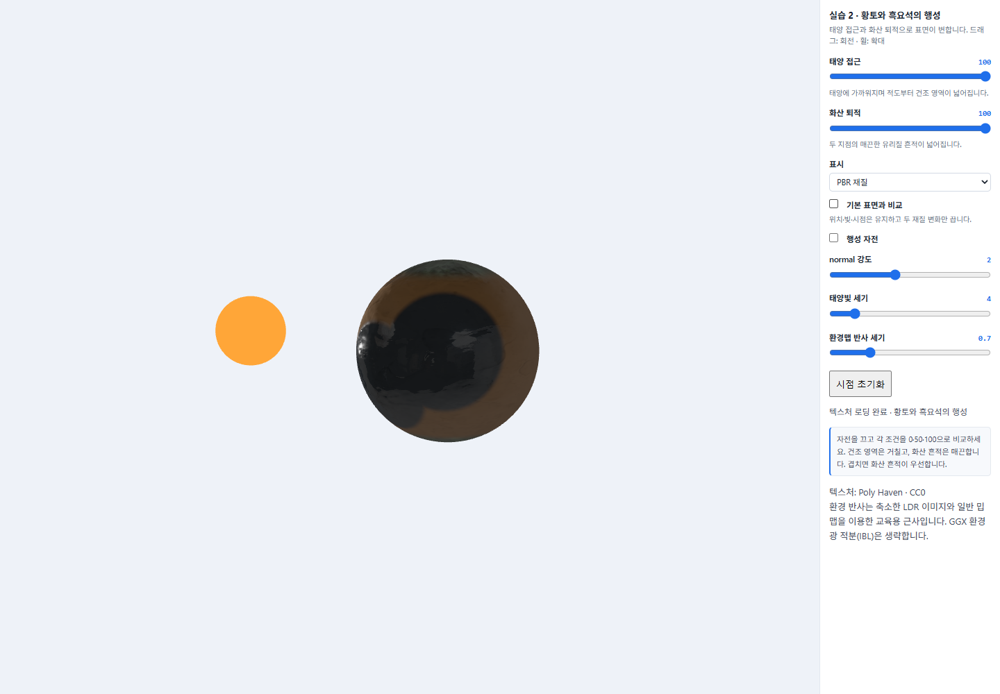
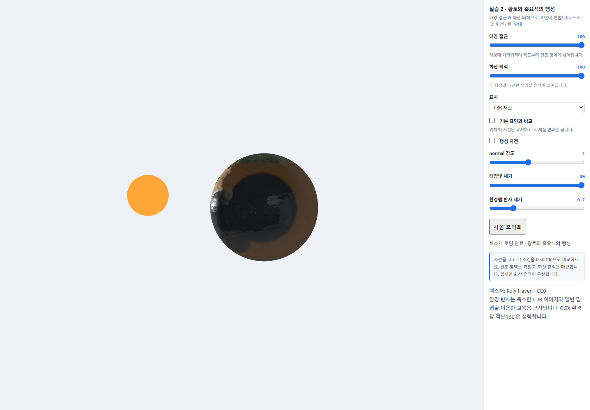

### 조작법과 검증

| 조작 | 동작 |
| --- | --- |
| 드래그·휠 | 카메라 회전·거리 조절 |
| 태양 접근 | 위치·감쇠·건조 범위 변경 |
| 화산 퇴적 | 두 화산 흔적의 크기·적용 강도 변경 |
| 표시 | PBR / 건조 마스크 / 화산 마스크 |
| 기본 표면과 비교 | 위치·빛을 유지한 채 색·roughness 변화만 끄기 |
| 행성 자전 | 켜기·정지. 조건 비교 전 정지 |
| normal 강도 / 태양빛 / 환경 반사 | 표면 명암·조명 확인 |

### 직접 관찰한 결과 - 실습 2

2026-10-15에 태양 접근, 화산 퇴적, 기본 표면 비교를 차례로 확인했다. 두 조건을 각각 0·50·100으로 비교하는 순서로 진행했으며, 직접 조작한 순간의 uniform 값이나 화면을 새로 저장하지는 않았다. 아래는 화면을 보며 확인한 내용이다.

| 비교 | 화면에서 본 변화 |
| --- | --- |
| 태양 접근 변경 | 행성이 이동하고 황토색 띠가 넓어지는 변화가 잘 보였다. |
| 태양 접근을 고정하고 화산 퇴적 변경 | 검은 흔적 두 곳이 넓어졌다. |
| 기본 표면 비교 | 행성 위치는 그대로이고 황토색 띠와 검은 흔적이 사라졌다 나타났다. |
| roughness 혼합 두 줄 | 건조 영역은 0.95 쪽으로 거칠게, 화산 흔적은 0.16 쪽으로 매끈하게 만든다는 역할과 뒤의 계산이 겹친 부분에 반영되는 순서는 대략 이해했다. |

```glsl
rough=mix(rough,0.95,dry);
rough=mix(rough,0.16,volcanic);
```

AI가 작성한 코드 중에서는 이 두 줄의 값과 순서를 살펴보았다. 기본 역할은 대략 이해했지만 `mix`의 모든 중간값이나 마스크 함수 전체를 혼자 설명하려면 더 연습해야 한다. 코드를 직접 바꾸었다가 복원하는 실험은 아직 하지 않았다. 두 흑백 마스크의 독립성은 아래 자동 검증으로 확인했으며, 직접 관찰에서는 표면의 영역 확대와 기본 전환을 중심으로 보았다.

### AI 보조 실행 검증

2026-10-15에 Microsoft Edge headless / SwiftShader, 1440×1000, DPR 1에서 최종 파일을 그대로 HTTP 실행했다. 위 조건 비교 캡처는 한 번 자전을 멈춘 뒤 카메라와 회전각을 유지했다. [검증 스크립트](verification/verify-task2.cjs)와 [실행 기록](verification/task2-results.json)에 25개 조건을 남겼고, 셰이더 링크 실패·WebGL 오류·JavaScript 및 콘솔 오류·HTTP 로딩 실패는 없었다.

두 마스크의 0·50·100에서 회색 픽셀 평균이 증가하는지 검사했다. 화산 값만 0→100으로 바꾼 건조 마스크의 캔버스 픽셀 해시는 동일했다. 기본/변화 비교에서는 행성 모델 행렬과 카메라가 같고 렌더링 픽셀은 달랐다. 자전 켜기에서는 모델 행렬이 변하고 끄면 유지됐다. 이 수치는 자동 검증 결과이며 직접 화면에서 느낀 차이와 구분했다.

390×844 세로 화면에서도 렌더링 오류가 없고 태양과 행성이 함께 보이는 캡처를 확인했다. 세로 화면에서는 시야각을 넓혀 가로 범위를 확보하므로 천체가 작게 보이고, 조작 패널은 아래로 스크롤해야 한다.

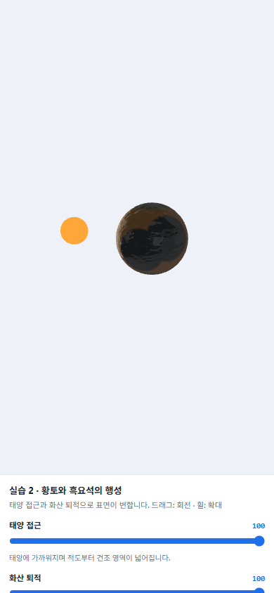

| 수업의 대면 확인 항목 | 코드·화면 근거와 현재 상태 |
| --- | --- |
| 태양·UV 행성·공전 또는 자전, PBR·normal | 구현. 실제 자전·정지와 normal 0·2의 차이 검증 |
| 태양계와 연결된 첫 조건 0·50·100 | 행성 x·광원 거리·건조 띠 동시 변경. 같은 시점의 세 화면 |
| 첫 조건 고정, 독립적인 둘째 조건 | 태양 접근 50 고정, 화산 퇴적 세 값. 건조 마스크 동일성 검사 |
| 색 이외의 roughness 또는 metallic 변화 | 두 마스크에 각각 0.95·0.16의 roughness 연결. 기본/변화·광원 세기 비교 |
| 마스크 1·2를 흑백으로 따로 보기 | 표시 메뉴와 두 함수 구현, 단계별 캡처 |
| 두 계산과 겹침 우선순위를 스스로 설명 | roughness 혼합 두 줄의 기본 역할과 순서는 대략 이해함. 수식 전체 설명은 더 연습할 필요가 있음 |
| AI 제안 중 확인·수정한 부분 | roughness 0.95·0.16과 적용 순서를 검토함. 직접 코드를 수정하지는 않음 |

### AI 사용 기록과 남은 확인

행성 설정과 두 변화 규칙의 설계, 실습 1 코드의 확장, 자동 실행 검증과 캡처 정리에 AI를 사용했다. 로컬 위치와 월드 위치의 분리, 역전치 법선 변환, point 광원의 `uLight-vP` 방향과 거리 감쇠, 기본 비교에서 위치와 광원을 유지하는 분기는 AI가 구현한 부분이다.

직접 실행에서는 영역 확대와 기본 표면 전환을 확인했고, 코드에서는 roughness를 0.95·0.16으로 섞는 두 줄과 적용 순서를 살펴보았다. 기본 역할은 대략 이해했지만 전체 수식을 혼자 설명하는 것은 더 연습해야 한다. 직접 코드를 수정한 부분은 아직 없다.

텍스처는 실습 1과 같은 Poly Haven CC0 돌의 Diffuse·ARM·`nor_gl` 및 환경 JPG다. [sources.json](assets/week06/sources.json)의 출처·라이선스를 유지했다. 새 외부 이미지나 라이브러리를 추가하지 않았다. GitHub 업로드, 두 Pages 주소의 공개 실행 확인, 사이버캠퍼스 제출은 아직 진행하지 않았다.

## 제출 상태

주차 9-3은 저장소 주소 제출을 안내하며, 전체 [과제와 평가](https://cg.catholic.ac.kr/~mgchoi/CG/assignments/)는 저장소·공개 URL·화면 캡처와 README의 작업·막힌 점 2~3줄 기록, 시크릿 창의 공개 실행 확인도 요구한다. 두 안내를 함께 충족하도록 준비했다. 코드·보고서·비교 PNG·출처 기록과 README를 로컬에 준비했고 보고서의 상대 링크도 확인했다.

아직 커밋·푸시·공개 배포·사이버캠퍼스 제출은 하지 않았다. 2026-10-15 푸시 전 점검에서 두 Pages 주소는 HTTP 404였다. 푸시 후 배포가 끝나면 시크릿 창에서 다시 열어 확인할 예정이다. 정확한 마감은 사이버캠퍼스 과제 공지를 확인해야 한다. 공개 일반 규정은 다음 주 화요일 수업 시작 전이며 과제별 공지가 우선한다. [제출 전 확인표](review.md)에 제출할 주소와 캡처를 정리했다.
