# 7주차 - 전역 조명과 ray tracing·path tracing

- 이름: 이경훈
- 저장소: [KyungHoon03/catholic.cg.26.2](https://github.com/KyungHoon03/catholic.cg.26.2)
- 웹사이트: [컴퓨터그래픽스 포트폴리오](https://kyunghoon03.github.io/catholic.cg.26.2/)
- 로컬 실행: [Task 1](task1.html)
- 로컬 실행: [Task 2](task2.html)
- GitHub Pages 실행 주소: [Task 1](https://kyunghoon03.github.io/catholic.cg.26.2/week7/task1.html)
- GitHub Pages 실행 예정 주소: [Task 2](https://kyunghoon03.github.io/catholic.cg.26.2/week7/task2.html)
- 수업: [7주차 전역 조명과 ray tracing·path tracing](https://cg.catholic.ac.kr/~mgchoi/CG/weeks/week07/)

> 실습 1을 구현하고 공개 페이지에서 일식·월식과 그림자 전환을 확인했다. 실습 2는 두 기기의 공통 조건과 부하를 비교했다. 두 기기에서 새로고침 후 최종 설정과 Path 화면이 복원되는 것을 확인했다. 코드 작성·측정·캡처·설명에 AI의 도움을 받았다.

## Task 1 - 기본 ray tracing으로 일식·월식 구현

### 의도와 방법

제공된 `week07-raytrace-starter.zip`의 별·행성·위성, 바닥·뒷벽, 카메라와 공전 UI를 유지하고 `task1.js`의 TODO 1~3을 수업 코드로 채웠다. 픽셀마다 카메라 광선을 만들고, 가장 가까운 표면을 찾은 뒤 별까지의 그림자 광선으로 직접광의 가림을 계산한다. 공용 `demo.js`와 `demo.css`는 제공 파일 그대로 사용한다. 새 라이브러리나 외부 이미지는 추가하지 않았다.

기존 주차의 구 메시를 삼각형으로 그리는 방식과 달리, `gl.drawArrays()`는 화면을 덮는 사각형만 그린다. 프래그먼트 셰이더에서 구·바닥·벽과의 교차를 직접 계산한다. GPU에서 픽셀 계산은 병렬로 실행하지만 BVH나 전용 RT Core를 사용하는 코드는 아니다.

### 0단계 - 시작 상태

카메라 광선이 모두 `(0, 0, -1)`이고 구 교차 함수가 `-1`을 반환한다. 시작 시점에서 같은 방향의 광선은 방도 놓치므로 배경만 보인다.

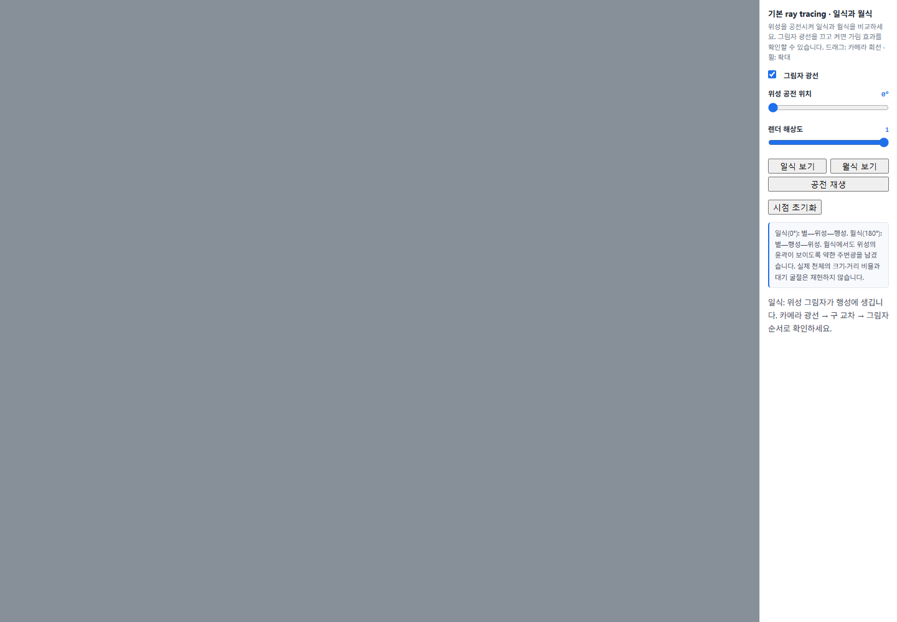

0~2단계 캡처는 최종 파일의 HTTP 응답 사본에서 아직 구현하지 않은 함수만 시작 코드로 되돌려 얻었다. 프로젝트 파일을 과거 상태로 덮어쓰지는 않았다. 화면의 제목·안내는 최종 UI이므로 원본 ZIP의 화면 전체와 같지는 않다.

### 1단계 - 픽셀마다 카메라 광선 만들기

```glsl
vec2 uv = (2.0 * pixel - uRes) / uRes.y;
vec3 target = vec3(0.0, 0.0, -1.8);
vec3 forward = normalize(target - eye);
vec3 right = normalize(cross(forward, vec3(0.0, 1.0, 0.0)));
vec3 up = cross(right, forward);
return normalize(1.7 * forward + uv.x * right + uv.y * up);
```

`pixel`은 `gl_FragCoord.xy`, `uRes`는 실제 렌더 크기다. 화면 중앙을 `(0, 0)`으로 옮기고 두 축을 모두 높이로 나누어 가로세로 비율을 유지한다. `forward`는 카메라에서 목표점을 보는 방향, `right`와 `up`은 카메라의 가로·세로 방향이다. `1.7`은 앞 방향의 비중으로 시야각을 정한다. 최종 방향을 정규화하므로 광선의 `t`를 거리로 해석할 수 있다.

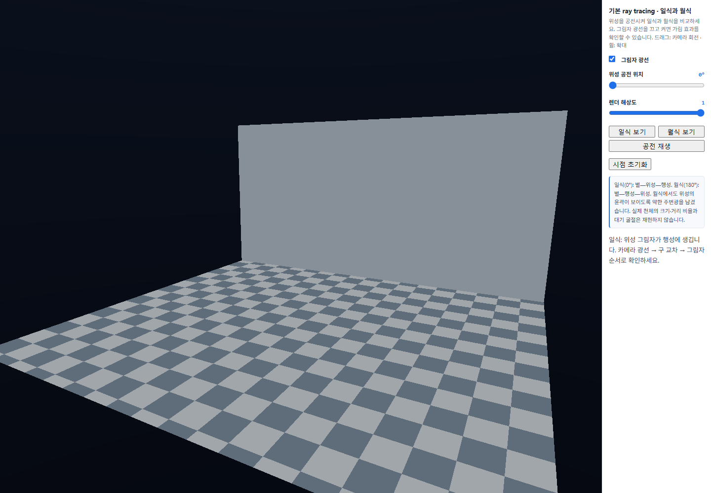

픽셀마다 방향이 달라져 바닥 격자와 뒷벽이 원근감 있게 나타난다. 이 단계에서는 구 교차를 아직 계산하지 않으므로 천체는 보이지 않는다.

### 2단계 - 광선과 구의 교차 거리

광선 `p(t) = ro + t * rd`를 구의 식 `dot(p-center, p-center) = radius²`에 대입하면 `a*t² + 2*halfB*t + c = 0`이 된다.

```glsl
vec3 oc = ro - center;
float a = dot(rd, rd);
float halfB = dot(oc, rd);
float c = dot(oc, oc) - radius * radius;
float disc = halfB * halfB - a * c;
if (disc < 0.0) return -1.0;
float root = sqrt(disc);
float t = (-halfB - root) / a;
if (t > 0.002) return t;
t = (-halfB + root) / a;
return t > 0.002 ? t : -1.0;
```

`oc`는 구 중심에서 광선 원점으로 향하는 벡터다. `disc`가 음수이면 실수 교차점이 없다. 작은 근을 먼저 확인하되, 구 안에서 출발하면 작은 근이 음수일 수 있어 큰 근도 검사한다. `0.002` 이하는 시작점에 너무 가까운 교차로 제외한다. 제공된 `traceScene()`은 세 구·바닥·벽 중 가장 가까운 양수 거리를 고른다.

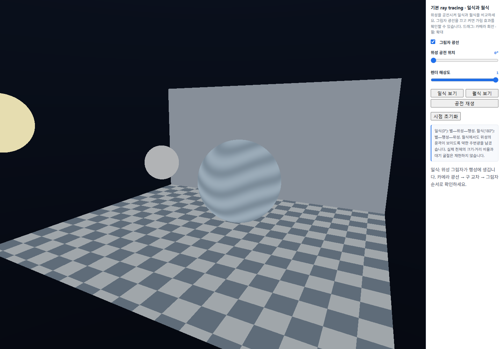

별·줄무늬 행성·위성이 나타나지만 조명이 없으므로 입체감과 식의 그림자는 아직 없다. 행성 줄무늬와 바닥 격자는 제공된 `surfaceColor()`의 절차적 무늬다.

### 3단계 - 직접광과 그림자 광선

```glsl
if (id == 0) return uColors[0];
vec3 p = ro + t * rd;
vec3 N = id == 3 ? vec3(0.0, 1.0, 0.0)
       : id == 4 ? vec3(0.0, 0.0, 1.0)
       : normalize(p - uBodies[id].xyz);
vec3 toStar = uBodies[0].xyz - p;
float lightDistance = length(toStar);
vec3 L = toStar / lightDistance;
float visible = 1.0;
if (uShadow == 1) {
  int blockerId;
  float blockerT = traceScene(p + N * 0.004, L, blockerId);
  if (blockerId > 0 && blockerT < lightDistance - 0.004) visible = 0.0;
}
float diffuse = max(dot(N, L), 0.0);
float power = 4.0 / (1.0 + 0.18 * lightDistance * lightDistance);
float ambient = id == 2 ? 0.13 : 0.045;
return surfaceColor(id, p) * (ambient + visible * diffuse * power);
```

`id`는 별 0, 행성 1, 위성 2, 바닥 3, 뒷벽 4다. 별은 자체발광으로 처리하고, 구의 법선은 중심에서 표면으로 향하는 단위 벡터를 쓴다. 바닥과 벽은 구 배열에 없으므로 고정 법선을 쓴다. `p`, `N`, 별의 위치, `L`은 모두 월드 공간 기준이다.

그림자 광선은 교차점에서 별 방향으로 보낸다. 시작점을 법선 방향으로 `0.004` 띄우는 이유는 부동소수점 오차로 자기 표면을 다시 맞는 shadow acne를 줄이기 위해서다. 가장 앞에 만난 물체가 별 자신이 아니고 별까지의 거리보다 앞에 있으면 `visible`을 0으로 만든다. 가림이 있으면 직접광만 사라지고 주변광은 남는다.

`diffuse`는 입사각에 따른 확산광이며 음수는 0으로 제한한다. `power`는 거리 제곱에 따른 감쇠다. 위성에는 `ambient = 0.13`, 나머지 표면에는 `0.045`를 사용한다. 월식에서도 위성의 윤곽을 보기 위한 교육용 단순화이며 대기 굴절에 의한 붉은 월식을 재현하지 않는다. 최종 출력에는 제공된 `displayColor()`의 `c/(1+c)`와 `1/2.2` 승을 유지했다.

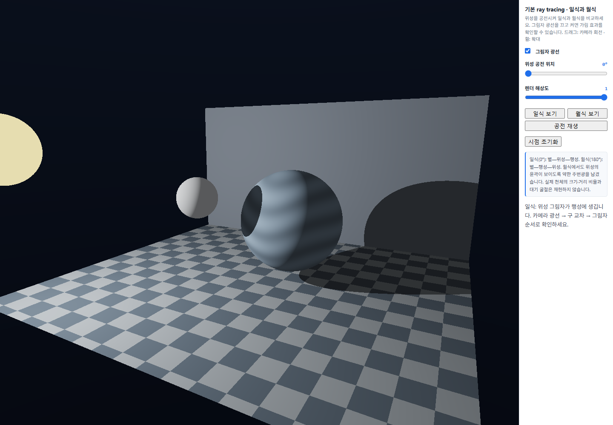

### 공전 위치와 일식·월식 비교

제공 코드의 `updateMoon()`은 행성에서 별로 향하는 `starward`와 그에 수직인 `sideways`로 공전 평면을 만든다.

```js
const a = degrees * Math.PI / 180;
for (let i = 0; i < 3; i++)
  bodies[8+i] = bodies[4+i] + 1.50 *
    (Math.cos(a) * starward[i] + Math.sin(a) * sideways[i]);
```

공전 반지름은 `1.50`, 행성 반지름은 `0.78`, 위성 반지름은 `0.29`다. 공전 0°에서는 별 쪽으로 위성이 이동해 **별—위성—행성** 순서가 된다. 180°에서는 반대쪽으로 이동해 **별—행성—위성** 순서가 된다. 실제 천체의 크기·거리 비율은 아니다. 두 보기 버튼은 해당 공전 위치와 관찰 시점을 함께 설정하므로, 일식과 월식 캡처는 서로 다른 시점이다. 각 식의 그림자 켬/끔 비교에서는 시점과 천체 위치를 유지했다.

**일식 0°:** 그림자를 켜면 위성이 가린 행성 표면이 어두워진다. 끄면 이 가림이 사라진다. 행성의 밤면 자체는 법선과 별 방향으로 계산하므로 그림자를 꺼도 남는다.

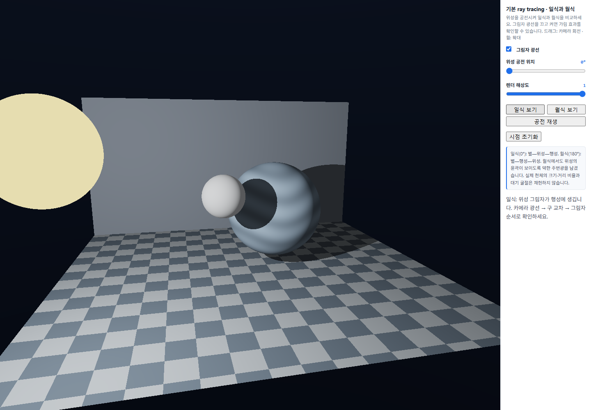
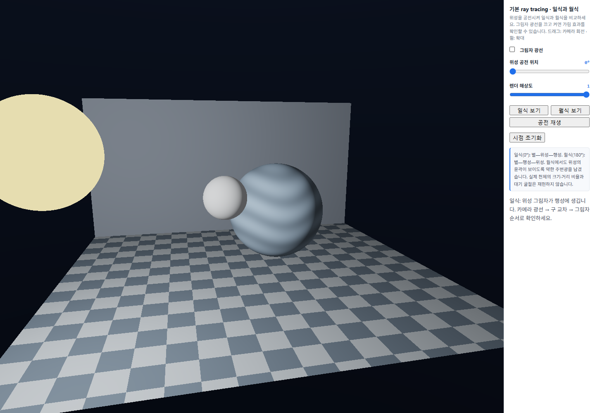

**월식 180°:** 그림자를 켜면 행성이 별빛을 가려 위성이 어두워진다. 주변광을 남겨 윤곽은 확인할 수 있다. 끄면 위성이 별의 직접광을 받는다.

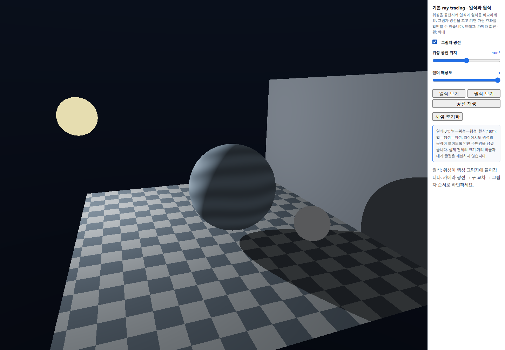
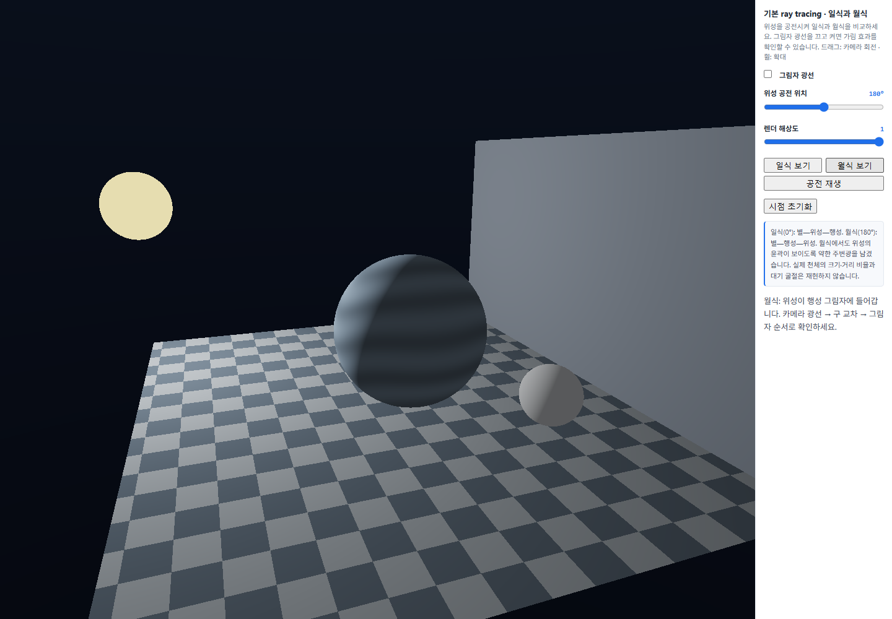

### 공개 페이지에서 직접 확인한 결과

2026-10-15에 [GitHub Pages의 실습 1](https://kyunghoon03.github.io/catholic.cg.26.2/week7/task1.html)에서 일식과 월식을 확인하고 그림자 광선을 껐다 켜며 비교했다. 일식에서는 위성이 행성에 만드는 둥근 그림자가 보였고, 그림자 광선을 끄면 식에 의한 가림 효과가 사라졌다. 월식에서도 그림자 광선을 끄면 위성이 직접 별빛을 받는 부분이 나타났다.

그림자 광선을 끄는 것은 천체의 공전 배치를 바꾸는 것이 아니라 다른 천체가 별빛을 가리는 검사를 생략하는 것이다. 따라서 식에 의한 그림자는 사라지지만, 표면이 별을 등져 생기는 밤면은 남는다. 밤낮은 `max(dot(N, L), 0.0)`, 다른 천체의 가림은 `visible`로 각각 계산한다.

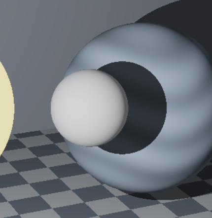
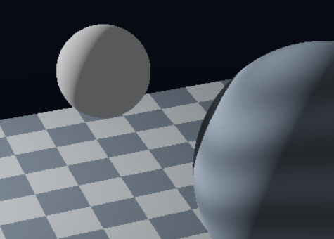

위 두 이미지는 이번 직접 확인에서 제공한 화면 일부다. 조작 패널이 포함되지 않아 캡처만으로 당시 체크박스 상태나 정확한 공전 각도를 재확인할 수는 없다. 앞의 단계별·그림자 전후 PNG와 수치 기록은 기존 AI 보조 검증 자료이며, 이번 화면과 구분한다. 이번에는 일식·월식과 그림자 전환을 확인했으며 공전 재생·정지와 카메라 조작의 재확인 기록은 추가하지 않았다.

### 조작법

| 조작 | 동작 |
| --- | --- |
| 드래그 / 휠 | 카메라 회전 / 거리 조절 |
| 위성 공전 위치 | 0~360° 위치 조절. 직접 조절하면 재생 정지 |
| 일식 보기 / 월식 보기 | 0° / 180°와 관찰 시점 설정 |
| 공전 재생 / 일시정지 | 초당 30°를 기준으로 공전 / 정지. 긴 프레임의 시간 간격은 0.05초로 제한 |
| 그림자 광선 | 가림 검사 켜기 / 끄기 |
| 렌더 해상도 | 화면 크기에 대한 렌더 배율 0.4~1 |
| 시점 초기화 | 제공 초기 카메라로 복귀. 공전 위치는 유지 |

### 실행 확인과 점검표

실행 근거는 [검증 스크립트](verification/verify-task1.cjs)와 [검증 결과](verification/task1-results.json)에 기록했다. 2026-10-15 Microsoft Edge headless / SwiftShader에서 HTTP로 실행했고, 기본 캡처 크기는 1440×1000, DPR 1이다. 14개 조건 모두 프로그램 링크 성공, WebGL 오류 없음, JavaScript·콘솔 오류 없음, HTTP 로딩 실패 없음으로 확인했다. PNG는 실제 브라우저 화면이며 합성하지 않았다. 이 소프트웨어 렌더러의 결과를 실제 GPU 성능 측정으로 사용하지 않는다.

최종 화면의 4픽셀 간격 RGB 샘플을 같은 카메라·장면의 광선 교차로 분류했다. 일식에서 행성의 평균 표시 밝기 `(R+G+B)/3`는 그림자 끔 약 `131.15`에서 켬 약 `101.87`로, 월식에서 위성은 약 `109.69`에서 `89.33`으로 줄었다. 각각 2,345개·521개의 샘플을 사용했다. 이는 0~255 표시 색의 비교이며 물리적인 광량 측정이나 사용자 체감의 기록은 아니다.

| 수업의 확인 항목 | 근거와 상태 |
| --- | --- |
| 카메라 광선으로 방이 보인다 | 1단계 캡처. 최종 화면의 실제 드래그·휠 입력 검증 |
| 가장 가까운 구가 나타난다 | 2단계 캡처와 두 근을 검사하는 `hitSphere()` |
| 일식·월식과 그림자 전후가 다르다 | 같은 천체 위치·카메라에서 비교한 네 캡처와 천체별 픽셀 밝기 비교 |
| 별의 자체발광 | 그림자 전후 별 표면의 샘플 평균 밝기 동일성 검사 |
| 공전·일시정지 | 실제 버튼 입력 후 천체 uniform 변화와 정지 확인 |
| 셰이더·JavaScript·HTTP 오류 | 14개 조건 링크 정상, WebGL·JavaScript·콘솔·HTTP 오류 없음 |
| 코드 설명 | 아래 질문과 답변에 천체 순서·교차 계산·그림자 광선의 근거를 정리함. 대면 구두 시연은 별도 |
| GitHub Pages·제출 | 공개 실습 1에서 일식·월식과 그림자 전환 확인. 실습 2의 공개 측정과 제출 확인은 남음 |

390×844 세로 화면에서도 오류 없이 렌더링되는 것을 확인했다. 패널은 아래로 이어져 스크롤이 필요하고, 제공 카메라 구도를 유지한 일식 화면에서는 별이 화면 밖으로 나간다. 모든 천체가 항상 화면 안에 들어오는 모바일 구도까지 완성한 것은 아니다.

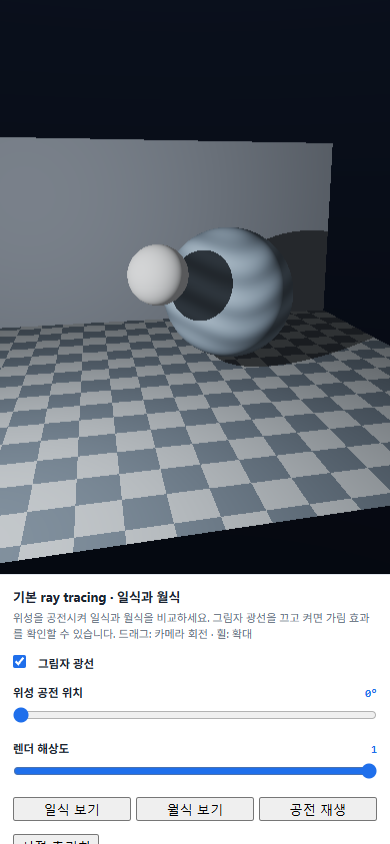

### 수업 질문과 답변

**일식과 월식에서 별·행성·위성의 순서는 어떻게 되며, 어떤 코드가 그림자를 확인하는가?**

일식은 별—위성—행성, 월식은 별—행성—위성 순서다. 공전 위치를 각각 0°와 180°로 두고 그림자를 켠 화면과 끈 화면을 비교했다. 일식에서는 행성 표면에 위성이 만든 어두운 영역이 나타나고, 월식에서는 행성 뒤의 위성이 어두워졌다. `shade()`의 `traceScene(p + N * 0.004, L, blockerId)`가 표면에서 별까지의 가림을 검사한다. `blockerId > 0`이고 `blockerT < lightDistance - 0.004`이면 별 앞에 다른 물체가 있으므로 `visible = 0.0`으로 직접광을 끈다.

**픽셀 좌표를 높이로 나누고 카메라 방향을 세 벡터로 합치는 이유는 무엇인가?**

화면 중앙을 원점으로 옮긴 뒤 가로와 세로를 모두 `uRes.y`로 나누면 두 축의 단위가 같아져 가로로 긴 화면에서도 구가 찌그러지지 않는다. `forward`는 앞 방향이고, `right`와 `up`은 화면의 가로·세로 방향이다. 여기에 픽셀 위치 `uv.x`, `uv.y`를 곱해 더하면 각 픽셀을 향하는 방향이 된다. 마지막 정규화로 방향 벡터 길이를 1로 맞춘다.

**구의 교차 거리에서 두 근을 확인하는 이유는 무엇인가?**

구를 통과하는 광선에는 들어가는 지점과 나오는 지점이 있다. 보통 가까운 양수 근이 눈에 보이는 앞면이므로 작은 근을 먼저 고른다. 하지만 광선 원점이 구 안에 있으면 작은 근은 뒤쪽의 음수 거리일 수 있다. 이때 큰 근도 확인해야 앞쪽으로 나가는 교차점을 찾는다. `traceScene()`은 각 물체의 거리 중 가장 작은 양수 거리를 선택해 뒤쪽 물체가 앞쪽을 덮지 않게 한다.

**그림자 광선은 어디에서 출발하고, 시작점을 조금 띄우는 이유는 무엇인가?**

카메라 광선이 찾은 표면점 `p`에서 출발해 별 방향 `L`로 진행한다. 실제 원점은 `p + N * 0.004`로 표면 바깥으로 조금 옮긴다. 표면 바로 위에서 시작하면 계산 오차 때문에 같은 표면을 다시 맞아 스스로 그림자를 만드는 얼룩이 생길 수 있기 때문이다. 또한 별보다 뒤의 물체까지 가림으로 처리하지 않도록 교차 거리와 별까지의 거리를 비교한다.

**그림자를 꺼도 밤면이 남고, 월식의 위성이 완전히 검지 않은 이유는 무엇인가?**

밤면은 `max(dot(N, L), 0.0)`으로 결정되고, 그림자 스위치는 다른 물체의 가림만 제어한다. 따라서 그림자를 꺼도 별을 등진 면의 직접광은 0이다. 월식의 위성은 직접광이 차단돼도 `ambient = 0.13`이 남아 윤곽이 보인다. 이 상수 주변광은 관찰을 위한 근사이며, 다른 표면에서 반사된 빛이나 실제 대기 굴절을 추적한 결과는 아니다.

**이 실습이 path tracing이나 하드웨어 ray tracing과 다른 점은 무엇인가?**

이번에는 픽셀의 카메라 광선과 표면에서 별로 향하는 그림자 광선을 계산했다. 무작위 반사 방향을 여러 번 표본 추출해 평균하지 않으므로 path tracing의 간접 확산광은 계산하지 않는다. 또한 세 구를 순서대로 검사하며 BVH 탐색이나 RT Core 전용 API를 호출하지 않는다. WebGL2의 프래그먼트 셰이더에서 교차 계산을 병렬로 실행하는 기본 ray tracing이다.

실습 2의 기기별 시간 차이, 부하 원인, 적정 설정과 자동 시작에 대한 질문은 실제 두 기기의 측정 후 작성한다. 실습 1의 실행 기록으로 그 값을 대신하지 않는다.

### AI 사용 기록

요청: 제공 시작 ZIP으로 실습 1을 완성하고, 실제 실행과 보고서를 정리하기.

반영한 수정: 수업의 `cameraRay()`, `hitSphere()`, `shade()` 코드 적용, 계산 의미를 설명하는 짧은 주석 추가, HTML의 시작 안내를 완성 화면의 조작 안내로 수정했다. 공전·장면 배치·공용 함수는 제공 구조를 유지했다.

검증 중 AI가 만든 측정 코드에서 `getUniform(..., 'uBodies[0]')`가 배열 전체를 반환한다고 잘못 가정했다. 실제로 첫 구의 값만 읽어 행성·위성 픽셀을 분류하지 못했고, 각 인덱스 0·1·2를 따로 읽도록 수정했다. 실습 셰이더가 아니라 검증 코드의 오류였으며, 수정 후 14개 조건의 검증을 통과했다.

계산 설명은 실제 `task1.js`의 변수와 값을 기준으로 정리했고, 실행 결과는 저장한 캡처와 검증 기록을 근거로 작성했다.

## Task 2 - 노트북·모바일 렌더링 비교와 자동 시작 설정

### 의도와 방법

노트북과 모바일에서 같은 방을 Local·Ray tracing·Path tracing으로 비교하고, 각 기기에서 측정한 적정 설정으로 다음 접속을 시작하도록 구성했다. 수업의 [실습 2 시작 ZIP](https://cg.catholic.ac.kr/~mgchoi/CG/downloads/week07-render-compare-starter.zip)을 사용했다. 실습 1의 코드를 복사해 새 렌더러를 만들지 않고, 실습 2에 제공된 장면·셰이더·측정 함수를 유지했다. `demo.js`와 `demo.css`는 두 ZIP의 파일이 동일하다.

Local은 삼각형과 직접광을 사용하고, Ray tracing은 광선 교차와 그림자 및 선택한 거울·굴절 경로를 계산한다. Path tracing은 여러 표본의 확산 반사 경로도 평균한다. Local에는 거울과 유리가 불투명하게 보이며, 세 방식이 같은 광학 효과를 모두 계산하는 것은 아니다.

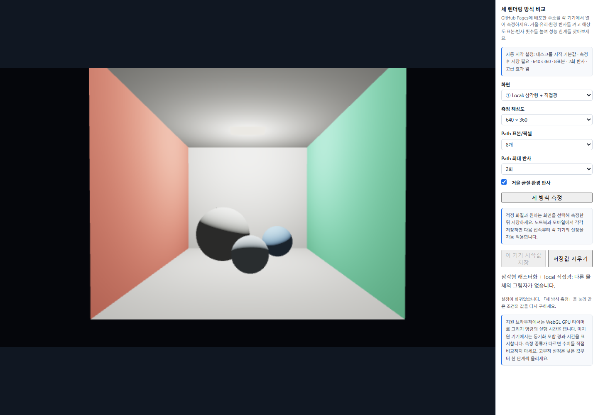
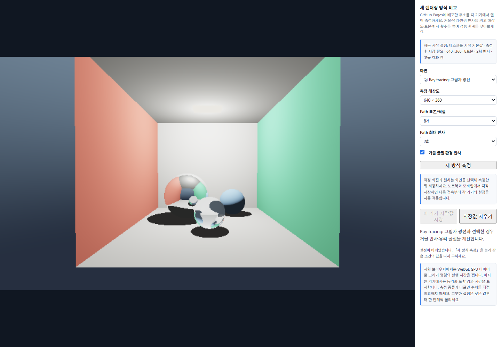


Path 화면에는 밝고 어두운 점이 남는다. 이는 표면 텍스처가 아니라 적은 경로 표본에 의한 노이즈다. 표본을 늘리면 평균이 안정되는 대신 계산할 경로가 늘어난다. 최대 반사 횟수는 경로의 상한이고, 모든 경로가 반드시 그 횟수까지 이어지는 것은 아니다.

### 기기별 설정 저장과 자동 적용

노트북과 모바일을 정확한 모델명으로 판별하기보다, 각 기기의 브라우저에 실측 설정을 저장하는 방법을 사용했다. `chooseInitialProfile()`은 `localStorage`의 `cg-week7-profile-v1`을 먼저 읽고, 지원되는 값인지 확인한 뒤 적용한다. 저장값이 없을 때만 제공 코드의 모바일·데스크톱 시작 기본값으로 실행한다. 이 기본값을 측정으로 정한 적정값이라고 표시하지 않는다.

```js
function currentSettings(){
  return {
    mode: String(S.mode),
    resolution: String(S.resolution),
    samples: String(S.samples),
    bounces: String(S.bounces),
    advanced: S.advanced
  };
}
```

저장하는 값은 화면 방식·해상도·표본 수·반사 횟수·고급 효과 여부다. `validProfile()`은 이 값들이 제공 UI의 선택 범위에 있는지 검사한다. `chooseInitialProfile()`에서 복원한 값을 `S`와 실제 select·checkbox 양쪽에 대입하므로, 표시된 설정과 렌더링 값이 일치한다. `#profile`에는 적용한 시작 설정을 표시한다.

```js
const saved = JSON.parse(localStorage.getItem(profileKey));
if (validProfile(saved))
  return {...saved, name: '이 기기에서 저장한 설정'};
```

「세 방식 측정」이 성공하면 `measuredSettings`에 그때의 설정을 남기고 저장 버튼을 켠다. 저장 직전에도 현재 설정과 측정 설정이 같은지 비교한다. 측정하지 않은 값으로 바꾼 뒤 저장하는 것을 막기 위해서다.

```js
if (!measuredSettings ||
    JSON.stringify(currentSettings()) !== JSON.stringify(measuredSettings)) return;
localStorage.setItem(profileKey, JSON.stringify(measuredSettings));
```

수동 조절과 원래 측정 버튼은 유지했다. 「저장값 지우기」는 다음 접속을 시작 기본값으로 되돌린다. JSON 손상·선택 범위 밖의 값·저장소 접근 오류가 있으면 안내를 표시하고 가능한 경우 기본값으로 실행한다.

`localStorage`는 기기·브라우저·사이트 출처별로 분리된다. 따라서 노트북의 값을 모바일로 자동 복사하지 않으며, localhost에 저장한 값도 GitHub Pages로 이동하지 않는다. 배포 후에는 두 기기에서 같은 Pages 주소를 열고 각각 측정·저장해야 한다.

### 측정 방법과 현재 환경

2026-10-15에 노트북의 로컬 HTTP 주소에서 Microsoft Edge headless 155.0.0.0으로 측정했다. 운영체제는 Windows 11 Home, CPU는 AMD Ryzen 9 5900HX다. 설치된 그래픽 장치는 AMD Radeon(TM) Graphics와 NVIDIA GeForce RTX 3050 Ti Laptop GPU이며, **이번 브라우저의 실제 렌더러는 AMD Radeon 내장 GPU / ANGLE Direct3D11**이었다. NVIDIA에서 측정한 결과로 해석하지 않는다. 전원 조회값은 `BatteryStatus = 2`, 배터리 98%였다. 전원 모드를 별도로 변경하거나 고정하지 않았다.

이번에는 `EXT_disjoint_timer_query_webgl2`가 지원되어 GPU 실행 시간을 사용했다. 지원하지 않는 기기는 제공 코드의 `performance.now()`와 `readPixels()` 동기화 포함 경과 시간을 사용한다. 두 방식은 포함하는 비용이 다르므로 같은 측정 종류처럼 직접 비교하지 않는다.

「세 방식 측정」 한 번은 각 방식의 준비 실행 1회와 측정 5회로 구성되고, 표에는 5회 시간의 중앙값이 표시된다. 공통 조건은 버튼을 3번 실행하고 그 세 중앙값의 중앙값을 다시 구했다. 아래 시간은 화면에 표시된 소수 둘째 자리 값을 사용한다. GPU 명령의 시간이며 전체 페이지 반응 시간이나 FPS와 같지 않다.

### 노트북 로컬 측정 결과

| 조건(해상도 / 표본 / 반사 / 고급 효과) | Local (ms) | Ray (ms) | Path (ms) |
| --- | ---: | ---: | ---: |
| 공통 1: 640×360 / 8 / 2 / 켬 | 0.17 | 0.71 | 5.46 |
| 공통 2: 640×360 / 8 / 2 / 켬 | 0.17 | 0.74 | 5.37 |
| 공통 3: 640×360 / 8 / 2 / 켬 | 0.17 | 0.73 | 5.45 |
| 공통 3회의 중앙값 | **0.17** | **0.73** | **5.45** |
| 960×540 / 8 / 2 / 켬 | 0.28 | 0.91 | 10.63 |
| 1280×720 / 8 / 2 / 켬 | 0.43 | 1.32 | 18.07 |
| 1920×1080 / 8 / 2 / 켬 | 0.96 | 2.49 | 37.39 |
| 640×360 / 16 / 2 / 켬 | 0.17 | 0.77 | 10.42 |
| 640×360 / 32 / 2 / 켬 | 0.17 | 0.67 | 18.11 |
| 640×360 / 8 / 3 / 켬 | 0.17 | 0.70 | 7.59 |
| 640×360 / 8 / 4 / 켬 | 0.17 | 0.73 | 8.90 |
| 640×360 / 8 / 2 / 끔 | 0.18 | 0.72 | 5.34 |
| 결합 부하: 1280×720 / 16 / 3 / 켬 | 0.74 | 1.50 | 46.79 |

공통 조건 Path 시간은 세 번의 표시값 중 중앙값을 사용했다. 해상도·표본·반사 횟수 실험은 나머지 조건을 공통값으로 되돌린 뒤 한 항목만 바꾸었다. 결합 부하는 이 단일 항목 비교와 구분한다. 설정을 바꾼 뒤 첫 렌더는 준비 실행에서 제외하지만, GPU 클록·다른 프로그램·온도까지 고정한 실험은 아니다.


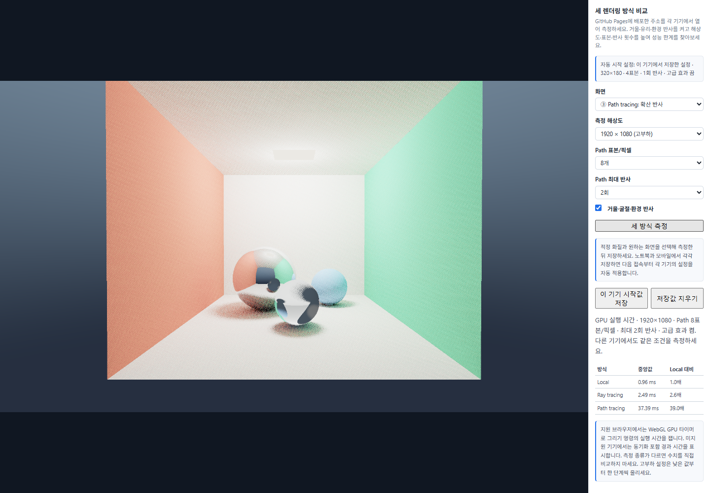
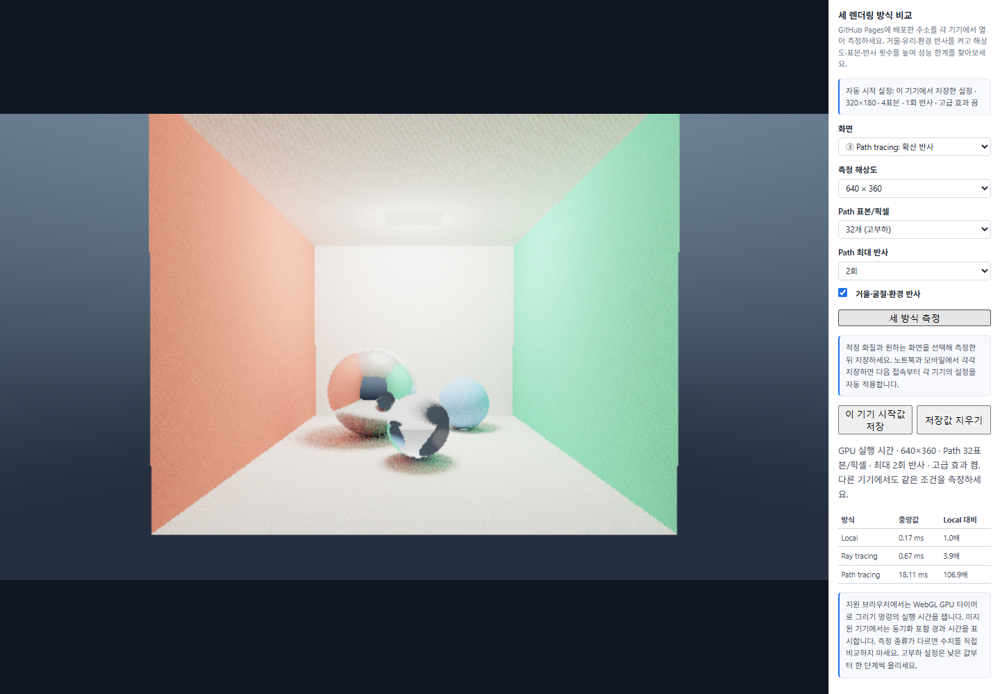
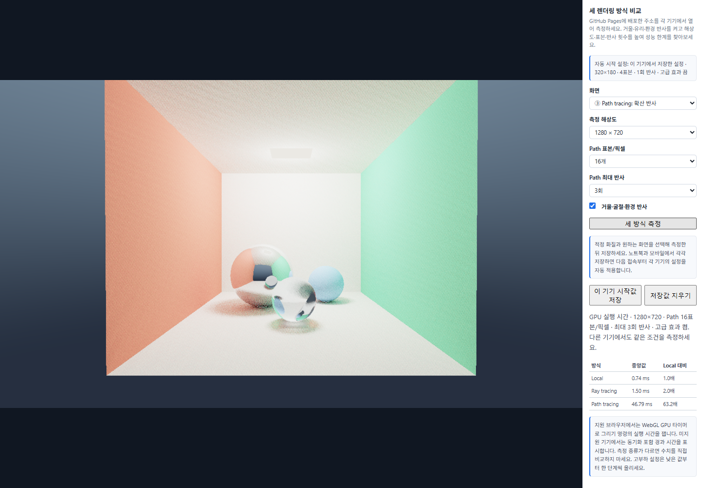

해상도를 640×360에서 1920×1080으로 높이면 픽셀 수는 9배다. 이번 측정에서 Path 시간은 공통 중앙값 5.45ms에서 37.39ms로 약 6.86배 늘었다. 표본을 8에서 32로 높이면 Path 시간은 18.11ms로 약 3.32배가 됐다. 최대 반사를 2에서 4로 높인 결과는 8.90ms로 약 1.63배였다. 같은 배수로 늘지 않는 이유는 경로가 장면 밖으로 나가거나 광원에 닿아 일찍 끝날 수 있고, 고정 비용과 GPU 실행 효율도 있기 때문이다.

고급 효과 끔은 5.34ms, 공통 켬은 5.45ms였다. 이 작은 차이와 단일 끔 측정만으로 거울·굴절의 비용이 항상 작다고 결론 내리지는 않는다. 표본·반사는 Path 계산을 조절하므로 Local·Ray의 작은 시간 변동을 이 설정의 직접적인 효과로 해석하지 않는다.

### 적정 설정의 기준과 현재 후보

설정을 자주 바꾸며 그림자·간접광을 비교하는 용도로, 우선 **Path의 GPU 실행 시간 100ms 이하**를 잠정 기준으로 잡았다. 이 기준은 전체 UI 반응 시간을 보장하는 값은 아니다. 로컬에서 시험한 결합 조건 `1280×720 / 16표본 / 3회 반사 / 고급 효과 켬`은 46.79ms여서 후보로 남겼다. 1920×1080의 단일 해상도 실험은 표본 8·반사 2였으므로 이 후보와 모든 화질 축이 같지는 않다. 후보는 해상도만 최대로 높이기보다 간접광의 표본과 반사를 함께 확보하는 쪽을 택한 것이다.

모든 설정 조합을 시험한 것은 아니므로 이 후보를 최적값으로 단정하지 않는다. GitHub Pages에서 노트북과 모바일을 측정한 뒤 각 기기의 용도·허용 시간·화질을 근거로 최종값을 정하고 저장한다. **모바일의 적정값은 아직 측정하지 않았다.**

### 자동 시작과 오류 처리 검증

[검증 스크립트](verification/verify-task2.cjs)와 [실행 기록](verification/task2-results.json)에 19개 화면 조건과 13회의 측정 실행을 남겼다. 셰이더 두 개의 링크, WebGL·JavaScript·콘솔·HTTP 오류 없음, 세 방식의 서로 다른 화면을 확인했다. 측정 전 저장 차단, 성공한 측정 설정 저장, 새로고침 후 다섯 값의 복원, 미측정 변경의 저장 차단, 저장 삭제, 잘못된 JSON·선택 범위 밖의 저장값·읽기 차단 시 기본값 적용을 검사했다.

아래는 저장·복원 기능을 확인하려고 `Path / 320×180 / 4표본 / 1회 반사 / 고급 효과 끔`을 측정·저장한 뒤 새로고침한 실제 화면이다. 최종 적정 설정의 캡처가 아니라 기능 검증용이다. 이 저장은 일회용 검증 브라우저에서 했으며 사용 중인 브라우저나 Pages의 값을 설정한 것은 아니다.

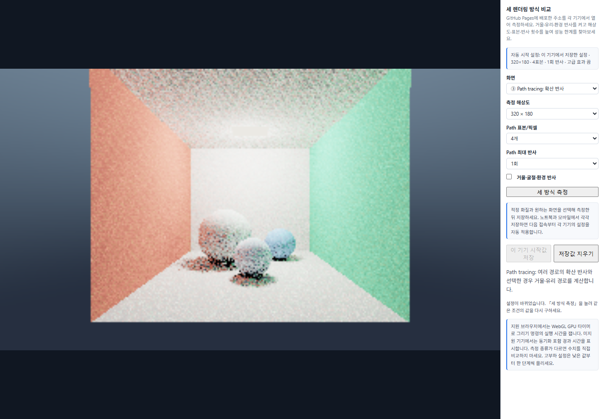

390×844에서도 화면과 조작 패널이 배치되는 것을 확인했다. 이는 노트북 브라우저의 화면 크기를 줄인 검사이며 실제 모바일 기기의 렌더링·성능 검증으로 세지 않는다.

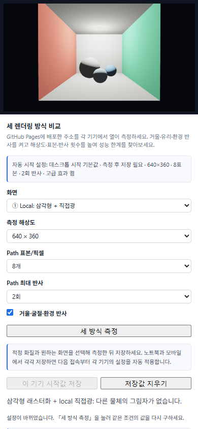

### 수업 질문과 답변

**같은 조건에서 두 기기의 Local·Ray·Path 시간이 어떻게 달랐는가?**

같은 공통 조건을 각 기기에서 3회 반복했다. 노트북의 중앙값은 Local 0.17ms, Ray 0.67ms, Path 4.95ms이며 GPU 실행 시간이다. 모바일의 중앙값은 Local 1.00ms, Ray 2.00ms, Path 9.00ms이며 브라우저 동기화 포함 시간이다. 두 기기 모두 Local보다 Ray, Ray보다 Path의 표시 시간이 길었다. 다만 측정에 포함된 비용이 다르므로 9.00/4.95로 모바일 GPU가 몇 배 느리다고 결론 내리지 않는다.

**무엇을 높였을 때 가장 크게 느려졌는가?**

노트북 공개 페이지의 같은 날 단일 항목 실험에서는 해상도를 640×360에서 1920×1080으로 높였을 때 Path 시간이 5.96ms에서 38.03ms로 가장 크게 늘었다. 표본 32개에서는 18.59ms, 최대 반사 4회에서는 8.54ms였다. 각 설정의 증가 폭이 다르므로 해상도가 항상 가장 비싸다고 일반화하지 않는다. 모바일은 해상도 960×540까지 확인해 가장 영향이 큰 항목은 아직 판단할 수 없다.

**적정 설정과 자동 적용은 어떻게 구현했는가?**

노트북은 Path GPU 시간 100ms 이하를 기준으로 `1280×720 / 32표본 / 3회 / 켬`을 골랐다. 공개 페이지에서 저장하고 새로고침한 뒤 설정과 Path 화면이 돌아오는 것을 확인했다. `chooseInitialProfile()`은 현재 브라우저의 저장값을 먼저 적용한다. 모바일은 1280×720 / 8표본 / 2회 / 켬으로 저장했고, 공개 페이지에서 같은 설정과 Path 화면이 자동 복원됐다.

### GitHub Pages에서 직접 측정한 결과

노트북과 모바일에서 [실습 2 공개 주소](https://kyunghoon03.github.io/catholic.cg.26.2/week7/task2.html)를 열고 공통 조건 `640×360 / 8표본 / 최대 2회 반사 / 고급 효과 켬`으로 「세 방식 측정」을 각각 3번 실행했다. 노트북에는 `GPU 실행 시간`, 모바일에는 `브라우저 동기화 포함`으로 표시됐다. 각 회차의 수치는 프로그램 내부 5회 측정의 중앙값이며, 기기별 마지막 행은 세 회차의 표시값을 정렬해 가운데 값을 고른 결과다.

| 기기 · 실행 | 측정 방식 | Local (ms) | Ray tracing (ms) | Path tracing (ms) |
| --- | --- | ---: | ---: | ---: |
| 노트북 · 공통 1회차 | GPU 실행 시간 | 0.17 | 0.56 | 4.95 |
| 노트북 · 공통 2회차 | GPU 실행 시간 | 0.17 | 0.77 | 5.39 |
| 노트북 · 공통 3회차 | GPU 실행 시간 | 0.17 | 0.67 | 4.89 |
| **노트북 · 3회 중앙값** | **GPU 실행 시간** | **0.17** | **0.67** | **4.95** |
| 모바일 · 공통 1회차 | 브라우저 동기화 포함 | 1.00 | 2.00 | 9.00 |
| 모바일 · 공통 2회차 | 브라우저 동기화 포함 | 1.00 | 2.00 | 11.00 |
| 모바일 · 공통 3회차 | 브라우저 동기화 포함 | 1.00 | 2.00 | 9.00 |
| **모바일 · 3회 중앙값** | **브라우저 동기화 포함** | **1.00** | **2.00** | **9.00** |

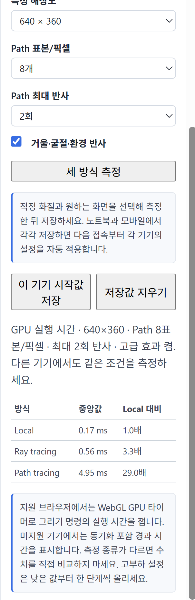
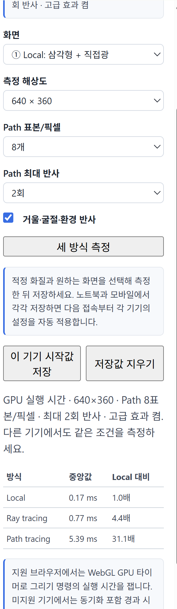
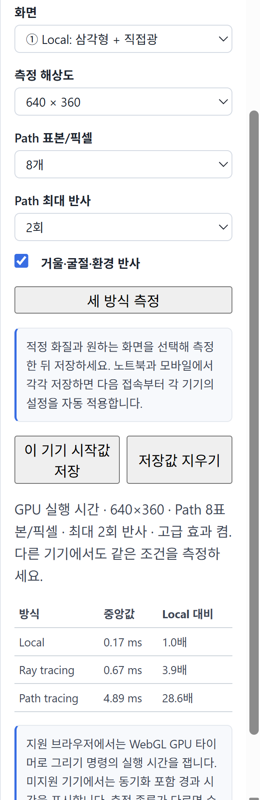

1회차 화면은 Local 대비 Ray 3.3배·Path 29.0배, 2회차는 4.4배·31.1배, 3회차는 3.9배·28.6배로 표시됐다. 배수는 내부의 반올림 전 수치로 계산하므로, 화면에 반올림되어 보이는 ms 값을 나눈 결과와 조금 다를 수 있다. 세 회차의 표시된 Path 시간은 4.89~5.39ms 범위였다. 같은 설정이라도 측정값이 완전히 같지는 않아 한 번의 값 대신 3회 중앙값을 사용했다. 공개 페이지 측정 시점의 브라우저 버전·실제 GPU·전원 상태는 이 부분 캡처만으로 확인할 수 없어, 앞의 로컬 검증 환경과 같다고 단정하지 않는다.

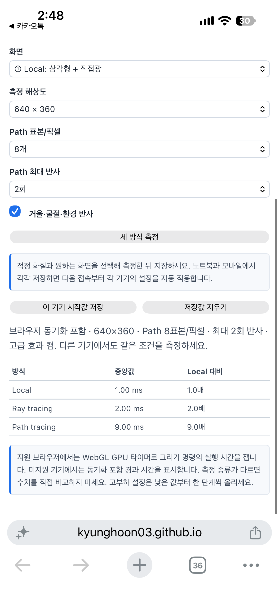

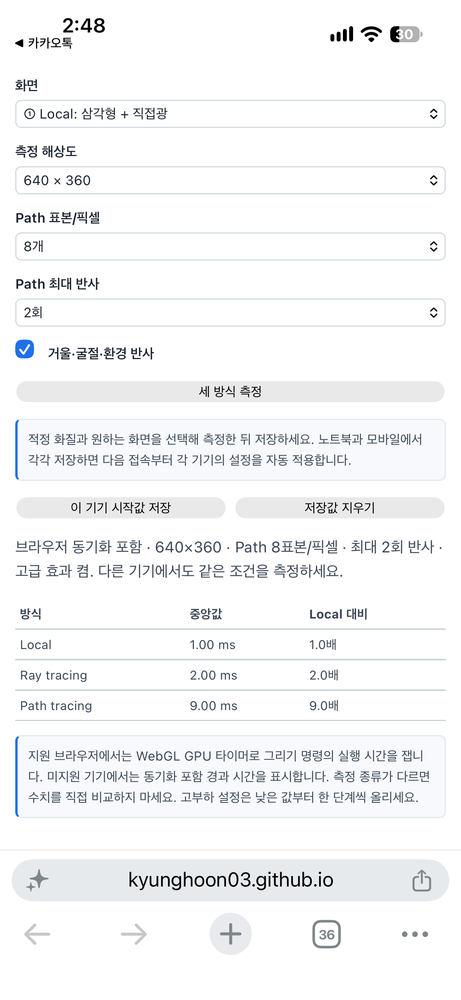

모바일의 Path 시간은 9.00~11.00ms였고 3회 중앙값은 9.00ms다. 모바일 내부의 Local 대비 표시 배수는 Ray 2배, Path 9배·11배·9배였다. 이는 같은 모바일 측정 방식 안에서의 비교다. 동기화 포함 시간에는 JavaScript 명령 제출과 GPU 완료 대기 등의 비용도 들어가므로 노트북 GPU 타이머 값과 같은 열의 순수 GPU 성능처럼 비교하지 않는다. 표시값이 정수 ms 간격이지만 캡처만으로 타이머 정밀도 제한의 원인을 특정하지 않는다.

모바일 캡처에는 배터리 30%가 표시됐다. 정확한 기기 모델·OS 버전·브라우저 이름과 버전·충전 여부·저전력 모드는 아직 확인하지 못했다. 화면 모양만으로 브라우저나 기종을 단정하지 않는다. 이번 캡처에는 렌더 화면과 새로고침 후 자동 설정 안내가 포함되지 않아, 기기별 화질과 저장·복원 확인은 별도 캡처가 필요하다.

### 노트북 Pages - 해상도 960×540 비교

공통 조건에서 해상도만 `640×360 → 960×540`으로 올리고, `8표본 / 최대 2회 반사 / 고급 효과 켬`을 유지해 3번 측정했다. 세 캡처 모두 GPU 실행 시간으로 표시됐다.

| 실행 | Local (ms) | Ray tracing (ms) | Path tracing (ms) |
| --- | ---: | ---: | ---: |
| 960×540 · 1회차 | 0.28 | 1.14 | 10.03 |
| 960×540 · 2회차 | 0.28 | 1.10 | 9.94 |
| 960×540 · 3회차 | 0.27 | 1.05 | 9.95 |
| **3회 중앙값** | **0.28** | **1.10** | **9.95** |

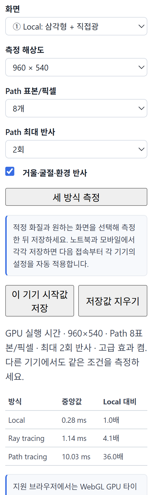
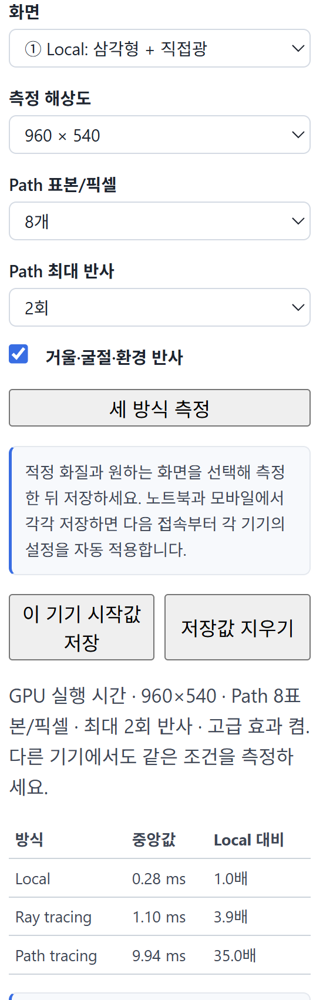
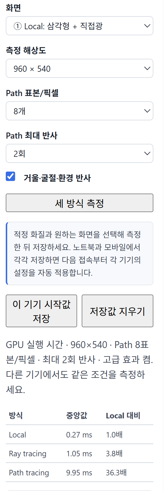

픽셀 수는 230,400개에서 518,400개로 2.25배 증가했다. 같은 GPU 시간 방식으로 기록한 공통 조건의 중앙값과 비교하면 Local은 `0.28 / 0.17 ≈ 1.65배`, Ray는 `1.10 / 0.67 ≈ 1.64배`, Path는 `9.95 / 4.95 ≈ 2.01배`가 됐다. 해상도를 올리면 계산할 픽셀이 늘어나는 경향을 확인할 수 있지만, 실행 시간이 픽셀 수와 정확히 비례하지는 않았다. 이 비교는 각 조건의 표시값 중앙값을 이용한 것이며 다른 프로그램이나 GPU 클록까지 고정한 실험은 아니다.

캡처는 측정표와 설정을 보여 주며 선택 화면은 Local이다. 「세 방식 측정」은 선택 화면과 관계없이 세 방식을 모두 측정하므로 Path 시간도 유효하다. 다만 Path의 실제 화질은 이 캡처에 포함되지 않아 별도 렌더 화면으로 확인해야 한다. 이번 조건에서의 체감 반응이나 화질 평가를 수치만으로 대신 기록하지 않았다.

### 모바일 Pages - 해상도 960×540 비교

모바일에서도 해상도만 `640×360 → 960×540`으로 올리고 `8표본 / 최대 2회 반사 / 고급 효과 켬`을 유지해 3번 측정했다. 세 캡처 모두 `브라우저 동기화 포함`으로 표시됐다.

| 실행 | Local (ms) | Ray tracing (ms) | Path tracing (ms) |
| --- | ---: | ---: | ---: |
| 960×540 · 1회차 | 2.00 | 4.00 | 20.00 |
| 960×540 · 2회차 | 1.00 | 4.00 | 20.00 |
| 960×540 · 3회차 | 1.00 | 4.00 | 20.00 |
| **3회 중앙값** | **1.00** | **4.00** | **20.00** |

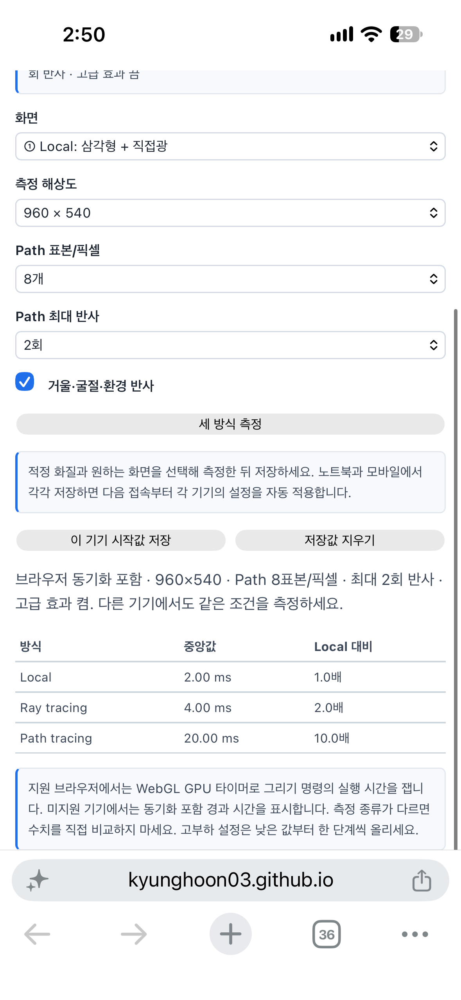
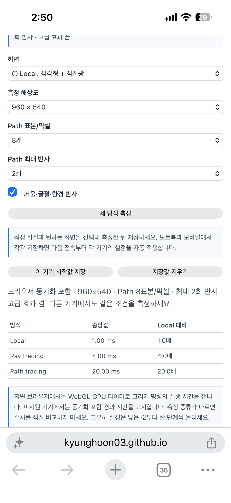


공통 조건의 중앙값과 비교하면 Local은 1.00ms로 같고, Ray는 2.00→4.00ms, Path는 9.00→20.00ms로 증가했다. 픽셀 수가 2.25배일 때 Path 시간은 약 2.22배가 됐다. Local은 첫 회차에서 2.00ms, 나머지에서 1.00ms로 나타났으며, 표시 정밀도나 고정 비용 등의 영향을 이 측정만으로 분리할 수는 없다.

이번 이미지는 측정표와 설정의 기록이며 선택 화면은 Local이다. Path 렌더 화면, 저장 후 자동 설정, 체감 속도는 이 이미지에서 확인하지 못했다. 배터리 표시는 29%였다.

### 노트북 Pages - 부하 비교와 최종 시작값

2026-11-11에 노트북 Chrome의 공개 페이지에서 추가 측정했다. AI가 실제 브라우저를 조작하고 캡처했다. 기존 공통 조건 3회의 중앙값은 두 기기 비교에 유지하고, 아래 단일 항목 비교에는 같은 날 다시 잰 기준값을 사용했다. 각 행은 측정 버튼 1회에 프로그램이 계산한 GPU 시간 중앙값이다.

| 해상도 / 표본 / 반사 / 고급 효과 | Local (ms) | Ray (ms) | Path (ms) | 캡처 |
| --- | ---: | ---: | ---: | --- |
| 640×360 / 8 / 2 / 켬 · 당일 기준 | 0.18 | 0.20 | 5.96 | [화면](images/task2-laptop-pages-nov11-common.jpg) |
| 1280×720 / 8 / 2 / 켬 | 0.49 | 0.96 | 19.93 | [화면](images/task2-laptop-pages-nov11-1280.jpg) |
| 1920×1080 / 8 / 2 / 켬 | 1.33 | 2.04 | 38.03 | [화면](images/task2-laptop-pages-nov11-1920.jpg) |
| 640×360 / 16 / 2 / 켬 | 0.14 | 0.55 | 10.33 | [화면](images/task2-laptop-pages-nov11-samples16.jpg) |
| 640×360 / 32 / 2 / 켬 | 0.19 | 0.43 | 18.59 | [화면](images/task2-laptop-pages-nov11-samples32.jpg) |
| 640×360 / 8 / 3 / 켬 | 0.19 | 0.42 | 6.95 | [화면](images/task2-laptop-pages-nov11-bounce3.jpg) |
| 640×360 / 8 / 4 / 켬 | 0.15 | 0.80 | 8.54 | [화면](images/task2-laptop-pages-nov11-bounce4.jpg) |
| 640×360 / 8 / 2 / 끔 | 0.11 | 0.25 | 5.10 | [화면](images/task2-laptop-pages-nov11-effects-off.jpg) |
| 1280×720 / 16 / 3 / 켬 · 후보 | 0.34 | 0.96 | 45.81 | [화면](images/task2-laptop-pages-nov11-chosen.jpg) |
| 1920×1080 / 16 / 3 / 켬 · 가장 느렸던 조건 | 0.72 | 2.14 | 107.58 | [화면](images/task2-laptop-pages-nov11-higher.jpg) |
| 1280×720 / 32 / 3 / 켬 · 최종값 재측정 | 0.61 | 1.05 | 94.89 | [화면](images/task2-laptop-pages-nov11-denser-table.jpg) |

노트북은 반사와 간접광을 자세히 보는 용도로, 기존에 잡은 Path GPU 시간 100ms 이하를 기준으로 삼았다. `1920×1080 / 16 / 3 / 켬`은 107.58ms로 기준을 넘겼다. 최종값은 1280×720을 유지하고, 입자 노이즈를 줄이기 위해 16표본 대신 32표본을 선택했다. Path 시간은 저장 전 93.53ms, 재측정 94.89ms였다. 두 번 모두 기준 안이지만 여유가 크지는 않으며, 이 값은 페이지 전체 반응 시간의 상한을 뜻하지 않는다. 고급 효과를 끈 경우 Path가 5.96ms에서 5.10ms로 줄었지만 1회씩의 비교이므로 차이를 단정하지 않는다.

노트북 Chrome에서 「이 기기 시작값 저장」을 누른 뒤 공개 페이지를 새로고침했다. 별도 조작 없이 `이 기기에서 저장한 설정` 안내와 `1280×720 / 32표본 / 3회 / 켬`의 Path 화면이 돌아왔다.

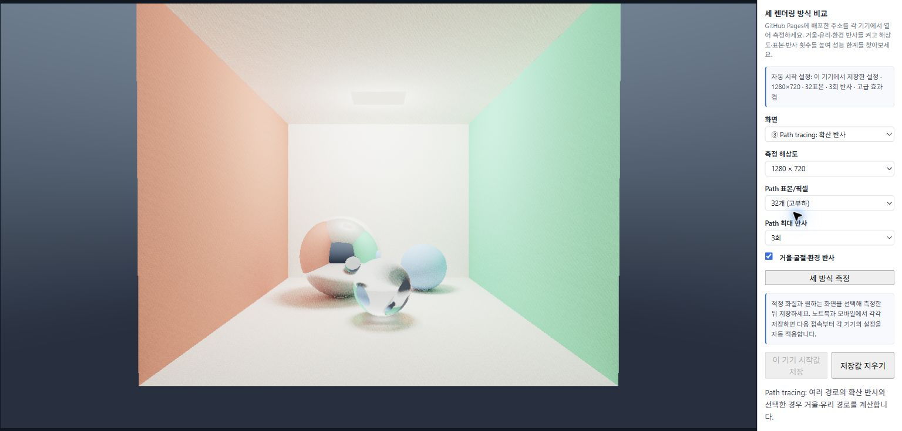

### 모바일 Pages - 부하 비교와 시작값 후보

모바일 공개 페이지에서 추가 조건을 각각 한 번 측정했다. 아래 수치는 모두 브라우저 동기화 포함 시간이며, 각 행은 프로그램이 표시한 중앙값이다.

| 해상도 / 표본 / 반사 / 고급 효과 | Local (ms) | Ray (ms) | Path (ms) | 캡처 |
| --- | ---: | ---: | ---: | --- |
| 1280×720 / 8 / 2 / 켬 | 2 | 6 | 33 | [결과](images/task2-mobile-pages-load-1280.png) |
| 1920×1080 / 8 / 2 / 켬 | 2 | 5 | 72 | [결과](images/task2-mobile-pages-load-1920.png) |
| 640×360 / 16 / 2 / 켬 | 1 | 3 | 18 | [결과](images/task2-mobile-pages-load-samples16.png) |
| 640×360 / 32 / 2 / 켬 | 1 | 2 | 34 | [결과](images/task2-mobile-pages-load-samples32.png) |
| 640×360 / 8 / 3 / 켬 | 1 | 1 | 13 | [결과](images/task2-mobile-pages-load-bounce3.png) |
| 640×360 / 8 / 4 / 켬 | 1 | 1 | 16 | [결과](images/task2-mobile-pages-load-bounce4.png) |
| 640×360 / 8 / 2 / 끔 | 1 | 2 | 10 | [결과](images/task2-mobile-pages-load-off.png) |

공통 조건의 Path 중앙값 9ms와 비교하면, 한 항목씩 바꾼 조건 중 1920×1080에서 72ms로 가장 크게 늘었다. 32표본은 34ms, 4회 반사는 16ms였다. 고급 효과를 끈 조건은 10ms였지만, 기존 공통 측정의 9~11ms 범위에 들어가므로 효과를 끄는 편이 느리다고 결론 내리지 않는다. 노트북의 GPU 실행 시간과 모바일의 동기화 포함 시간은 직접 배수 비교하지 않는다.

모바일은 화면을 빠르게 확인하면서 해상도를 확보하는 용도로, Path의 동기화 포함 표시 시간 40ms 이하를 기준으로 잡았다. 시험한 조건 중 **1280×720 / 8표본 / 2회 / 켬**은 33ms로 기준 안이면서 1920×1080의 72ms보다 짧아 시작값으로 저장했다.

### 기기별 최종 비교와 모바일 저장 확인

| 기기 · 측정 방식 | 조건 (해상도 / 표본 / 반사 / 고급 효과) | Local (ms) | Ray (ms) | Path (ms) |
| --- | --- | ---: | ---: | ---: |
| 노트북 · GPU · 공통 | 640×360 / 8 / 2 / 켬 | 0.17 | 0.67 | 4.95 |
| 노트북 · GPU · 최고 부하 | 1920×1080 / 16 / 3 / 켬 | 0.72 | 2.14 | 107.58 |
| 노트북 · GPU · 적정 | 1280×720 / 32 / 3 / 켬 | 0.61 | 1.05 | 94.89 |
| 모바일 · 동기화 포함 · 공통 | 640×360 / 8 / 2 / 켬 | 1 | 2 | 9 |
| 모바일 · 동기화 포함 · 최고 부하 | 1920×1080 / 8 / 2 / 켬 | 2 | 5 | 72 |
| 모바일 · 동기화 포함 · 적정 | 1280×720 / 8 / 2 / 켬 | 2 | 6 | 33 |

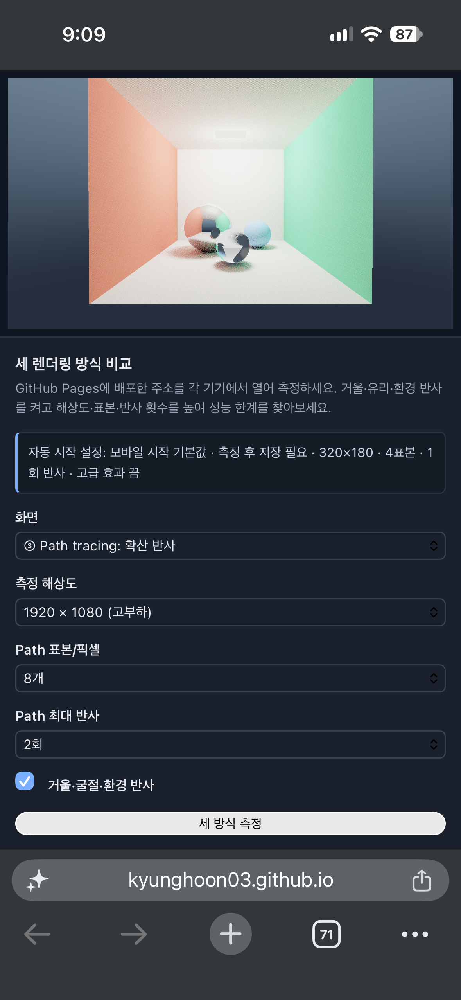
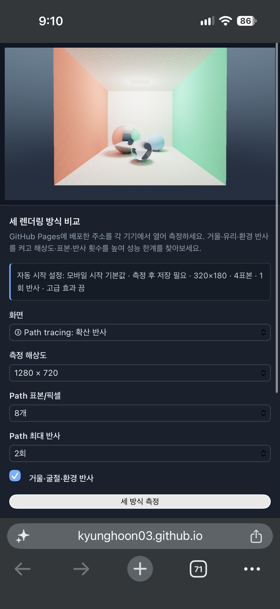
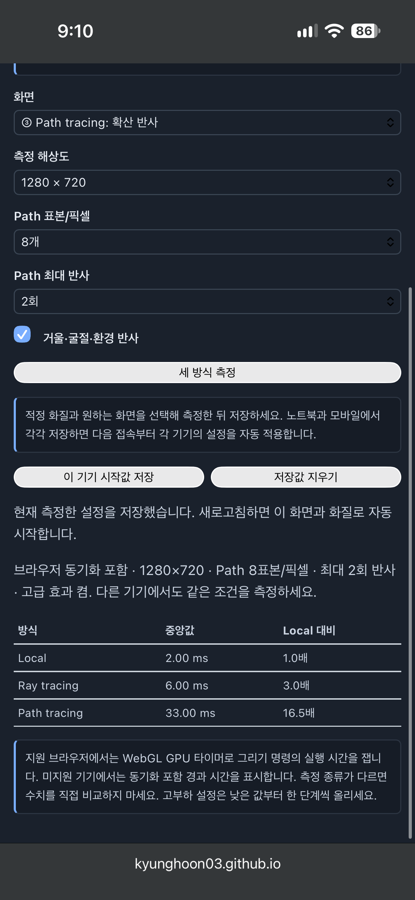
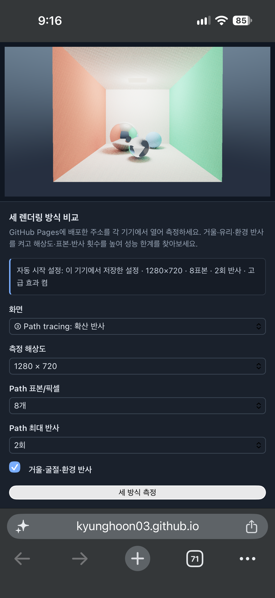

모바일에서 1280×720의 적정값을 다시 측정해 Path 33ms를 확인하고 저장했다. 두 해상도 모두 구체의 반사와 바닥의 색 번짐이 보이고, 8표본에서는 입자 노이즈가 남아 있다. 모바일은 해상도를 확보하면서 40ms 기준을 만족하도록 8표본을 선택했고, 노트북은 100ms 기준 안에서 노이즈를 줄이려고 32표본을 선택했다. 새로고침 후 ‘이 기기에서 저장한 설정’ 안내와 Path 렌더가 함께 표시됐다.

### AI 사용 기록

제공 셰이더를 바꾸지 않고 기기별 설정의 검증·저장·복원과 안내를 추가하는 데 AI를 사용했다. 노트북·모바일 판별에 의존하지 않는 저장 방식과 현재 설정이 측정값과 같은지 확인하는 조건을 반영했다. 로컬 브라우저 검증과 측정·캡처·설명 정리에도 AI를 사용했다. 검증 코드에서 환경 조회를 위해 WebGL context를 다시 읽을 때 링크 기록이 초기화되는 문제가 있었고, 같은 문서에서는 계측을 한 번만 초기화하도록 수정했다.

## 제출 상태

실습 1은 공개 Pages에서 일식·월식과 그림자 전환을 확인했다. 실습 2는 두 기기의 공통·고부하·적정 조건 비교표를 작성했다. 두 기기의 시작값 저장과 새로고침 후 자동 복원을 확인했다.
